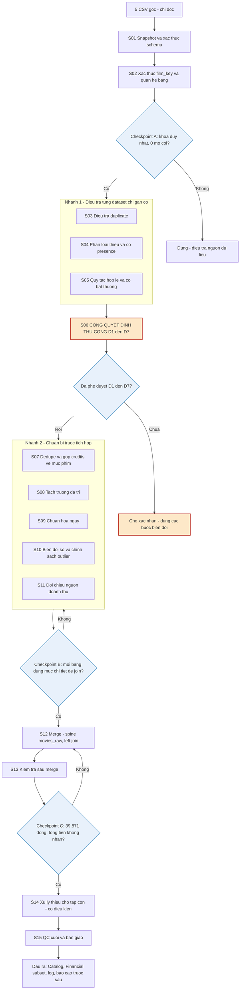

---

## 16. Đề xuất Data Preparation dựa trên bằng chứng

Mỗi nhóm trình bày: vấn đề + bằng chứng EDA; cột liên quan; phương pháp và điều kiện áp dụng; lý do; phương án thay thế; ưu/nhược/rủi ro; quyết định cần xác nhận; tiêu chí kiểm tra. Tất cả đề xuất **chưa được thực hiện**. Không có phương pháp nào được chọn "mặc định" (không impute median hàng loạt, không loại mọi outlier).

| Nhóm | Vấn đề & bằng chứng EDA | Cột liên quan | Phương pháp đề xuất & điều kiện | Lý do | Phương án thay thế | Ưu / nhược / rủi ro | Quyết định cần xác nhận | Kiểm tra sau xử lý |
|---|---|---|---|---|---|---|---|---|
| **G1. Schema & kiểu** | Ngày là text; 10 cột hằng số/rỗng; cờ dư thừa; float chỉ vì NaN (§4) | `release_date_ref`, `retrieval_date`, `theater_count`, `source`, `market_scope`, `*_missing_flag`, `release_month` | Tạo schema contract (kiểu mong đợi); parse ngày sang datetime trên bản sao; cột hằng số giữ làm metadata, loại khỏi tập đặc trưng; `theater_count` đề xuất loại sau xác nhận | Nguồn có thể đổi; contract giúp phát hiện sai lệch | Giữ mọi cột, chỉ đánh dấu | Ưu: tái lập; nhược: tốn công; rủi ro thấp | Xác nhận với nguồn rằng `theater_count` thật sự không có dữ liệu | 0 lỗi kiểu; số cột/dòng trước–sau khớp log |
| **G2. Quản lý `film_key`** | 100% khóa duy nhất/không mồ côi; `film_key` = "FK"+tmdb_id 8 số; `imdb_id` thiếu 25,92% ở movies (§3, §6) | `film_key`, `tmdb_id`, `imdb_id` | Validate regex `^FK\d{8}$`; kiểm tra tính duy nhất trước mỗi merge; **luôn join bằng `film_key`**, dùng `imdb_id` chỉ làm kiểm tra chéo | Khóa đã sạch, không cần sinh khóa mới | Dùng `imdb_id` làm khóa phụ (không khuyến nghị: thiếu 25,92%) | Ưu: đơn giản; rủi ro: không có | Không | Mọi bảng: 0 khóa thiếu/mồ côi; bảng 1-1 khóa duy nhất |
| **G3. Duplicate** | 1.021 dòng cast trùng (film, person, role) khác billing; 3 dòng trùng (film, billing); 1 nhóm title+ngày trùng (§6) | `credits_raw`, `movies_raw.title` | Điều tra mẫu → nếu cùng người lặp, giữ dòng có `billing_order` nhỏ nhất và ghi log dòng bị loại; **không xóa** dòng ở file gốc (chỉ ở bản làm việc) | Bảo toàn đếm cast chính xác | Giữ cả hai dòng, dùng `nunique(person_id)` khi đếm | Ưu: đếm đúng; nhược: quy tắc "giữ nhỏ nhất" chưa được chứng minh; rủi ro mất thông tin vai phụ | Quy tắc giữ dòng nào | Không còn khóa (film, person, role) lặp; log khớp 1.021 |
| **G4. Missing** | 7 biến thiếu 71,5–91,9%; thiên lệch theo vote_count; 3 loại thiếu ở rt (§5) | Biến tiền, điểm RT, metadata | (1) Cờ `has_*`; (2) giữ NaN trong Catalog; (3) Financial subset: complete-case theo biến cần dùng; (4) impute **chỉ khi** có mục tiêu + giả định cơ chế thiếu + đánh giá độ nhạy, kèm cờ imputed | Thiếu >80% khiến impute tạo phân phối giả; cơ chế thiếu chưa xác định | MICE/KNN theo phân tầng vote; mô hình xử lý NaN trực tiếp; bỏ biến | Ưu: trung thực; nhược: n nhỏ (2.844); rủi ro thiên lệch chọn mẫu | Mục tiêu phân tích; chấp nhận complete-case hay impute | Số dòng/NaN trước–sau khớp log; cờ imputed = đúng số giá trị điền |
| **G5. Ngày** | 754 thiếu; 200 sau 2026-10-22 (124 từ 2027); 2.447 ngày 01-01 (6,26%) (§9) | `release_date_ref`, `release_month` | Cờ `date_missing`, `date_after_retrieval`, `date_is_jan1`; giữ ngày gốc; với phim tương lai: cờ + loại khỏi phân tích doanh thu/điểm (tùy mục tiêu) | Ngăn nhầm 01-01 và phim chưa chiếu là dữ liệu hợp lệ | Chỉ dùng `year` cho phân tích; thay 01-01 bằng NaN theo tháng | Ưu: bảo toàn; nhược: cần thêm bước lọc | 01-01 có phải ngày mặc định? Xử lý phim tương lai | Tổng cờ khớp số đếm EDA |
| **G6. Categorical/text/đa trị** | `genre_ids`: 3.833 chuỗi vs 1.573 tập; token đuôi dài; chỉ ID (§8) | 4 cột đa trị, `title`, `tmdb_collection_id` | Tách ra bảng quan hệ (movie–genre, movie–director, movie–company); chuẩn hóa thứ tự trong ô (genre); lookup tên ngoài; chỉ tạo đặc trưng đếm/top-k cho ID đuôi dài; **không** chuẩn hóa title | Group-by chuỗi sẽ chia sai; one-hot ID không khả thi | Giữ chuỗi nhưng chuẩn hóa thứ tự; embedding | Ưu: đếm đúng; nhược: nhiều bảng; rủi ro mất thứ tự billing ở `lead_cast` | Bảng tra tên; xác nhận thứ tự `lead_cast` có nghĩa | Số token sau tách = tổng token đếm EDA |
| **G7. Hợp lệ giá trị số** | 225 budget và 73 global < 1.000 USD; 467 phim gross < budget; 10 phim opening > domestic (§7) | 5 biến tiền | Quy tắc **cờ**: `value_lt_1000`, `ratio_extreme`; điều tra mẫu trước khi quyết định | Không đủ bằng chứng để sửa/xóa | Loại hẳn; thay NaN; giữ nguyên | Ưu: có kiểm chứng; nhược: tốn công | Quy tắc cho từng nhóm | Danh sách cờ khớp EDA; tỷ lệ phim được xem xét ≥ ngưỡng mẫu đã chốt |
| **G8. Outlier** | Cao = bom tấn (hợp lệ); thấp = nghi vấn (§7.2) | 5 biến tiền | **Giữ outlier cao**; outlier thấp xử lý theo kết luận G7; dùng log10/hạng khi cần | Xóa bom tấn làm mất thông tin chính | Winsorize (chỉ khi mô hình nhạy outlier và có lý do) | Ưu: giữ thông tin; rủi ro: mô hình tuyến tính nhạy | Có winsorize không | Phân phối log sau xử lý được lập báo cáo trước–sau |
| **G9. Đơn vị đo** | Dataset không có cột tiền tệ/đơn vị; giá trị danh nghĩa, chưa điều chỉnh lạm phát; ngân sách làm tròn (§7, §9) | 5 biến tiền | Xác nhận USD với nguồn; nếu so sánh theo thời gian: điều chỉnh CPI từ nguồn ngoài (cần cung cấp) | Tránh so sánh sai thập niên | Phân tầng theo era thay vì điều chỉnh | Ưu: so sánh đúng; rủi ro: phụ thuộc nguồn CPI | Cần quy đổi lạm phát không? | Ghi rõ "USD danh nghĩa/thực" trong mọi bảng |
| **G10. Nhất quán nguồn** | 348 intl>global; 464 lệch >1%; hai nguồn bổ sung nhau (§11.4) | `global_gross`, `domestic_gross`, `international_gross`, `opening_weekend_gross` | Cờ `conflict_*`; định nghĩa **nguồn chuẩn theo mục đích** (vd. global từ `box_office_raw`); chỉ điền global từ dom+intl nếu được duyệt và gắn cờ nguồn | Không tự ghi đè; giữ truy vết | Giữ cả hai cột song song | Ưu: minh bạch; rủi ro: thêm cột | Quy tắc ưu tiên nguồn | Mọi phim conflict có cờ; số liệu tổng không đổi sau khi gắn cờ |
| **G11. Merge** | Credits 1-N → 16,08× dòng và 57,64× tổng; `box_office_detailed` phủ 74% (§11.5) | Tất cả bảng | Spine = `movies_raw`; **left join** từng bảng 1-1; credits **gộp về mức phim trước**; không inner join với detailed | Giữ đủ 39.871 phim, tránh mất 25,9% | Bảng quan hệ riêng cho cast/director | Ưu: kiểm soát; nhược: nhiều bước | Danh sách đặc trưng gộp từ credits | `len(merged) == 39.871`; `film_key` duy nhất |
| **G12. Sau merge** | Nguy cơ nhân dòng, mất giá trị, trùng cột (§11) | Tập tích hợp | Assert số dòng, số null mỗi cột = nguồn, tổng tiền = nguồn, tên cột không đụng nhau | Bắt lỗi merge sớm | Kiểm thử từng bước | Ưu: phát hiện lỗi; rủi ro: không | Không | Toàn bộ assert pass |
| **G13. QC cuối** | Cần chứng minh từng thay đổi (§14) | Toàn bộ | Báo cáo trước–sau; log mọi thay đổi/loại; đối chiếu ngược 14.1 | Trách nhiệm giải trình | — | — | Người phê duyệt | Mọi vấn đề HIGH có trạng thái đóng/ghi chú |

---

## 17. Pipeline Data Preparation chi tiết

**Thứ tự và lý do:** (1) snapshot và xác thực schema/khóa trước mọi thao tác (không hiểu khóa thì chưa merge được); (2) điều tra trùng, bản chất thiếu và tính hợp lệ **ở từng bảng** (chỉ gắn cờ); (3) **cổng quyết định thủ công S06** — vì cách xử lý giá trị nhỏ, nguồn doanh thu, dedupe credits, ngày 01-01 và mục tiêu phân tích cần xác nhận, nên các bước biến đổi S07–S11 chỉ bắt đầu sau cổng này; (4) chuẩn bị từng bảng đến mức "đúng độ chi tiết để join" (credits gộp về phim; đa trị tách bảng); (5) merge và kiểm tra sau merge; (6) xử lý thiếu cho tập con phân tích **sau** khi biết mục tiêu và giả định (S14); (7) QC và bàn giao.

**Phụ thuộc:** S01 → S02 → {S03, S04, S05} → S06 → {S07, S08, S09, S10, S11} → S12 → S13 → S14 → S15. S10 cần S05+S06; S11 cần S05+S06; S12 cần S07–S11. Mọi bước chỉ làm việc trên **bản sao** trong thư mục làm việc riêng; 5 CSV gốc chỉ đọc.

### S01 — Snapshot và xác thực schema

| Field | Description |
|---|---|
| Step ID | S01 |
| Step Name | Snapshot dữ liệu gốc và xác thực schema/kiểu |
| Objective | Cố định phiên bản đầu vào; phát hiện thay đổi schema |
| Input | 5 CSV gốc |
| Affected Columns | Tất cả 41 cột |
| EDA Evidence | Ngày dạng text; 10 cột hằng số/rỗng; cờ dư thừa (§4) |
| Proposed Action | Tính hash từng file; lưu schema contract (tên, kiểu, nullable); phát hiện cột lạ |
| Method | Hash SHA-256; so sánh với `column_overview.csv`; cột rỗng 100% chỉ gắn cờ |
| Dependencies | — |
| Expected Output | `schema_contract.json`, bảng hash, log |
| Validation Criteria | Số dòng/cột đúng bảng §3; 0 sai kiểu |
| Priority | HIGH |
| Decision Required | Xác nhận `theater_count` thật sự rỗng ở nguồn |

### S02 — Xác thực `film_key` và quan hệ liên bảng

| Field | Description |
|---|---|
| Step ID | S02 |
| Step Name | Kiểm tra `film_key` và quan hệ bảng |
| Objective | Bảo đảm khóa dùng được cho merge |
| Input | 5 CSV |
| Affected Columns | `film_key`, `imdb_id`, `tmdb_id` |
| EDA Evidence | 0 mồ côi; khóa duy nhất ở bảng 1-1; credits 1-N; imdb khớp 29.527/29.527 (§6) |
| Proposed Action | Kiểm tra định dạng, duy nhất, mồ côi, kích thước quan hệ; lập bảng coverage |
| Method | Regex `^FK\d{8}$`; set-difference; `groupby.size().max()` |
| Dependencies | S01 |
| Expected Output | `key_consistency` (cập nhật), cờ `in_<bảng>` |
| Validation Criteria | 0 khóa thiếu/mồ côi; bảng 1-1 max=1 |
| Priority | HIGH |
| Decision Required | Không |

### S03 — Điều tra duplicate

| Field | Description |
|---|---|
| Step ID | S03 |
| Step Name | Điều tra bản ghi trùng |
| Objective | Hiểu bản chất trùng ở credits và title |
| Input | `credits_raw`, `movies_raw` |
| Affected Columns | `film_key`, `person_id`, `role`, `billing_order`, `title`, `release_date_ref` |
| EDA Evidence | 1.021 cast trùng; 3 trùng billing; 1 nhóm title+ngày trùng (§6) |
| Proposed Action | Lấy mẫu 50–100 nhóm trùng để xem nguyên nhân; đề xuất quy tắc; **chưa xóa** |
| Method | So sánh billing_order giữa các dòng trùng; kiểm tra thủ công nhóm title+ngày trùng |
| Dependencies | S02 |
| Expected Output | `duplicate_cases.csv`, đề xuất quy tắc |
| Validation Criteria | Mọi nhóm trùng được phân loại (lỗi/hợp lệ) |
| Priority | MEDIUM |
| Decision Required | Quy tắc giữ dòng (xem S06-D3) |

### S04 — Ngữ nghĩa thiếu và cờ presence

| Field | Description |
|---|---|
| Step ID | S04 |
| Step Name | Phân loại thiếu và tạo cờ presence |
| Objective | Phân biệt không áp dụng / chưa ghi nhận / chưa khớp / dòng vỏ rỗng |
| Input | Tất cả bảng |
| Affected Columns | 7 biến tiền–điểm; `rt_status`, `rt_url`; `billing_order`; `imdb_id` |
| EDA Evidence | 62,18% phim không có biến nào; 22.906 dòng vỏ rỗng; 3 loại thiếu ở rt; billing_order thiếu theo thiết kế (§5) |
| Proposed Action | Tạo cờ `has_budget`, `has_global`, `has_detail_values`, `has_critic`, `has_audience`, `rt_missing_reason`, `has_credits`; **không điền thiếu** |
| Method | Cờ từ `notna()`; `rt_missing_reason` từ `rt_status` |
| Dependencies | S02 |
| Expected Output | Bảng cờ (khóa film_key), báo cáo thiếu theo phân tầng vote |
| Validation Criteria | Tổng cờ = số liệu §5 (ví dụ has_budget = 4.192; has_detail_values = 6.621) |
| Priority | HIGH |
| Decision Required | Không (chỉ gắn cờ) |

### S05 — Quy tắc hợp lệ và cờ bất thường

| Field | Description |
|---|---|
| Step ID | S05 |
| Step Name | Kiểm tra hợp lệ giá trị, gắn cờ bất thường |
| Objective | Lập danh sách bản ghi nghi vấn mà không sửa |
| Input | `movies_raw`, `box_office_*`, `rt_scores` |
| Affected Columns | 5 biến tiền; `release_date_ref`; `critic_score` |
| EDA Evidence | 225/73 giá trị < 1.000; 467 gross<budget; 348 intl>global; 464 lệch >1%; 10 opening>domestic; 200 ngày tương lai; 2.447 ngày 01-01; critic biên (§7, §9, §11) |
| Proposed Action | Cờ `value_lt_1000_<col>`, `ratio_extreme`, `conflict_intl_gt_global`, `conflict_sum`, `open_gt_dom`, `date_after_retrieval`, `date_is_jan1`, `score_at_boundary` |
| Method | Quy tắc xác định trên bản sao; xuất danh sách |
| Dependencies | S02 |
| Expected Output | `anomaly_flags.csv`, `anomaly_summary.csv` |
| Validation Criteria | Số cờ khớp bảng §14 |
| Priority | HIGH |
| Decision Required | Ngưỡng 1.000 USD và 1% (xem S06) |

### S06 — Cổng quyết định thủ công

| Field | Description |
|---|---|
| Step ID | S06 |
| Step Name | Điều tra mẫu và phê duyệt quyết định |
| Objective | Biến các điểm "chưa đủ bằng chứng" thành quyết định có căn cứ |
| Input | Đầu ra S03–S05 |
| Affected Columns | Biến tiền; credits; ngày; `tmdb_collection_id` |
| EDA Evidence | DQ-05, 06, 08, 11, 12, 16 (§14) |
| Proposed Action | **D1** giá trị < 1.000 (placeholder/thật/sai đơn vị); **D2** nguồn doanh thu chuẩn; **D3** quy tắc dedupe credits; **D4** xử lý 01-01 và phim tương lai; **D5** ý nghĩa `tmdb_collection_id`; **D6** mục tiêu phân tích và tập con; **D7** điều chỉnh lạm phát |
| Method | Lấy mẫu ngẫu nhiên có phân tầng, đối chiếu nguồn ngoài; ghi biên bản |
| Dependencies | S03, S04, S05 |
| Expected Output | `decision_log.md` có chữ ký người duyệt |
| Validation Criteria | Mọi D1–D7 có quyết định hoặc ghi "chưa quyết" kèm hệ quả |
| Priority | HIGH |
| Decision Required | Tất cả D1–D7 |

### S07 — Làm sạch và gộp `credits_raw`

| Field | Description |
|---|---|
| Step ID | S07 |
| Step Name | Dedupe (theo D3) và aggregate credits về mức phim |
| Objective | Tạo bảng 1 dòng/phim để join không nhân dòng |
| Input | `credits_raw` |
| Affected Columns | `film_key`, `person_id`, `role`, `billing_order` |
| EDA Evidence | 639.728 dòng cho 38.430 phim; join thô 16,08×; 3.467 phim không có đạo diễn; 2.101 không có cast (§8, §11) |
| Proposed Action | Áp quy tắc D3; tính `cast_count`, `director_count`, `has_director`, `top_billed_ids` (tùy chọn) |
| Method | `groupby(film_key)` sau dedupe; phim không có credits giữ NaN + cờ `has_credits=0` |
| Dependencies | S06 (D3) |
| Expected Output | `credits_by_film` (38.430 dòng, khóa duy nhất) |
| Validation Criteria | `film_key` duy nhất; Σ cast_count = số dòng cast sau dedupe |
| Priority | HIGH |
| Decision Required | Danh sách đặc trưng gộp |

### S08 — Chuẩn hóa trường đa trị

| Field | Description |
|---|---|
| Step ID | S08 |
| Step Name | Tách trường đa trị thành bảng quan hệ |
| Objective | Cho phép đếm/gom nhóm chính xác |
| Input | `movies_raw` |
| Affected Columns | `genre_ids`, `director_ids`, `production_company_ids`, `lead_cast_ids_superset` |
| EDA Evidence | 3.833 chuỗi vs 1.573 tập (genre); 38,4% ô không sắp; token đuôi dài; director_ids = credits 100% (§8) |
| Proposed Action | Tạo bảng movie–genre/company (và movie–director nếu không dùng credits); đặc trưng đếm; join bảng tra cứu tên |
| Method | tách chuỗi theo ký tự gạch đứng + explode trên bản sao; chuẩn hóa thứ tự genre; không one-hot đầy đủ cho ID hiếm |
| Dependencies | S06 |
| Expected Output | `movie_genre`, `movie_company`, (tùy chọn) `movie_director` |
| Validation Criteria | Số token sau explode = số token EDA (genre: 68,371 token); mọi genre_id có trong bảng tra |
| Priority | MEDIUM |
| Decision Required | Nguồn bảng tra tên |

### S09 — Chuẩn hóa ngày

| Field | Description |
|---|---|
| Step ID | S09 |
| Step Name | Parse ngày và tạo trường thời gian |
| Objective | Có ngày chuẩn + cờ chất lượng ngày |
| Input | `movies_raw` |
| Affected Columns | `release_date_ref`, `release_month` |
| EDA Evidence | 754 thiếu; 200 sau thời điểm thu thập; 2.447 ngày 01-01 (§9) |
| Proposed Action | Cột `release_date` (datetime), `release_year`, `release_decade`; áp D4 cho 01-01 và phim tương lai |
| Method | `to_datetime(errors='coerce')`; không ghi đè cột gốc |
| Dependencies | S06 (D4) |
| Expected Output | Bảng ngày chuẩn + cờ |
| Validation Criteria | 0 lỗi parse; tháng trùng `release_month` (hiện khớp 100%) |
| Priority | MEDIUM |
| Decision Required | D4 |

### S10 — Biến đổi số và chính sách outlier

| Field | Description |
|---|---|
| Step ID | S10 |
| Step Name | Biến đổi log/hạng và áp chính sách outlier |
| Objective | Làm biến tiền dùng được cho thống kê/mô hình mà không mất thông tin |
| Input | 5 biến tiền (sau S05–S06) |
| Affected Columns | `production_budget`, `global_gross`, `domestic_gross`, `international_gross`, `opening_weekend_gross` |
| EDA Evidence | skew 3,15–6,04 → âm sau log; outlier cao = bom tấn; outlier thấp nghi vấn (§7) |
| Proposed Action | Tạo cột `log10_*` (chỉ cho giá trị ≥ 1 và theo D1); giữ outlier cao; xử lý nhóm < 1.000 theo D1; **chọn một** trong domestic/opening khi mô hình (VIF 7,3/7,6) |
| Method | `log10(x)` trên cột mới; cột gốc giữ nguyên; winsorize chỉ nếu D6 yêu cầu |
| Dependencies | S05, S06 (D1, D6) |
| Expected Output | Cột log10 mới; báo cáo trước–sau phân phối |
| Validation Criteria | Không có -inf/NaN mới; số NaN = nguồn + số loại theo D1 |
| Priority | MEDIUM |
| Decision Required | D1; winsorize hay không |

### S11 — Đối chiếu nguồn doanh thu

| Field | Description |
|---|---|
| Step ID | S11 |
| Step Name | Hòa giải `box_office_raw` và `box_office_detailed` |
| Objective | Quy định cột doanh thu chuẩn và cách xử lý xung đột |
| Input | `box_office_raw`, `box_office_detailed` |
| Affected Columns | `global_gross`, `domestic_gross`, `international_gross`, `opening_weekend_gross` |
| EDA Evidence | 2.782 chỉ có detailed; 651 chỉ có global; 348 intl>global; 464 lệch >1%; 886 khớp chính xác (§11.4) |
| Proposed Action | Giữ cả hai nguồn; thêm `revenue_source_used`, `conflict_flag`; tùy D2 có/không điền global từ dom+intl (gắn cờ nguồn) |
| Method | So sánh theo quy tắc ±1%; không ghi đè |
| Dependencies | S05, S06 (D2) |
| Expected Output | Bảng doanh thu có cờ nguồn/conflict |
| Validation Criteria | Phim conflict = 348 (intl>global) / 464 (tổng); không số liệu nào bị mất |
| Priority | HIGH |
| Decision Required | D2 |

### S12 — Lập kế hoạch và thực hiện merge

| Field | Description |
|---|---|
| Step ID | S12 |
| Step Name | Merge tạo Catalog (và tập con Financial) |
| Objective | Tích hợp 5 nguồn mà không đổi số dòng |
| Input | Đầu ra S04, S07–S11; `movies_raw` |
| Affected Columns | Tất cả |
| EDA Evidence | Join thô credits 16,08×; inner join với detailed mất 25,9% (§11.5) |
| Proposed Action | Spine = `movies_raw` (39.871); left join các bảng 1-1 và `credits_by_film`; đặt tên cột không đụng nhau; tạo tập Financial theo D6 |
| Method | `merge(how='left', validate='one_to_one')` |
| Dependencies | S07–S11 |
| Expected Output | `catalog_prepared`; (tùy chọn) `financial_subset_<định nghĩa>` |
| Validation Criteria | `len == 39.871`; `film_key` duy nhất; không merge `_x/_y` |
| Priority | HIGH |
| Decision Required | Định nghĩa tập Financial (D6) |

### S13 — Kiểm tra sau merge

| Field | Description |
|---|---|
| Step ID | S13 |
| Step Name | Post-merge validation |
| Objective | Chứng minh không mất/nhân dữ liệu |
| Input | Đầu ra S12 + dữ liệu gốc |
| Affected Columns | Tất cả |
| EDA Evidence | Rủi ro nhân dòng/tổng; số NaN từng cột (§5, §11) |
| Proposed Action | So sánh số dòng, số null theo cột, tổng tiền, giá trị mẫu ngẫu nhiên với nguồn |
| Method | Assert tự động + kiểm tra mẫu 100 phim |
| Dependencies | S12 |
| Expected Output | `post_merge_report.csv` |
| Validation Criteria | Tổng `production_budget` = 1.0× nguồn; null mỗi cột = nguồn (+ cờ mới) |
| Priority | HIGH |
| Decision Required | Không |

### S14 — Xử lý thiếu cho tập con phân tích (có điều kiện)

| Field | Description |
|---|---|
| Step ID | S14 |
| Step Name | Chiến lược thiếu cho tập con (chỉ khi D6 yêu cầu) |
| Objective | Chọn complete-case hay impute có kiểm soát |
| Input | `catalog_prepared`, cờ S04 |
| Affected Columns | Biến cần dùng của tập con |
| EDA Evidence | Thiếu 71,5–91,9%; liên hệ mạnh với vote_count; MAR/MNAR chưa phân biệt (§5.4) |
| Proposed Action | (a) complete-case + báo cáo thiên lệch theo vote/thập niên/thể loại; (b) nếu impute: phân tầng, kèm cờ imputed, so sánh độ nhạy |
| Method | Chọn sau khi có D6; không dùng median/mode mặc định |
| Dependencies | S13, S06 (D6) |
| Expected Output | Tập con phân tích + `imputation_log.csv` |
| Validation Criteria | Số giá trị điền = số cờ imputed; phân phối trước–sau không bị biến dạng ngoài dự kiến |
| Priority | MEDIUM |
| Decision Required | Giả định cơ chế thiếu; chấp nhận n nhỏ |

### S15 — QC cuối và bàn giao

| Field | Description |
|---|---|
| Step ID | S15 |
| Step Name | Đánh giá chất lượng cuối cùng và bàn giao |
| Objective | Chứng minh mọi vấn đề HIGH đã đóng hoặc ghi nhận |
| Input | Mọi đầu ra S01–S14 |
| Affected Columns | Tất cả |
| EDA Evidence | Bảng vấn đề §14 |
| Proposed Action | Báo cáo chất lượng trước–sau; đối chiếu từng DQ-ID; danh sách phim bị loại và lý do |
| Method | Chạy lại script EDA trên đầu ra; so sánh với baseline |
| Dependencies | S13, S14 |
| Expected Output | Các đầu ra ở §19 |
| Validation Criteria | Mọi DQ HIGH có trạng thái; mọi số trong báo cáo truy được tới tệp |
| Priority | HIGH |
| Decision Required | Người phê duyệt cuối |

---

## 18. Sơ đồ pipeline

*Chú giải:* ô cam = bước cần xác minh/phê duyệt thủ công; ô xanh nhạt = checkpoint chất lượng. Mọi nút S01–S15 đều có bảng ở §17 và có cơ sở EDA ở §5–§11. Sơ đồ dùng chữ không dấu để tương thích mọi trình hiển thị Mermaid.

---

## 19. Đầu ra mong đợi và tiêu chí xác nhận

| Đầu ra | Mục đích | Điều kiện xác nhận sẵn sàng |
|---|---|---|
| `schema_contract.json`, bảng hash 5 file | Tái lập, phát hiện đổi nguồn | Hash khớp; schema khớp §4 |
| `key_consistency` cập nhật | Chứng minh toàn vẹn khóa | 0 thiếu/mồ côi; bảng 1-1 duy nhất |
| `anomaly_flags.csv` + `anomaly_summary.csv` | Danh sách bản ghi nghi vấn (không sửa) | Số cờ khớp §14 |
| `decision_log.md` (D1–D7) | Căn cứ mọi quyết định | Có người duyệt, ngày, lý do |
| `credits_by_film` | Join không nhân dòng | `film_key` duy nhất; Σ cast_count khớp |
| `movie_genre`, `movie_company` (+ bảng tra tên) | Đếm/gom nhóm chính xác | Token khớp EDA; mọi id có tên |
| `catalog_prepared` (39.871 dòng) | Phân tích toàn catalog | `len == 39.871`; null = nguồn + cờ |
| `financial_subset_*` | Phân tích ngân sách–doanh thu | Định nghĩa tập (D6) + n; báo cáo thiên lệch theo vote |
| `imputation_log.csv` (nếu có) | Truy vết giá trị điền | Số điền = số cờ imputed |
| `excluded_records.csv` | Danh sách bản ghi bị loại + lý do | Mọi bản ghi loại có lý do |
| `unverified_cases.csv` | Các trường hợp chưa xác minh được | Mỗi mục có người chịu trách nhiệm |
| Bảng theo dõi số dòng trước–sau từng bước | Kiểm soát mất/nhân dòng | Mọi bước giải thích được thay đổi |
| `data_quality_before_after.md` | Chứng minh cải thiện | Mọi DQ-ID HIGH có trạng thái |

**Điều kiện "sẵn sàng cho bước phân tích tiếp theo":** (1) S13 pass; (2) mọi quyết định D1–D7 đã ghi nhận; (3) không còn vấn đề HIGH chưa có trạng thái; (4) tập phân tích có mô tả đầy đủ (n, thiên lệch, đơn vị).

---

## 20. Giới hạn và các quyết định cần xác minh thêm

**Giới hạn của báo cáo:**
- **Không biết cách thu thập** (chưa có mô tả nguồn): vì vậy không thể xác định cơ chế thiếu (MCAR/MAR/MNAR); chỉ chứng minh được mối liên hệ với `vote_count`.
- **Không có đơn vị/tiền tệ trong dataset**: các nhận định "USD" là giả định theo quy ước nguồn, cần xác nhận.
- **Chỉ có ID, không có tên** cho thể loại, đạo diễn, diễn viên, hãng; tên thể loại trong biểu đồ lấy từ bảng TMDB chuẩn (ngoài dataset).
- **Chưa kiểm chứng ngoài dữ liệu**: các giá trị lớn nhất (ví dụ ngân sách 658,8 triệu), xác minh phim 01-01, giá trị < 1.000 USD đều cần nguồn ngoài.
- **Số review RT không có** nên không đánh giá được độ tin cậy điểm biên.
- **Tương quan ≠ nhân quả**; các hệ số tính trên mẫu có dữ liệu (thiên lệch) và dùng quan sát chung (pairwise) với n khác nhau.
- **Mục tiêu mô hình hóa chưa được xác định** → pipeline không chọn biến mục tiêu; một số bước (S10, S14) có điều kiện.

**Quyết định cần xác nhận (D1–D7):**

| ID | Quyết định | Hệ quả nếu chưa quyết |
|---|---|---|
| D1 | Giá trị < 1.000 USD: placeholder, thật, hay sai đơn vị? | Không thể tính ROI/log đáng tin; S10 treo |
| D2 | Nguồn doanh thu chuẩn khi mâu thuẫn; có điền global từ dom+intl? | Số liệu doanh thu không nhất quán giữa các phân tích |
| D3 | Quy tắc dedupe credits | `cast_count` sai |
| D4 | Xử lý ngày 01-01 và phim ngày tương lai | Phân tích theo tháng/mùa sai; điểm/ngân sách của phim chưa chiếu lẫn vào |
| D5 | Ý nghĩa `tmdb_collection_id` | Không nên dùng làm nhóm nhượng quyền |
| D6 | Mục tiêu phân tích và định nghĩa tập con | Không chọn được cách xử lý thiếu |
| D7 | Có điều chỉnh lạm phát không (cần nguồn CPI) | So sánh theo thời kỳ sai lệch |

**Cách kiểm tra thêm gợi ý:** lấy mẫu có phân tầng theo `vote_count` để đối chiếu giá trị < 1.000 với nguồn gốc; so sánh `box_office_raw` và `box_office_detailed` theo thời điểm thu thập (nếu có); hỏi nhóm thu thập về `tmdb_collection_id` và `theater_count`; lấy số review RT cho điểm biên.

---

*Hết báo cáo. Bảng và biểu đồ tái tạo bằng `python code/data_understanding_eda.py --data-dir <thư mục CSV> --out-dir <thư mục đầu ra>` rồi `python build_report.py` để ghép lại báo cáo từ `_template/`. Dataset gốc không bị thay đổi.*
