# BÁO CÁO DATA UNDERSTANDING (PHIÊN BẢN NÂNG CẤP)
## Phân tích dữ liệu thị trường điện ảnh — đánh giá chất lượng và đề xuất pipeline Data Preparation

| | |
|---|---|
| **Giai đoạn** | Data Understanding / EDA (CRISP-DM) — **chỉ đọc, không chỉnh sửa dữ liệu gốc** |
| **Dữ liệu** | 5 file CSV: `movies_raw`, `box_office_raw`, `box_office_detailed`, `credits_raw`, `rt_scores` (khóa `film_key`) |
| **Thời điểm thu thập** | `retrieval_date` = 2026-10-22 (movies/box_office/credits), 2026-10-23 (rt_scores) |
| **Mã nguồn tái tạo** | `code/data_understanding_eda.py` (sinh toàn bộ bảng trong `reports/` và biểu đồ trong `plots/`) |
| **Quy ước số liệu** | Dấu phẩy ngăn cách hàng nghìn, dấu chấm là dấu thập phân. Mọi số liệu được tính lại từ 5 CSV; các bảng lớn được chèn trực tiếp từ `reports/md/*.md` |

> **Phạm vi:** báo cáo chỉ *phát hiện – giải thích – đề xuất*. Không có bước điền thiếu, xóa dòng/cột, loại trùng, sửa giá trị, loại outlier, encode hay merge tạo dataset cuối nào được thực hiện. Các phép `log10`, parse ngày, merge thử, tính tương quan chỉ chạy trên bản sao trong bộ nhớ. Các bảng/ biểu đồ sinh ra là sản phẩm EDA, không phải dataset đã xử lý.

---

## Mục lục
1. Executive Summary
2. Bối cảnh, mục tiêu và đánh giá báo cáo cũ
3. Tổng quan 5 dataset
4. Schema và kiểu dữ liệu
5. Phân tích missing values
6. Duplicate và tính duy nhất
7. Dữ liệu số
8. Dữ liệu categorical / text / đa trị
9. Ngày tháng và xu hướng thời gian
10. Quan hệ giữa các biến
11. Phân tích liên bảng (Cross-dataset)
12. Phân tích 5 biểu đồ hiện có
13. Biểu đồ bổ sung và phát hiện mới
14. Tổng hợp vấn đề chất lượng dữ liệu
15. Kết luận Data Understanding
16. Đề xuất Data Preparation
17. Pipeline Data Preparation chi tiết
18. Sơ đồ pipeline
19. Đầu ra mong đợi và tiêu chí xác nhận
20. Giới hạn và các quyết định cần xác minh

---

## 1. Executive Summary

**Bức tranh chung.** Năm bảng mô tả **39.871 bộ phim** (TMDB) với khóa `film_key` sạch về cấu trúc: duy nhất ở các bảng 1-1, **0 khóa mồ côi**, 100% khóa của mọi bảng phụ đều có trong `movies_raw`. Vấn đề nằm ở **nội dung**, không phải cấu trúc: dữ liệu tài chính và điểm đánh giá cực kỳ thưa và thiên lệch theo mức độ nổi tiếng của phim.

**Năm phát hiện quan trọng nhất (đã kiểm chứng bằng tính toán):**

1. **Độ phủ tài chính rất thấp.** `production_budget` thiếu 89,49%, `global_gross` 88,74%, `domestic_gross` 91,11%, `opening_weekend_gross` 91,93%. Chỉ **2.844 phim (7,13%)** có đồng thời budget và global_gross; **24.790 phim (62,18%)** không có giá trị nào trong 7 biến tiền/điểm. (§5)
2. **Missingness không ngẫu nhiên theo mức độ nổi tiếng.** Median `vote_count` của phim có budget là 324 so với 2 ở phim thiếu; độ phủ budget tăng từ 1,9% (0 vote) lên 91,0% (≥1.000 vote). Điều này **loại trừ MCAR** đối với biến quan sát được `vote_count`, nhưng dữ liệu hiện có **không đủ để phân biệt MAR với MNAR**. (§5.4)
3. **Hai nguồn doanh thu bổ sung chứ không dư thừa, nhưng mâu thuẫn ở một số phim.** 2.782 phim chỉ có doanh thu ở `box_office_detailed` (global thiếu), 651 phim chỉ có `global_gross`; đồng thời 348/3.341 phim có `international_gross` > `global_gross` và 464/1.846 phim có (dom+intl) lệch global >1%. (§11.4)
4. **Rủi ro nhân dòng khi merge.** Left join trực tiếp `movies_raw` với `credits_raw` tạo **641.169 dòng (16,08×)** và làm tổng `production_budget` bị nhân **57,64×**. Cần gộp credits về mức phim trước khi merge. (§11.5)
5. **Số liệu của báo cáo cũ có nhiều chỗ sai** (median/mean của budget, global_gross, critic_score; bảng độ phủ theo vote_count; số cột và % thiếu của `box_office_detailed`) và **bỏ sót** cột `theater_count` rỗng 100%. Phiên bản này thay thế các số đó bằng số tính lại. (§2.2)

**Kết luận về mức sẵn sàng.** *Sẵn sàng về liên kết khóa; chưa sẵn sàng để phân tích tài chính trên toàn catalog.* Cần: (i) chia tập Catalog / Financial; (ii) điều tra giá trị tiền < 1.000 USD, xung đột nguồn doanh thu, ngày 01-01 và ngày tương lai; (iii) gộp credits và tách trường đa trị trước khi tích hợp; (iv) ra quyết định nghiệp vụ về nguồn doanh thu chuẩn và cách xử lý thiếu. Pipeline 15 bước ở §17 chuyển các phát hiện này thành hành động có thứ tự, điều kiện và tiêu chí kiểm tra.

---

## 2. Bối cảnh, mục tiêu và đánh giá báo cáo cũ

### 2.1. Bối cảnh và mục tiêu
Dự án phân tích dữ liệu phim cần hiểu chất lượng dữ liệu trước khi chuẩn bị (theo slide *From Understanding to Preparation*: Data Understanding trả lời "dữ liệu thu thập có đại diện cho bài toán không?"; Data Preparation trả lời "dữ liệu được chuẩn bị bằng cách nào?"). Mục tiêu mô hình hóa **chưa được xác định trong tài liệu**, nên báo cáo không giả định biến mục tiêu hay bài toán kinh doanh; các đề xuất nêu rõ điều kiện áp dụng và quyết định cần phê duyệt.

### 2.2. Đối chiếu báo cáo cũ với dữ liệu thực tế

**Giữ lại (đã kiểm chứng):** tính toàn vẹn khóa; tỷ lệ missing các cột chính; 22.906 dòng rỗng ở `box_office_detailed`; 225 phim budget < 1.000 USD và 73 phim global_gross < 1.000 USD; tương quan Pearson/Spearman; VIF (7,30 và 7,62); 348 và 464 phim mâu thuẫn doanh thu; 641.169 dòng khi join thô; 127 phim `critic_score = 0` và 11,4% = 100; skewness của các biến tiền.

**Sai hoặc không khớp dữ liệu:**

| Dataset/Biến | Chỉ số | Báo cáo cũ | Tính lại | Khớp? |
|---|---|---|---|---|
| production_budget | Median | 5,000,000 | 5,425,000 | KHÔNG KHỚP |
| production_budget | Mean | 24,161,424 | 26,198,471 | KHÔNG KHỚP |
| global_gross | Median | 2,578,414 | 15,200,000 | KHÔNG KHỚP |
| global_gross | Mean | 16,738,450 | 98,591,610 | KHÔNG KHỚP |
| critic_score | Median | 67 | 69.00 | KHÔNG KHỚP |
| critic_score | Mean | 61.60 | 63.20 | KHÔNG KHỚP |
| audience_score | Median | 61 | 61.00 | Khớp |
| audience_score | Mean | 59.40 | 59.39 | Khớp |
| box_office_detailed | Số cột | 5 | 6 | KHÔNG KHỚP |
| box_office_detailed | % ô trống | 52.55 | 60.46 | KHÔNG KHỚP |
| credits_raw | Max dòng/phim | 451 | 452 | KHÔNG KHỚP |
| movies_raw | % phim có vote 100-999 có budget | 51.20 | 37.10 | KHÔNG KHỚP |
| movies_raw | % phim có vote 1-9 có budget | 3.20 | 2.80 | KHÔNG KHỚP |
| movies_raw | % phim 10-99 vote có budget | 15.40 | 9.70 | KHÔNG KHỚP |
| movies_raw | Tỷ lệ phim vote 1-9 | 31.40 | 37.80 | KHÔNG KHỚP |
| movies_raw | Tỷ lệ phim vote ≥1000 | 3.80 | 4.10 | KHÔNG KHỚP |
| rt_scores | % phim critic_score = 100 | 11.40 | 11.42 | Khớp |

**Ghi chú diễn giải các điểm lệch:**
- Median `global_gross` trong báo cáo cũ (2.578.414) thực ra bằng **Q1**, không phải median; median thật là 15.200.000. Tỷ lệ Mean/Median 6,49× và P99/Median 69,64× của báo cáo cũ lại đúng với số thật (98,59 triệu / 15,2 triệu), nên bảng cũ tự mâu thuẫn nội bộ.
- Bảng "% có dữ liệu theo nhóm vote_count" của báo cáo cũ **không khớp** cả dữ liệu lẫn biểu đồ gốc (Hình 05): ví dụ nhóm 100–999 vote có budget 37,1% (không phải 51,2%). Cũng thiếu `audience_score`.
- Nhận định cũ "độ phủ tăng vọt sau năm 2000" **không được dữ liệu ủng hộ**: độ phủ budget/global_gross ổn định ~10–14% từ thập niên 1980, giảm ở 2020s (§9).
- Báo cáo cũ ghi `box_office_detailed` có 5 cột, 52,55% ô trống; thực tế có **6 cột** (thêm `theater_count`, rỗng 100%) và **60,46%** ô trống. Hình 01 cũng bỏ cột này (không vẽ cột rỗng hoàn toàn).
- "Tối đa 451 người/phim": 451 là số diễn viên lớn nhất; số **dòng** credits lớn nhất của một phim là 452 (451 cast + ≥1 director).
- Chưa kiểm chứng được: nhận định "median vote = 9" cho phim điểm biên. Tính lại: median `vote_count` của phim có `critic_score` ∈ {0,100} là **1**, của phim điểm 1–99 là **118**.

**Phần còn sơ sài của báo cáo cũ (được phát triển trong phiên bản này):** chưa có thống kê toàn bộ cột (§4), chưa phân tích categorical/đa trị (§8), chưa có phân tích ngày (§9), chưa kiểm tra xung đột doanh thu theo logic nghiệp vụ và vai trò bổ sung của `box_office_detailed` (§11), chưa phân tách "thiếu" theo `rt_status` (§5.5), chưa có bảng vấn đề có ưu tiên và tiêu chí kiểm tra (§14), pipeline chỉ gồm sơ đồ chung (§17–18).

---

## 3. Tổng quan 5 dataset

| Dataset | Number of Rows | Number of Columns | Key | Unique film_key | Full-row duplicates | Missing cells % | Main Purpose |
|---|---|---|---|---|---|---|---|
| movies_raw | 39,871 | 16 | film_key | 39,871 | 0 | 11.19 | Metadata phim (TMDB): tên, ngày phát hành, ngân sách, thể loại, đạo diễn, diễn viên, hãng SX, vote_count |
| box_office_raw | 39,871 | 6 | film_key | 39,871 | 0 | 14.79 | Doanh thu toàn cầu (global_gross) từ TMDB API |
| box_office_detailed | 29,527 | 6 | film_key | 29,527 | 0 | 60.46 | Doanh thu nội địa / quốc tế / tuần mở màn (theo imdb_id) |
| credits_raw | 639,728 | 6 | film_key | 38,430 | 0 | 1.07 | Đoàn làm phim: mỗi dòng = 1 người x 1 vai trò (cast/director) x 1 phim (quan hệ 1-N) |
| rt_scores | 39,871 | 7 | film_key | 39,871 | 0 | 29.28 | Điểm Rotten Tomatoes (critic/audience) + trạng thái khớp RT |

**Quan hệ giữa các bảng** (số liệu §11):

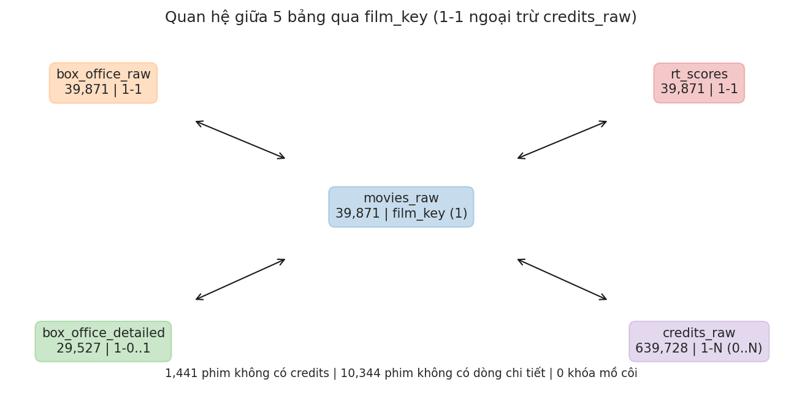

*Hình 3.1 — Quan hệ 5 bảng qua `film_key`. `movies_raw` là bảng gốc (spine); `box_office_raw` và `rt_scores` phủ 100% phim; `box_office_detailed` phủ 74,06%; `credits_raw` phủ 96,39% và là quan hệ 1-N.*

Vai trò: `movies_raw` giữ metadata và ngân sách; `box_office_raw` chỉ có **một** loại doanh thu (`market_scope` luôn = `global`); `box_office_detailed` định danh thêm bằng `imdb_id` và bổ sung doanh thu nội địa/quốc tế/mở màn; `credits_raw` là bảng quan hệ người–phim; `rt_scores` bổ sung điểm đánh giá và trạng thái khớp RT.

**Nhận xét cấu trúc đã kiểm chứng:**
- `film_key` = `"FK" + tmdb_id` đệm số 0 đủ 8 chữ số, đúng 100% dòng của `movies_raw`; `movies_raw`, `box_office_raw`, `rt_scores` cùng thứ tự dòng (không cần dựa vào thứ tự — vẫn phải join theo khóa).
- `imdb_id` ở `box_office_detailed` khớp 29.527/29.527 với `movies_raw`; `imdb_id` của `movies_raw` thiếu 10.335 dòng (25,92%).
- Không có ký tự nhiễu kiểu `$`, `,`, `%`, `N/A` trong các cột số (đọc đúng kiểu số); mọi thiếu đều là `NaN` rỗng. *Giới hạn:* với cột text, chưa kiểm tra toàn bộ token lạ ngoài các mẫu đã nêu ở §8.

---

## 4. Schema và kiểu dữ liệu

Bảng đầy đủ **41 cột** (`reports/column_overview.csv`). Cột "Role (suy luận)" do script suy ra từ kiểu và nội dung, **không phải mô tả chính thức** của nguồn.

| Dataset | Column | Data Type | Role (suy luận) | Unique Values | Missing Count | Missing Percentage |
|---|---|---|---|---|---|---|
| movies_raw | film_key | str | định danh | 39,871 | 0 | 0.00 |
| movies_raw | tmdb_id | int64 | định danh | 39,871 | 0 | 0.00 |
| movies_raw | imdb_id | str | định danh | 29,536 | 10,335 | 25.92 |
| movies_raw | title | str | text / categorical | 39,519 | 0 | 0.00 |
| movies_raw | release_date_ref | str | ngày (text) | 16,580 | 754 | 1.89 |
| movies_raw | tmdb_collection_id | float64 | định danh/rời rạc | 9,728 | 30 | 0.08 |
| movies_raw | director_ids | str | đa trị ('\|') | 13,002 | 4,908 | 12.31 |
| movies_raw | lead_cast_ids_superset | str | đa trị ('\|') | 34,535 | 3,542 | 8.88 |
| movies_raw | production_company_ids | str | đa trị ('\|') | 14,348 | 8,353 | 20.95 |
| movies_raw | genre_ids | str | đa trị ('\|') | 3,833 | 7,035 | 17.64 |
| movies_raw | production_budget | float64 | số | 940 | 35,679 | 89.49 |
| movies_raw | budget_missing_flag | bool | cờ (bool) | 2 | 0 | 0.00 |
| movies_raw | release_month | float64 | định danh/rời rạc | 12 | 754 | 1.89 |
| movies_raw | vote_count | int64 | số | 2,261 | 0 | 0.00 |
| movies_raw | source | str | hằng số / rỗng | 1 | 0 | 0.00 |
| movies_raw | retrieval_date | str | hằng số / rỗng | 1 | 0 | 0.00 |
| box_office_raw | film_key | str | định danh | 39,871 | 0 | 0.00 |
| box_office_raw | market_scope | str | hằng số / rỗng | 1 | 0 | 0.00 |
| box_office_raw | global_gross | float64 | số | 4,066 | 35,381 | 88.74 |
| box_office_raw | missing_flag | bool | cờ (bool) | 2 | 0 | 0.00 |
| box_office_raw | source | str | hằng số / rỗng | 1 | 0 | 0.00 |
| box_office_raw | retrieval_date | str | hằng số / rỗng | 1 | 0 | 0.00 |
| box_office_detailed | film_key | str | định danh | 29,527 | 0 | 0.00 |
| box_office_detailed | imdb_id | str | định danh | 29,527 | 0 | 0.00 |
| box_office_detailed | domestic_gross | float64 | số | 2,610 | 26,902 | 91.11 |
| box_office_detailed | international_gross | float64 | số | 5,956 | 23,539 | 79.72 |
| box_office_detailed | opening_weekend_gross | float64 | số | 2,368 | 27,143 | 91.93 |
| box_office_detailed | theater_count | float64 | rỗng 100% | 0 | 29,527 | 100.00 |
| credits_raw | film_key | str | định danh | 38,430 | 0 | 0.00 |
| credits_raw | person_id | int64 | định danh | 281,809 | 0 | 0.00 |
| credits_raw | role | str | text / categorical | 2 | 0 | 0.00 |
| credits_raw | billing_order | float64 | số | 451 | 41,116 | 6.43 |
| credits_raw | source | str | hằng số / rỗng | 1 | 0 | 0.00 |
| credits_raw | retrieval_date | str | hằng số / rỗng | 1 | 0 | 0.00 |
| rt_scores | film_key | str | định danh | 39,871 | 0 | 0.00 |
| rt_scores | critic_score | float64 | số | 101 | 33,488 | 83.99 |
| rt_scores | audience_score | float64 | số | 100 | 28,520 | 71.53 |
| rt_scores | rt_url | str | text / categorical | 17,101 | 19,721 | 49.46 |
| rt_scores | rt_status | str | text / categorical | 4 | 0 | 0.00 |
| rt_scores | source | str | hằng số / rỗng | 1 | 0 | 0.00 |
| rt_scores | retrieval_date | str | hằng số / rỗng | 1 | 0 | 0.00 |

**Điểm đáng chú ý về schema:**
- **10 cột hằng số/rỗng** (≤ 1 giá trị duy nhất): `source`, `retrieval_date` (ở 4 bảng), `market_scope`, và `theater_count` (0 giá trị). Chúng là metadata truy vết, không mang thông tin phân biệt phim.
- Ngày (`release_date_ref`, `retrieval_date`) đang là **text** (`str`), không phải datetime; tất cả 39.117 ngày không thiếu đều đúng định dạng `YYYY-MM-DD` (độ dài 10; parse lỗi 0).
- `release_month` là float chỉ vì có NaN; khớp 100% với tháng của `release_date_ref`.
- `tmdb_collection_id`, `billing_order`, `theater_count` là float do NaN — là mã/thứ hạng, không nên coi là biến liên tục.
- Các cờ `budget_missing_flag` (movies) và `missing_flag` (box_office_raw) **khớp 100%** với trạng thái null của `production_budget` / `global_gross` → dư thừa thông tin, không phải biến độc lập.
- Cột đa trị: `genre_ids`, `director_ids`, `lead_cast_ids_superset`, `production_company_ids` lưu nhiều ID trong một ô, ngăn cách bằng `|` (§8).

---

## 5. Phân tích missing values

### 5.1. Tỷ lệ thiếu theo cột và theo dataset

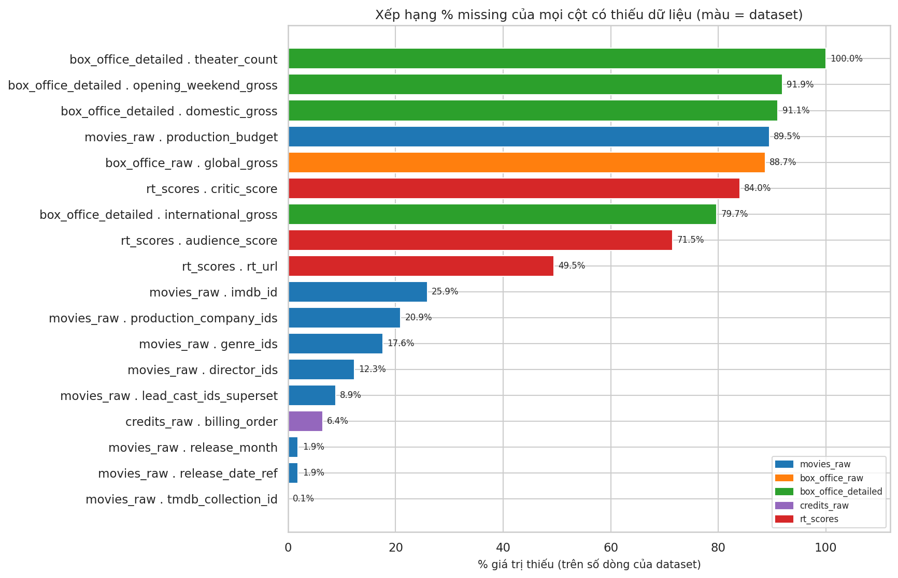

*Hình 5.1 — Xếp hạng % missing của mọi cột có thiếu. Dữ liệu: cả 5 dataset. Biểu đồ dạng thanh ngang xếp hạng để so sánh trực tiếp giữa các dataset (khác Hình 01 gốc, vốn tách theo bảng).*

**Quan sát:** 7 biến tài chính/điểm đều thiếu ≥ 71,5%; các cột metadata thiếu 9–26% (`imdb_id` 25,92%, `production_company_ids` 20,95%, `genre_ids` 17,64%, `director_ids` 12,31%, `lead_cast_ids_superset` 8,88%); `release_date_ref`/`release_month` 1,89%; `tmdb_collection_id` 0,08%; `credits_raw.billing_order` 6,43%.

| Dataset | Column | Data Type | Role (suy luận) | Unique Values | Missing Count | Missing Percentage |
|---|---|---|---|---|---|---|
| box_office_detailed | theater_count | float64 | rỗng 100% | 0 | 29,527 | 100.00 |
| box_office_detailed | opening_weekend_gross | float64 | số | 2,368 | 27,143 | 91.93 |
| box_office_detailed | domestic_gross | float64 | số | 2,610 | 26,902 | 91.11 |
| movies_raw | production_budget | float64 | số | 940 | 35,679 | 89.49 |
| box_office_raw | global_gross | float64 | số | 4,066 | 35,381 | 88.74 |
| rt_scores | critic_score | float64 | số | 101 | 33,488 | 83.99 |
| box_office_detailed | international_gross | float64 | số | 5,956 | 23,539 | 79.72 |
| rt_scores | audience_score | float64 | số | 100 | 28,520 | 71.53 |
| rt_scores | rt_url | str | text / categorical | 17,101 | 19,721 | 49.46 |
| movies_raw | imdb_id | str | định danh | 29,536 | 10,335 | 25.92 |
| movies_raw | production_company_ids | str | đa trị ('\|') | 14,348 | 8,353 | 20.95 |
| movies_raw | genre_ids | str | đa trị ('\|') | 3,833 | 7,035 | 17.64 |
| movies_raw | director_ids | str | đa trị ('\|') | 13,002 | 4,908 | 12.31 |
| movies_raw | lead_cast_ids_superset | str | đa trị ('\|') | 34,535 | 3,542 | 8.88 |
| credits_raw | billing_order | float64 | số | 451 | 41,116 | 6.43 |
| movies_raw | release_date_ref | str | ngày (text) | 16,580 | 754 | 1.89 |
| movies_raw | release_month | float64 | định danh/rời rạc | 12 | 754 | 1.89 |
| movies_raw | tmdb_collection_id | float64 | định danh/rời rạc | 9,728 | 30 | 0.08 |

**Tỷ lệ ô thiếu cả bảng:** `box_office_detailed` 60,46% (52,55% nếu loại cột rỗng `theater_count`), `rt_scores` 29,28%, `box_office_raw` 14,79%, `movies_raw` 11,19%, `credits_raw` 1,07%.

### 5.2. Pattern thiếu ở mức phim

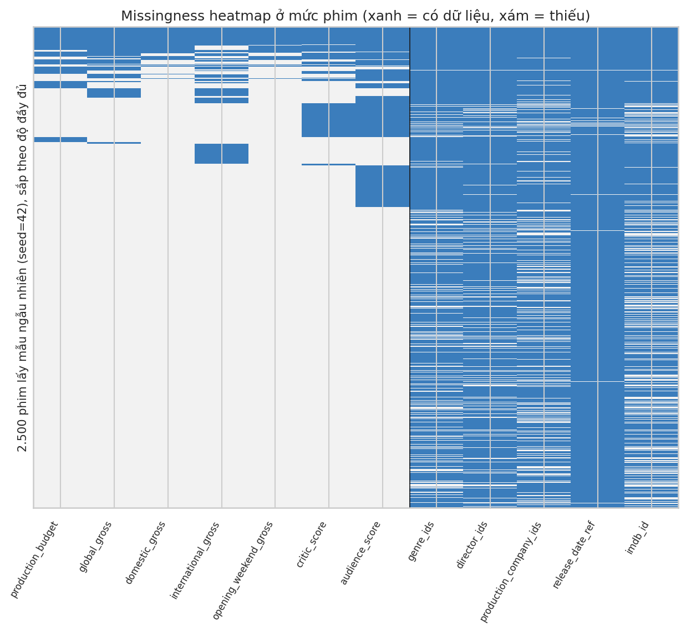

*Hình 5.2 — Missingness heatmap trên 2.500 phim lấy mẫu ngẫu nhiên (seed 42), xếp theo độ đầy đủ. Xanh = có dữ liệu.*

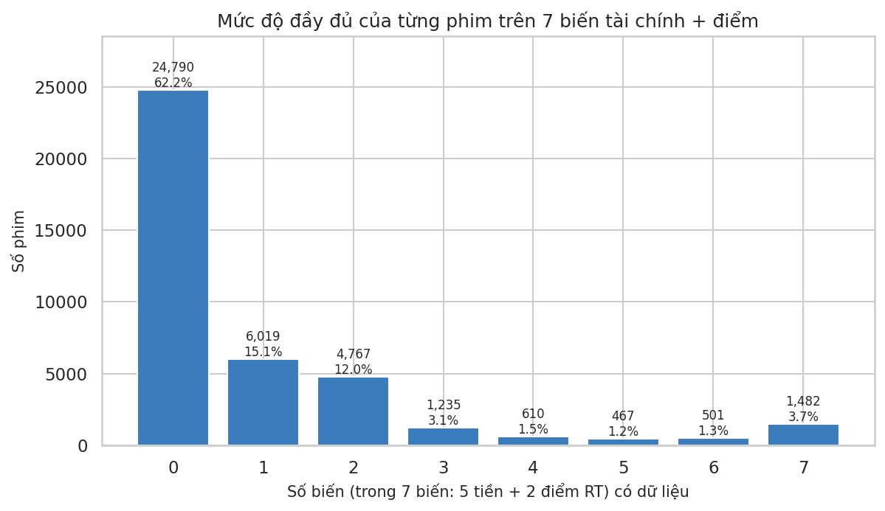

*Hình 5.3 — Phân phối số biến có dữ liệu trên 7 biến (5 tiền + 2 điểm).*

**Quan sát:** 24.790 phim (62,18%) không có biến nào trong 7 biến; chỉ **1.482 phim (3,72%)** có đủ cả 7. Heatmap cho thấy thiếu **có cấu trúc khối**: các biến doanh thu cùng xuất hiện/cùng vắng theo cụm phim, thay vì rải đều; các khoảng trống của `genre_ids`, `production_company_ids`, `imdb_id` tập trung ở nửa dưới (phim ít thông tin tài chính), trong khi `release_date_ref` hầu như đầy đủ ở mọi mức.

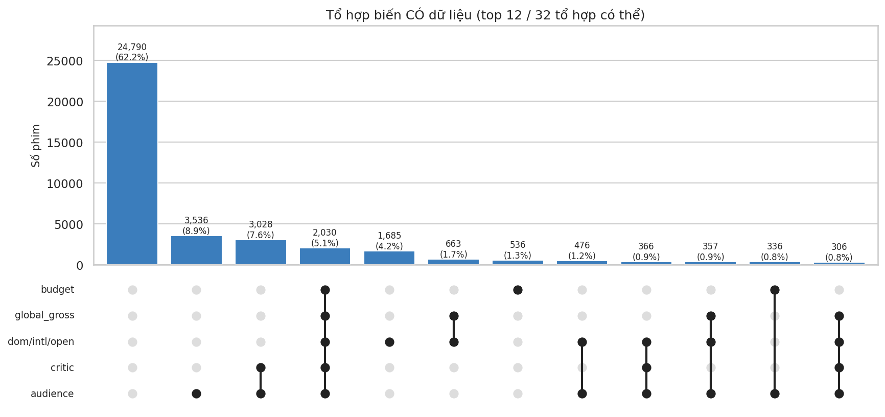

*Hình 5.4 — UpSet: tổ hợp biến cùng có dữ liệu (top 12/32).*

**Quan sát:** sau nhóm "không có gì" (24.790), các tổ hợp phổ biến nhất chỉ có `audience_score` (3.536), `critic+audience` (3.028), cả 5 nhóm biến (2.030), và chỉ `dom/intl/open` (1.685). Phim có đủ budget + global_gross + doanh thu chi tiết + 2 điểm RT chỉ 2.030 (5,09%).

**Ý nghĩa:** phân tích đa biến cần chọn tập con theo biến, và mỗi tập con có n rất khác nhau (2.844 cho budget∩global; 2.154 cho budget∩global∩critic∩audience).

### 5.3. Thiếu trong `box_office_detailed`: "dòng vỏ rỗng" và cột rỗng

| Mẫu (dom, intl, opening) | Số dòng |
|---|---:|
| không có giá trị nào | **22.906** (77,58% của 29.527 dòng) |
| chỉ international | 3.996 |
| đủ cả 3 | 1.860 |
| dom + opening (không intl) | 524 |
| dom + intl (không opening) | 132 |
| chỉ domestic | 109 |
| `theater_count` | 0/29.527 (rỗng 100%) |

Số phim thật sự có doanh thu chi tiết là **6.621**, không phải 29.527 dòng. Điều này là **giá trị chưa được ghi nhận** (không biết do chưa thu thập hay không tồn tại), không thể coi là 0.

### 5.4. Missingness và mức độ nổi tiếng (`vote_count`)

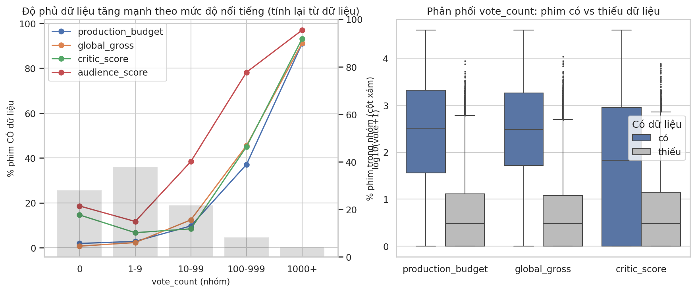

*Hình 5.5 — Trái: % phim có dữ liệu theo nhóm vote_count (tính lại; cột xám = tỷ trọng nhóm). Phải: phân phối log10(vote+1) của phim có vs thiếu dữ liệu.*

| vgroup | n | share % | production_budget | global_gross | domestic_gross | international_gross | opening_weekend_gross | critic_score | audience_score |
|---|---|---|---|---|---|---|---|---|---|
| 0 | 11,210 | 28.10 | 1.90 | 0.70 | 0.00 | 1.40 | 0.00 | 14.60 | 18.60 |
| 1-9 | 15,061 | 37.80 | 2.80 | 2.30 | 0.30 | 6.70 | 0.30 | 6.70 | 11.70 |
| 10-99 | 8,668 | 21.70 | 9.70 | 12.40 | 3.80 | 23.40 | 3.20 | 8.40 | 38.40 |
| 100-999 | 3,290 | 8.30 | 37.10 | 45.50 | 25.80 | 42.80 | 22.50 | 45.00 | 78.20 |
| 1000+ | 1,642 | 4.10 | 91.00 | 91.20 | 85.30 | 84.20 | 81.00 | 93.10 | 97.00 |

| Variable | n có dữ liệu | Median vote (có) | Median vote (thiếu) | Rank-biserial | Mann-Whitney p | Cramér V (vote group x có/thiếu) |
|---|---|---|---|---|---|---|
| production_budget | 4,192 | 324.00 | 2.00 | 0.75 | 0.00 | 0.63 |
| global_gross | 4,490 | 303.00 | 2.00 | 0.83 | 0.00 | 0.65 |
| critic_score | 6,383 | 67.00 | 2.00 | 0.35 | 0.00 | 0.52 |
| audience_score | 11,351 | 37.00 | 2.00 | 0.50 | 0.00 | 0.52 |
| domestic_gross | 2,625 | 1,201 | 2.00 | 0.93 | 0.00 | 0.71 |
| international_gross | 5,988 | 78.00 | 2.00 | 0.71 | 0.00 | 0.53 |

**Finding:** độ phủ tăng đơn điệu mạnh theo `vote_count` (budget: 1,9% → 91,0%; global_gross: 0,7% → 91,2%; domestic: 0% → 85,3%). Median `vote_count`: phim có budget 324 vs thiếu 2; có domestic_gross 1.201 vs 2. Rank-biserial 0,35–0,93; Cramér V (nhóm vote × có/thiếu) 0,52–0,71.

**Interpretation:** dữ liệu tài chính **không thiếu ngẫu nhiên hoàn toàn** (không MCAR) đối với `vote_count`. Hai cách giải thích còn mở: (a) *MAR* — thiếu phụ thuộc vào biến quan sát được (độ nổi tiếng, năm, thể loại) và có thể điều chỉnh bằng cách điều kiện hóa các biến này; (b) *MNAR* — thiếu phụ thuộc vào chính giá trị doanh thu/ngân sách (ví dụ phim doanh thu thấp ít được ghi nhận). Dữ liệu hiện có **không cho phép phân biệt** hai khả năng.

**Limitation:** vote_count là số vote của TMDB, vừa là proxy độ phổ biến vừa có thể bị tác động bởi chính việc phim được thu thập nhiều thông tin; không thể kết luận quan hệ nhân quả. Nhóm 0 vote chiếm 28,1% phim.

**Hệ quả:** bất kỳ kết luận nào rút từ phim có dữ liệu (ví dụ "ngân sách giải thích doanh thu") chỉ áp dụng cho **phim tương đối phổ biến**, không suy rộng được cho toàn bộ 39.871 phim.

**Độ phủ theo thể loại** (cùng chiều với phát hiện trên: thể loại có nhiều phim phổ biến có độ phủ cao hơn):

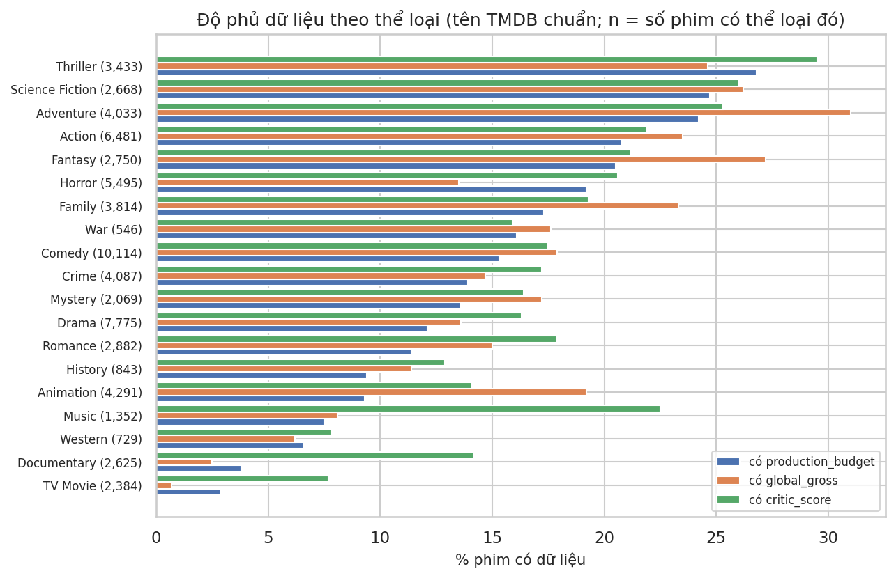

*Hình 5.6 — % phim có budget/global_gross/critic_score theo thể loại (tên theo bảng TMDB chuẩn, ngoài dataset). Thriller 26,8%, Adventure 24,2%, Sci-Fi 24,7% cao nhất; Documentary 3,8% và TV Movie 2,9% thấp nhất.*

### 5.5. Thiếu ở `rt_scores`: ba loại "thiếu" khác nhau

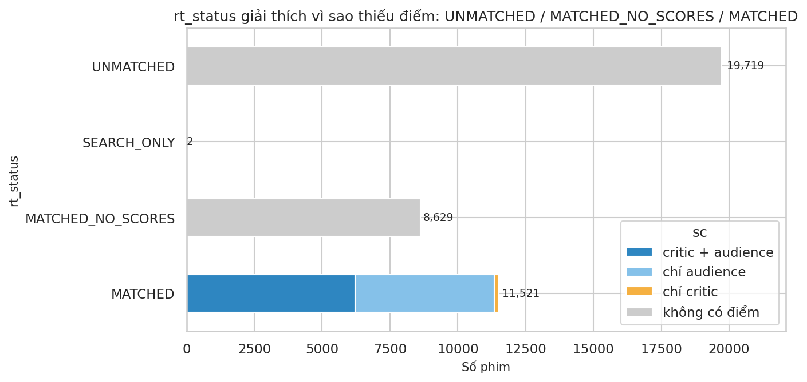

*Hình 5.7 — `rt_status` × có điểm.*

| `rt_status` | Số phim | % | Ý nghĩa dữ liệu |
|---|---:|---:|---|
| UNMATCHED | 19.719 | 49,46% | không khớp được trang RT; `rt_url` trống; không có điểm nào |
| MATCHED | 11.521 | 28,90% | có trang RT: 6.211 có cả 2 điểm; 5.140 chỉ audience; 170 chỉ critic |
| MATCHED_NO_SCORES | 8.629 | 21,64% | có trang RT nhưng **không có điểm nào** |
| SEARCH_ONLY | 2 | 0,01% | `rt_url` trống; có `critic_score` (ca hiếm, cần xem lại) |

`critic_score` thiếu 33.488 = 19.719 + 8.629 + 5.140 (đúng khớp). Tức là **"thiếu điểm" gồm ít nhất 3 nghĩa khác nhau**: không tìm thấy phim trên RT, tìm thấy nhưng chưa có điểm, và có điểm audience nhưng không có điểm critic. Chỉ dữ liệu hiện có không cho biết lý do (ví dụ chưa đủ review hay lỗi thu thập).

### 5.6. Thiếu ở các cột metadata
`imdb_id` thiếu rất nhiều ở phim ít vote (66,2% ở nhóm 0 vote → 0,0% ở nhóm ≥1.000). `credits_raw.billing_order` thiếu 41.116 = **đúng bằng số dòng `director`** → thiếu *theo thiết kế* (không áp dụng), không phải lỗi. 1.441 phim (3,61%) không có dòng credits nào; median vote của nhóm này là 0.

### 5.7. Tác động và định hướng (không thực hiện ở giai đoạn này)
- *Giá trị không áp dụng* (billing_order của director): không impute.
- *Giá trị chưa ghi nhận* (budget, doanh thu, điểm): cần tạo cờ có/không có dữ liệu; impute chỉ cân nhắc sau khi quyết định mục tiêu và giả định cơ chế thiếu (§16, §17 S14).
- *Dòng vỏ rỗng / cột rỗng*: xử lý ở mức diễn giải (cờ `has_detail_values`), không xóa ở nguồn.
- Với tỷ lệ thiếu 80–92%, impute bằng median/mode **không được khuyến nghị mặc định**: sẽ tạo phân phối giả và làm yếu tương quan thật.

---

## 6. Duplicate và tính duy nhất

| Dataset | Check | Count | Note |
|---|---|---|---|
| movies_raw | Trùng toàn bộ dòng | 0 |  |
| movies_raw | film_key bị thiếu | 0 |  |
| movies_raw | Dòng có film_key lặp (keep=False) | 0 | kỳ vọng 0 (quan hệ 1-1) |
| box_office_raw | Trùng toàn bộ dòng | 0 |  |
| box_office_raw | film_key bị thiếu | 0 |  |
| box_office_raw | Dòng có film_key lặp (keep=False) | 0 | kỳ vọng 0 (quan hệ 1-1) |
| box_office_detailed | Trùng toàn bộ dòng | 0 |  |
| box_office_detailed | film_key bị thiếu | 0 |  |
| box_office_detailed | Dòng có film_key lặp (keep=False) | 0 | kỳ vọng 0 (quan hệ 1-1) |
| credits_raw | Trùng toàn bộ dòng | 0 |  |
| credits_raw | film_key bị thiếu | 0 |  |
| credits_raw | Dòng có film_key lặp (keep=False) | 637,322 | quan hệ 1-N là bình thường |
| rt_scores | Trùng toàn bộ dòng | 0 |  |
| rt_scores | film_key bị thiếu | 0 |  |
| rt_scores | Dòng có film_key lặp (keep=False) | 0 | kỳ vọng 0 (quan hệ 1-1) |
| credits_raw | Trùng (film_key, person_id, role) - dòng dư | 1,021 | khác nhau ở billing_order; vai trò: {'cast': 1021} |
| credits_raw | Trùng (film_key, person_id) - dòng dư | 6,265 | gồm cả người vừa là đạo diễn vừa là diễn viên (hợp lệ) |
| credits_raw | Trùng (film_key, billing_order) trong cast | 3 |  |
| movies_raw | Số dòng có title trùng (keep=False) | 652 | 39,519 title khác nhau / 39,871 dòng; không phải lỗi |
| movies_raw | Nhóm title trùng + cùng release_date_ref | 1 | ứng viên trùng phim, cần kiểm tra thủ công |
| movies_raw | imdb_id trùng (non-null) | 0 |  |
| movies_raw | tmdb_id trùng | 0 |  |

| Dataset | Rows | Unique film_key | Missing film_key | Rows per key (max) | Keys in movies_raw | Orphan keys (not in movies_raw) | Coverage of movies_raw % |
|---|---|---|---|---|---|---|---|
| movies_raw | 39,871 | 39,871 | 0 | 1 | 39,871 | 0 | 100.00 |
| box_office_raw | 39,871 | 39,871 | 0 | 1 | 39,871 | 0 | 100.00 |
| box_office_detailed | 29,527 | 29,527 | 0 | 1 | 29,527 | 0 | 74.06 |
| credits_raw | 639,728 | 38,430 | 0 | 452 | 38,430 | 0 | 96.39 |
| rt_scores | 39,871 | 39,871 | 0 | 1 | 39,871 | 0 | 100.00 |

**Finding & Interpretation:**
- **Không có dòng trùng toàn bộ** ở bất kỳ bảng nào; `film_key`, `tmdb_id`, `imdb_id` (non-null) duy nhất ở `movies_raw`; `film_key` duy nhất ở 4 bảng 1-1.
- **`credits_raw`:** 1.021 dòng dư có cùng (`film_key`, `person_id`, `role`), **toàn bộ là role `cast`** và khác nhau ở `billing_order` (một người được liệt kê hai lần với thứ tự billing khác nhau); 3 dòng trùng (`film_key`, `billing_order`) trong cast. 6.265 dòng dư theo (`film_key`, `person_id`) gồm cả trường hợp một người vừa đạo diễn vừa diễn xuất — **hợp lệ**, không phải trùng.
- **`title` trùng** ở 652 dòng (39.519 title khác nhau/39.871) vì có phim cùng tên khác nhau (ví dụ các tập đặc biệt có tên giống nhau, phiên bản làm lại). Chỉ **1 nhóm** trùng cả title lẫn `release_date_ref` → ứng viên trùng phim cần kiểm tra thủ công.
- **Tác động merge:** chỉ `credits_raw` làm tăng dòng khi join (§11.5).
- **Không xóa bản ghi nào.** Đề xuất xử lý ở S03 và S07.

---

## 7. Dữ liệu số

### 7.1. Thống kê mô tả

| Column | Count | Mean | Median | Std | Min | Q1 | Q3 | Max | Skewness | Kurtosis | Mean/Median | P99/Median |
|---|---|---|---|---|---|---|---|---|---|---|---|---|
| production_budget | 4,192 | 26,198,471 | 5,425,000 | 50,026,984 | 1.00 | 800,000 | 25,000,000 | 658,800,000 | 3.45 | 17.38 | 4.83 | 42.48 |
| global_gross | 4,490 | 98,591,610 | 15,200,000 | 222,979,393 | 1.00 | 2,578,414 | 81,044,985 | 2,925,713,609 | 4.64 | 31.53 | 6.49 | 69.64 |
| domestic_gross | 2,625 | 64,160,861 | 24,922,237 | 102,741,906 | 120.00 | 1,242,995 | 80,282,231 | 958,463,462 | 3.15 | 14.08 | 2.57 | 18.46 |
| international_gross | 5,988 | 46,133,862 | 3,807,160 | 131,929,146 | 9.00 | 499,553 | 22,516,180 | 2,247,392,194 | 6.04 | 56.19 | 12.12 | 171.43 |
| opening_weekend_gross | 2,384 | 19,479,012 | 7,370,310 | 33,007,509 | 270.00 | 357,636 | 23,190,516 | 360,091,572 | 3.57 | 18.81 | 2.64 | 21.46 |
| critic_score | 6,383 | 63.20 | 69.00 | 29.41 | 0.00 | 40.00 | 89.00 | 100.00 | -0.46 | -0.99 | 0.92 | 1.45 |
| audience_score | 11,351 | 59.39 | 61.00 | 24.58 | 0.00 | 40.00 | 80.00 | 100.00 | -0.25 | -0.90 | 0.97 | 1.62 |
| vote_count | 39,871 | 252.55 | 3.00 | 1,533 | 0.00 | 0.00 | 20.00 | 39,940 | 10.87 | 150.00 | 84.18 | 2,305 |
| release_month | 39,117 | 6.45 | 7.00 | 3.69 | 1.00 | 3.00 | 10.00 | 12.00 | -0.03 | -1.32 | 0.92 | 1.71 |
| billing_order | 598,612 | 16.33 | 10.00 | 21.85 | 0.00 | 4.00 | 21.00 | 450.00 | 5.18 | 52.73 | 1.63 | 9.50 |

*(Bảng đầy đủ hơn, gồm P99, outlier và các chỉ số log: `reports/numerical_statistics.csv`.)* `tmdb_id`, `person_id`, `tmdb_collection_id` là mã định danh nên không đưa vào thống kê. `theater_count` rỗng 100% nên không có thống kê.

**Finding:**
- **Biến tiền tệ lệch phải cực đoan:** skewness 3,15–6,04; kurtosis 14–56; Mean/Median từ 2,57× (domestic) đến **12,12× (international)**; P99/Median lên tới 171×. `international_gross` có median chỉ 3,8 triệu nhưng mean 46,1 triệu.
- **Điểm RT** gần như trải đều trên [0,100] với lệch trái nhẹ (critic −0,46; audience −0,25), kurtosis âm (−0,99; −0,90 → đỉnh phẳng hơn chuẩn); không có giá trị ngoài miền [0,100].
- **`vote_count` cực kỳ lệch** (skew 10,87; median 3, mean 252,6; 28,1% = 0 vote; top 1% phim chiếm 52,0% tổng vote, top 10% chiếm 95,5%).
- **`billing_order`** (cast): median 10, max 450 — hợp lệ như thứ hạng.

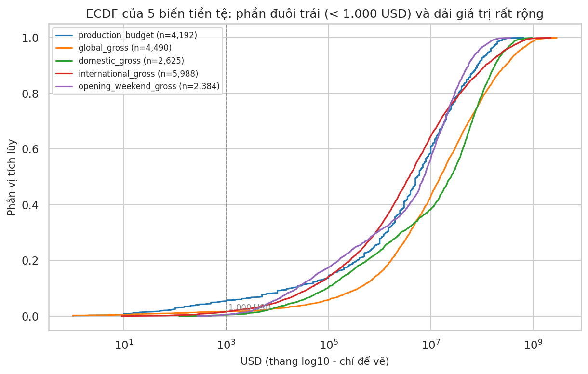

*Hình 7.1 — ECDF (thang log10 chỉ để vẽ) của 5 biến tiền. Câu hỏi: dải giá trị trải rộng thế nào và phần đuôi trái nằm ở đâu?*

**Quan sát:** các biến trải ~9 bậc độ lớn (từ 1 USD tới ~3 tỷ USD). Mỗi biến có "chân" kéo dài về phía trái vạch 1.000 USD (225 giá trị ở budget, 91 ở international, 73 ở global). Median các biến nằm trong khoảng 10^6,6–10^7,4 USD. **Ý nghĩa:** phép đo trung bình/độ lệch chuẩn trên thang gốc không mô tả được "phim điển hình"; thang log cần cho trực quan hóa, nhưng đuôi trái (giá trị cực nhỏ) sẽ bị kéo giãn mạnh khi log.

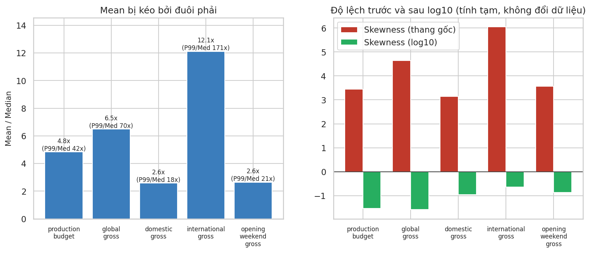

*Hình 7.2 — Trái: Mean/Median (và P99/Median). Phải: skewness trước và sau log10 (tính tạm).*

**Quan sát:** log10 đảo dấu độ lệch: skew gốc dương (3,15–6,04) thành **âm** (−0,64 đến −1,59). Tức là sau log, phân phối có **đuôi trái** (giá trị nhỏ) đáng kể thay vì đối xứng như một số nhận xét trước giả định. **Ý nghĩa:** log10 là phép biến đổi hữu ích để giảm ảnh hưởng đuôi phải, nhưng không "chuẩn hóa" hoàn toàn dữ liệu và làm nổi bật các giá trị < 1.000 USD.

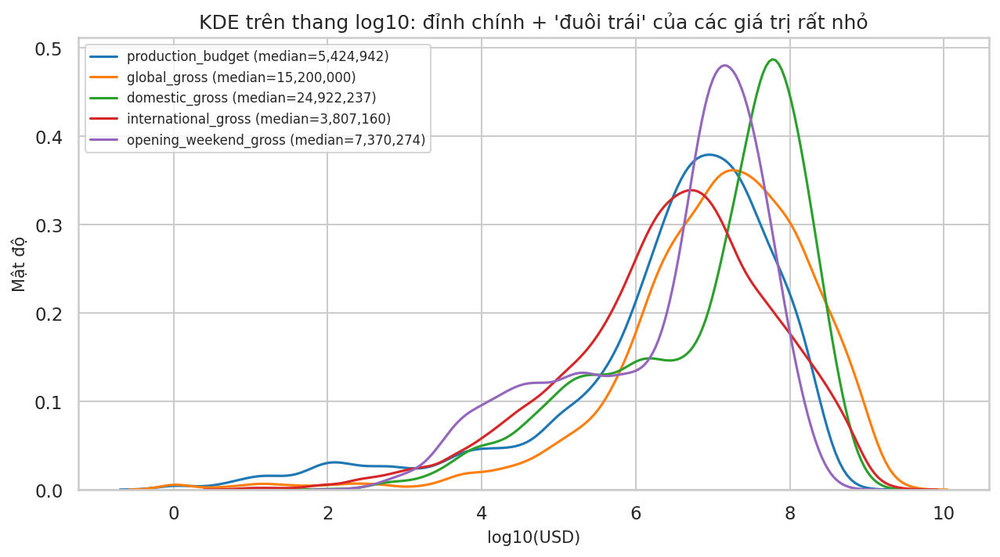

*Hình 7.3 — KDE trên log10 của 5 biến tiền.*

**Quan sát:** đỉnh chính nằm ở 10^6–10^8; `international_gross` có median thấp hơn (3,8 triệu) so với global (15,2 triệu) và domestic (24,9 triệu). **Hạn chế:** KDE làm mượt, không phát hiện được các giá trị lặp chính xác.

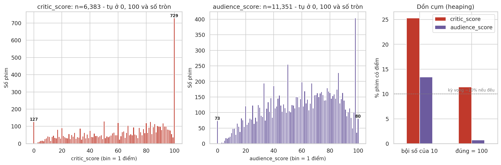

*Hình 7.4 — Phân phối điểm theo từng điểm nguyên và mức dồn cụm.*

**Quan sát:** `critic_score` = 100 ở **729 phim (11,42%)** và = 0 ở 127 phim; 25,3% điểm critic là bội số của 10 (nếu đều chỉ ~10–11%). `audience_score`: 13,4% bội số của 10, chỉ 0,7% = 100. **Interpretation (giả thuyết):** điểm critic của phim ít review có độ phân giải thô (ví dụ 1 review → 0 hoặc 100); dữ liệu không có số review RT để kiểm chứng. **Ý nghĩa:** điểm biên có độ tin cậy thấp hơn.

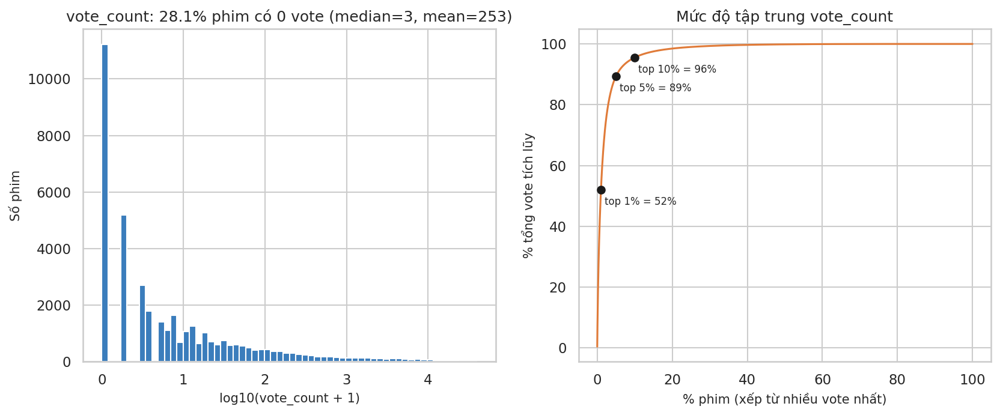

*Hình 7.5 — `vote_count`: phân phối log và độ tập trung tích lũy.*

**Quan sát:** 28,1% phim 0 vote; top 1% phim giữ 52% vote; top 5% giữ 89,4%. **Ý nghĩa:** `vote_count` là biến phân tầng tự nhiên cho mọi so sánh (§5.4).

### 7.2. Outlier: phân biệt giá trị hợp lệ và giá trị đáng nghi

| Column | Count | Q1 | Q3 | IQR | IQR outliers high | IQR outliers high % | Extreme high (>3IQR) |
|---|---|---|---|---|---|---|---|
| production_budget | 4,192 | 800,000 | 25,000,000 | 24,200,000 | 548 | 13.07 | 338 |
| global_gross | 4,490 | 2,578,414 | 81,044,985 | 78,466,570 | 607 | 13.52 | 416 |
| domestic_gross | 2,625 | 1,242,995 | 80,282,231 | 79,039,236 | 221 | 8.42 | 98 |
| international_gross | 5,988 | 499,553 | 22,516,180 | 22,016,627 | 966 | 16.13 | 743 |
| opening_weekend_gross | 2,384 | 357,636 | 23,190,516 | 22,832,880 | 211 | 8.85 | 97 |
| critic_score | 6,383 | 40.00 | 89.00 | 49.00 | 0 | 0.00 | 0 |
| audience_score | 11,351 | 40.00 | 80.00 | 40.00 | 0 | 0.00 | 0 |

*Quy tắc IQR trên thang gốc, chỉ ghi nhận số lượng (không loại). Điểm RT: 0 outlier.*

| Column | Skewness | Skew(log10) | Log-IQR outliers high | Log-IQR outliers low | Values <1000 | Values <100 | Values <=0 |
|---|---|---|---|---|---|---|---|
| production_budget | 3.45 | -1.54 | 0.00 | 290.00 | 225.00 | 103.00 | 0.00 |
| global_gross | 4.64 | -1.59 | 0.00 | 134.00 | 73.00 | 47.00 | 0.00 |
| domestic_gross | 3.15 | -0.96 | 0.00 | 21.00 | 12.00 | 0.00 | 0.00 |
| international_gross | 6.04 | -0.64 | 0.00 | 126.00 | 91.00 | 20.00 | 0.00 |
| opening_weekend_gross | 3.57 | -0.87 | 0.00 | 5.00 | 14.00 | 0.00 | 0.00 |

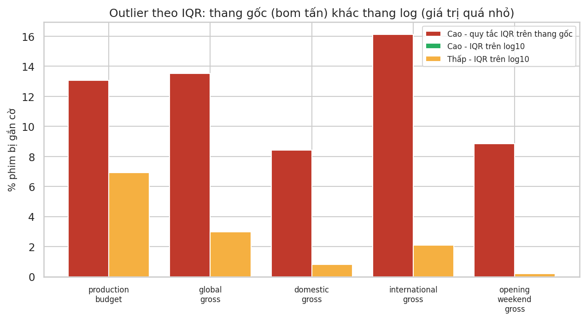

*Hình 7.6 — % phim bị gắn cờ outlier theo IQR trên thang gốc (phía cao) và trên log10 (cao/thấp).*

**Finding:** trên thang gốc, 8,4–16,1% giá trị bị gắn cờ outlier **phía cao**; trên thang log10 **không còn outlier phía cao nào** nhưng xuất hiện outlier **phía thấp** (290 budget; 134 global; 126 international; 21 domestic; 5 opening).

**Interpretation:**
- *Outlier cao* = bom tấn. Giá trị lớn nhất (`reports/top_values_check.csv`): global_gross tối đa 2.925.713.609 (Avengers: Endgame), international tối đa 2.247.392.194 (Ne Zha 2), budget tối đa 658.800.000. Đây là các phim thật nổi tiếng, **không phải lỗi nhập**. *Lưu ý:* ngân sách tối đa lớn hơn ~34% so với giá trị lớn thứ hai (489.900.000) → nên đối chiếu nguồn ngoài cho vài giá trị lớn nhất trước khi dùng; dữ liệu hiện có không đủ để xác minh.
- *Outlier thấp (< 1.000 USD)* mới là điểm đáng nghi: `production_budget` 225 giá trị (103 < 100; 24 < 10; giá trị nhỏ nhất = 1), `global_gross` 73 (47 < 100), `international_gross` 91, `opening_weekend_gross` 14, `domestic_gross` 12. Với phim chiếu rạp thương mại, các giá trị này khó thật.

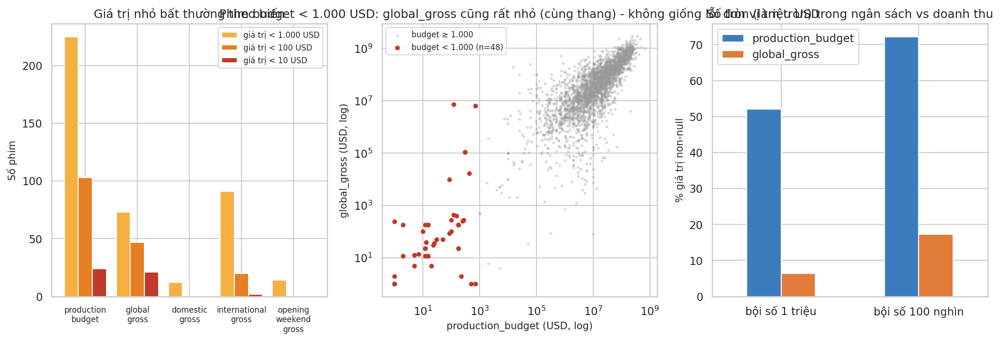

*Hình 7.7 — Trái: số giá trị < 1.000/100/10 USD theo biến. Giữa: budget < 1.000 USD vs global_gross. Phải: tỷ lệ giá trị là bội số của 1 triệu/100 nghìn.*

**Kiểm tra hai giả thuyết về giá trị nhỏ:**
- *Giả thuyết "sai đơn vị" (triệu USD ghi thành USD):* **không được ủng hộ** ở nhóm budget < 1.000 USD: trong 48 phim có cả global_gross, median global_gross chỉ **50 USD**; chỉ 4,2% có global_gross ≥ 1 triệu. Nếu budget ghi theo triệu thì gross phải lớn tương ứng.
- *Giả thuyết "placeholder/phim vô danh":* phù hợp hơn nhưng chưa chứng minh được: median `vote_count` của 225 phim budget < 1.000 chỉ là 1; chỉ 9 phim có ≥ 100 vote. Các phim thấp ngân sách có doanh thu cũng rất thấp (nhỏ, nghiệp dư, hoặc dữ liệu giữ chỗ).
- *Số tròn:* 52,0% giá trị `production_budget` là bội số của 1 triệu (72,2% bội số của 100 nghìn) so với 6,4% / 17,3% ở `global_gross` và ≤ 1,0% ở doanh thu chi tiết → **ngân sách là con số ước lượng/làm tròn**, doanh thu thì chính xác hơn.
- **Kết luận:** nhóm giá trị nhỏ là *dấu hiệu bất thường cần điều tra*, chưa đủ bằng chứng để quyết định xóa/sửa. Các giá trị lặp nhiều nhất (ví dụ `domestic_gross` = 509 xuất hiện 5 lần; `international_gross` = 291 xuất hiện 4 lần) cũng cần kiểm tra thủ công.

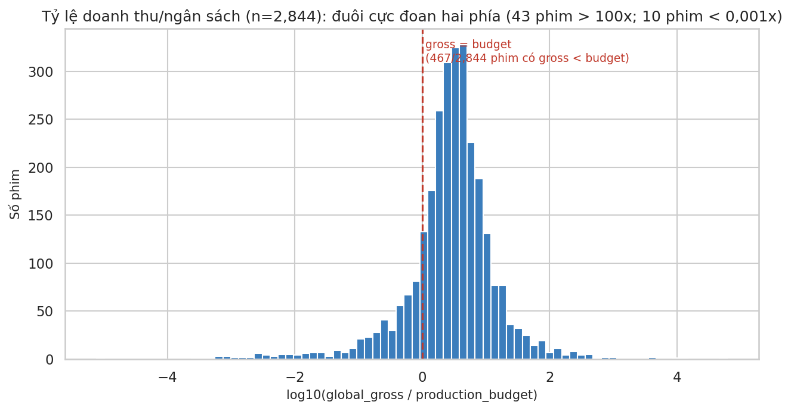

*Hình 7.8 — log10(global_gross / production_budget) trên 2.844 phim có cả hai.*

**Quan sát:** median tỷ lệ = 3,17×; **467 phim (16,4%) có doanh thu < ngân sách** (có thể là phim lỗ hợp lệ); 43 phim có tỷ lệ > 100×; 10 phim < 0,001×. **Ý nghĩa:** hai đuôi cực đoan này phần lớn do các giá trị nhỏ bất thường; ROI sẽ bị chi phối bởi chúng nếu không điều tra trước.

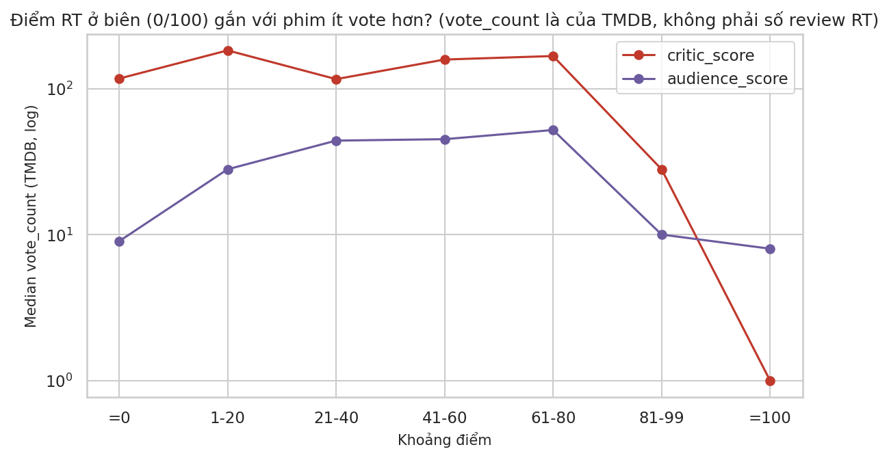

*Hình 7.9 — Median `vote_count` theo khoảng điểm RT.*

**Quan sát:** phim có critic = 0 hoặc 100 có median vote = 1 so với 118 ở nhóm 1–99. **Ý nghĩa:** điểm ở biên đi cùng phim ít thông tin; nhưng `vote_count` là của TMDB, không phải số review RT, nên chỉ là bằng chứng gián tiếp.

---

## 8. Dữ liệu categorical, text và đa trị

| Column | Non-null cells | Tokens/cell mean | Tokens/cell max | Unique tokens | Unique cell strings | Unique as sets | Cells not numerically sorted % | Top-1 token share % | Top-10 token share % | Tokens appearing once | Top token |
|---|---|---|---|---|---|---|---|---|---|---|---|
| genre_ids | 32,836 | 2.08 | 10 | 19 | 3,833 | 1,573 | 38.40 | 14.79 | 76.65 | 0 | 35 |
| director_ids | 34,963 | 1.18 | 35 | 14,590 | 13,002 | 12,741 | 5.20 | 0.27 | 2.08 | 6,911 | 554487 |
| lead_cast_ids_superset | 36,329 | 12.02 | 20 | 183,357 | 34,535 | 34,291 | 90.10 | 0.06 | 0.47 | 113,425 | 135645 |
| production_company_ids | 31,518 | 1.85 | 42 | 14,288 | 14,348 | 13,531 | 24.90 | 1.35 | 6.19 | 7,072 | 5822 |

### 8.1. Thể loại (`genre_ids`)

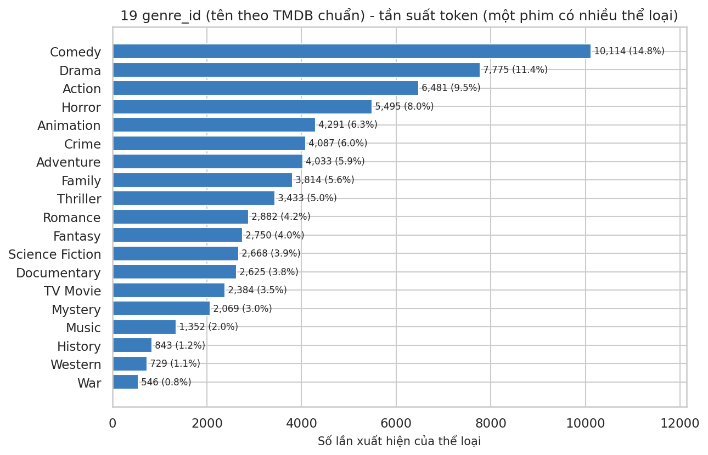

*Hình 8.1 — Tần suất token của 19 `genre_id` (tên theo bảng TMDB chuẩn, **không có trong dataset**; cần bảng tra cứu chính thức khi chuẩn bị).*

**Quan sát:** 19 thể loại; Comedy chiếm 14,79% lượt, Drama 11,4%, Action 9,5% (top 10 = 76,65%). Mỗi ô có trung bình 2,08 thể loại (tối đa 10); 7.035 phim (17,64%) không có thể loại.

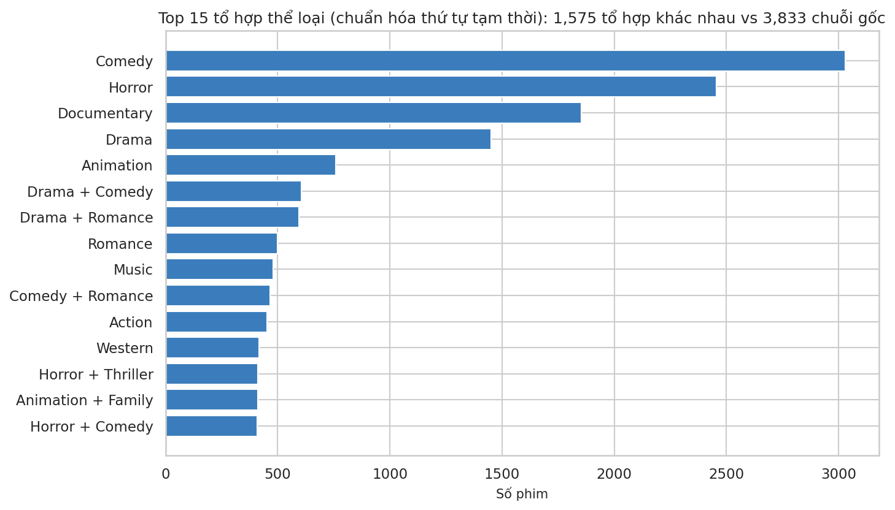

*Hình 8.2 — Top 15 tổ hợp thể loại sau khi sắp lại thứ tự tạm thời.*

**Finding quan trọng:** có **3.833 chuỗi** `genre_ids` khác nhau nhưng chỉ **1.573 tập hợp** thể loại khác nhau; **38,4% ô không sắp theo thứ tự số**. Nghĩa là cùng một tổ hợp (ví dụ {35, 18}) có thể bị lưu thành nhiều chuỗi khác nhau → group-by trực tiếp trên chuỗi sẽ **chia nhỏ sai** nhóm. Thứ tự trong ô thể loại có vẻ không mang ý nghĩa (khác `lead_cast_ids_superset`, nơi thứ tự có thể là thứ hạng billing — 90,1% ô "không sắp xếp", cần xác nhận với nguồn).

### 8.2. Trường đa trị và độ tập trung

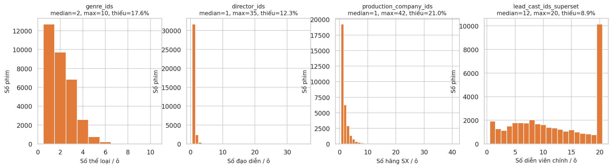

*Hình 8.3 — Số giá trị trong mỗi ô đa trị.*

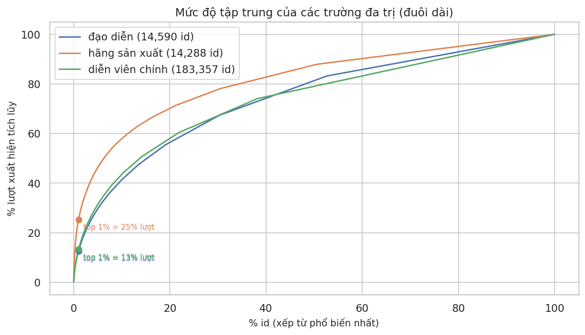

*Hình 8.4 — Đường tập trung tích lũy của đạo diễn, hãng sản xuất, diễn viên chính.*

**Quan sát:** đạo diễn: 14.590 id, **6.911 id (47,4%) chỉ xuất hiện 1 lần**, id phổ biến nhất chỉ chiếm 0,27% lượt; hãng SX: 14.288 id, 7.072 xuất hiện 1 lần, tối đa 42 hãng/phim; diễn viên chính: 183.357 id, 113.425 xuất hiện 1 lần, tối đa 20 người/ô. **Ý nghĩa:** đuôi dài cực đoan → không thể one-hot đầy đủ; id hiếm không đủ mẫu để học thống kê; cần gom nhóm/đếm/tần suất. Chỉ có ID, **không có tên** → không đánh giá được tính nhất quán chính tả, trùng người khác id.

### 8.3. Nhóm `tmdb_collection_id`

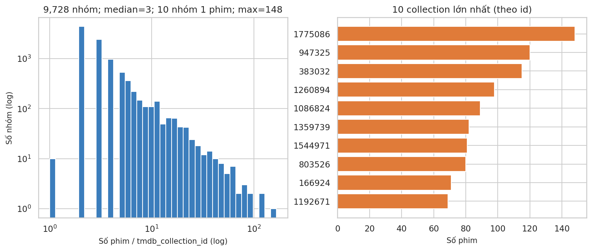

*Hình 8.5 — Kích thước nhóm `tmdb_collection_id`.*

**Quan sát:** 39.841 phim (99,92%) có giá trị; 9.728 nhóm; median 3 phim/nhóm; chỉ 10 nhóm 1 phim; nhóm lớn nhất 148 phim. Tỷ lệ phim thuộc một nhóm bất thường cao và kích thước nhóm nhiều phim. **Limitation:** không xác minh được trường này biểu diễn "nhượng quyền thật" hay một cách gom nhóm khác (cần hỏi nguồn); không suy diễn thêm.

### 8.4. `title` và `credits_raw`

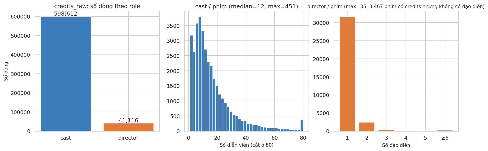

*Hình 8.6 — Số dòng theo role; số cast và director mỗi phim.*

- `title`: 8,74% có ký tự phi-ASCII (tiếng Nhật, Hàn, v.v.); khoảng trắng đầu/cuối: 0; không dùng làm khóa.
- `credits_raw`: 598.612 dòng `cast`, 41.116 dòng `director`; median 12 dòng/phim, trung bình 16,65, tối đa 452. 3.467 phim có credits nhưng **không có đạo diễn**; 2.101 phim có credits nhưng không có diễn viên; tối đa 35 đạo diễn/phim.
- **Đối chiếu:** `movies_raw.director_ids` khớp 100% (34.963/34.963 phim, cùng tập hợp) với dòng `director` trong `credits_raw` → **thông tin dư thừa**. `lead_cast_ids_superset` (≤ 20 người) luôn không nhiều hơn số cast ở `credits_raw` (tương quan số lượng 0,71) → là tập con cắt tại 20.

---

## 9. Ngày tháng và xu hướng thời gian

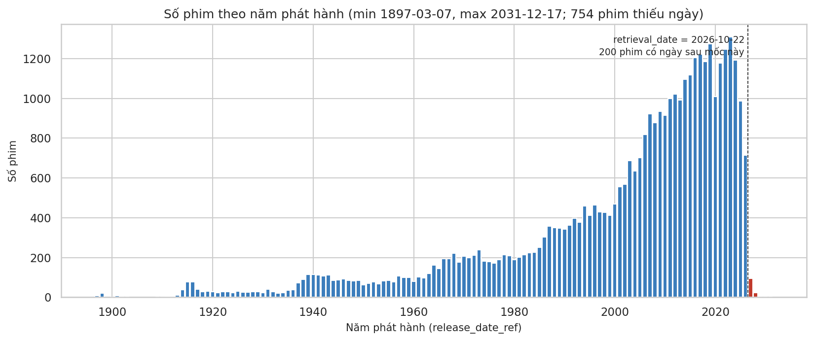

*Hình 9.1 — Số phim theo năm phát hành. Cột đỏ: các năm sau 2026.*

**Finding:** `release_date_ref` từ 1897-03-07 đến **2031-12-17**; 754 thiếu (1,89%); 0 lỗi định dạng. **200 phim có ngày sau 2026-10-22** (124 phim từ năm 2027). Trong 200 phim này có 19 phim có `production_budget` và 23 có `critic_score` nhưng 0 phim có `global_gross`. 6.400 phim (16,36% số phim có ngày) trước năm 1980. Năm 2025–2026 có 1.702 phim.

**Interpretation:** phim phát hành trong tương lai là *chưa phát hành*; ngân sách dự kiến có thể hợp lệ (kế hoạch) nhưng điểm RT cho phim chưa chiếu cần kiểm tra (có thể là ngày dự kiến sai hoặc điểm của phim khác bị khớp nhầm — **chưa thể xác định**).

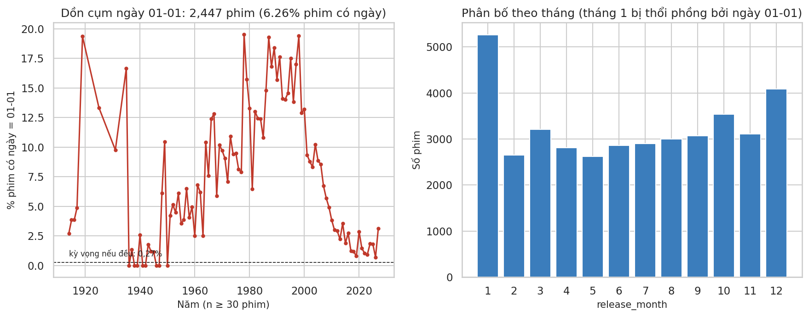

*Hình 9.2 — Trái: % phim có ngày 01-01 theo năm (n ≥ 30). Phải: phân bố theo tháng.*

**Finding:** **2.447 phim (6,26%) có ngày đúng 01-01**, trong khi nếu đều chỉ ~0,27%; tập trung nhiều nhất ở thập niên 1990 (639 phim) và 2000 (576). Tháng 1 vì vậy bị thổi phồng trong phân bố tháng. **Interpretation (giả thuyết):** 01-01 có thể là ngày mặc định khi nguồn chỉ biết năm; không thể xác nhận từ dữ liệu. **Ý nghĩa:** phân tích theo tháng/mùa vụ cần xử lý 01-01 riêng; phân tích theo năm không bị ảnh hưởng.

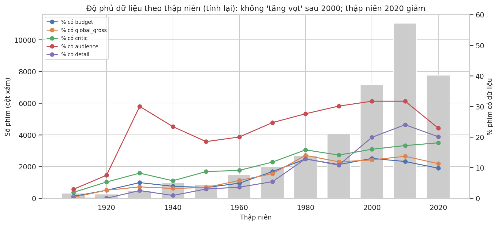

*Hình 9.3 — Số phim và % có dữ liệu theo thập niên (tính lại).*

| decade | n | budget | global_gross | critic | audience | detail |
|---|---|---|---|---|---|---|
| 1890s | 28 | 0.00 | 0.00 | 0.00 | 0.00 | 0.00 |
| 1900s | 13 | 0.00 | 0.00 | 0.00 | 0.00 | 0.00 |
| 1910s | 313 | 0.60 | 0.30 | 1.90 | 2.90 | 0.00 |
| 1920s | 266 | 2.60 | 2.60 | 5.30 | 7.50 | 0.00 |
| 1930s | 487 | 5.10 | 3.70 | 8.20 | 30.00 | 2.50 |
| 1940s | 966 | 3.90 | 3.20 | 5.70 | 23.40 | 0.90 |
| 1950s | 831 | 3.50 | 3.50 | 8.70 | 18.50 | 3.00 |
| 1960s | 1,494 | 4.90 | 5.80 | 9.10 | 20.00 | 3.60 |
| 1970s | 2,002 | 8.70 | 8.00 | 11.80 | 24.70 | 5.40 |
| 1980s | 2,666 | 12.80 | 14.00 | 15.80 | 27.60 | 12.90 |
| 1990s | 4,084 | 11.00 | 11.90 | 14.10 | 30.10 | 10.80 |
| 2000s | 7,174 | 13.00 | 12.50 | 16.00 | 31.70 | 19.90 |
| 2010s | 11,032 | 12.00 | 13.70 | 17.20 | 31.70 | 24.00 |
| 2020s | 7,759 | 9.80 | 11.30 | 18.10 | 22.90 | 20.10 |
| 2030s | 2 | 0.00 | 0.00 | 0.00 | 0.00 | 0.00 |

**Finding:** độ phủ `production_budget` ≤ 8,7% trước 1980, rồi ~11–13% từ 1980 đến 2010s và **giảm xuống 9,8% ở 2020s**; `global_gross` tương tự (11,3% ở 2020s). Chỉ `critic_score` tăng đều (1,9% → 18,1%). Khác nhận định cũ, **không có bước tăng vọt sau 2000**.

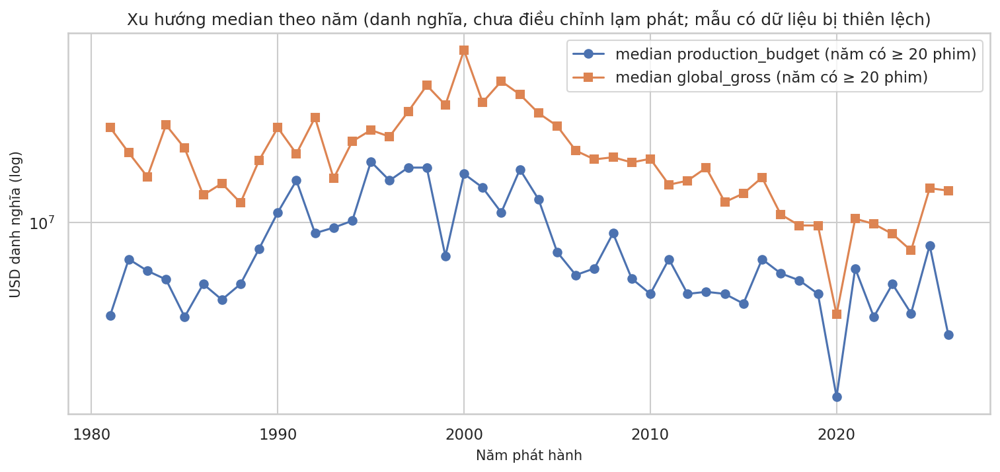

*Hình 9.4 — Median budget và global_gross theo năm (năm có ≥ 20 phim có dữ liệu; USD danh nghĩa).*

**Limitation:** giá trị danh nghĩa (chưa điều chỉnh lạm phát; cần chỉ số CPI ngoài dataset để điều chỉnh) và chỉ tính trên phim có dữ liệu (thiên lệch, §5.4). Xu hướng này **không đại diện cho toàn bộ thị trường**.

---

## 10. Quan hệ giữa các biến

| Var A | Var B | n | Pearson | Spearman | Pearson(log10) |
|---|---|---|---|---|---|
| production_budget | global_gross | 2,844 | 0.78 | 0.81 | 0.82 |
| production_budget | domestic_gross | 2,044 | 0.70 | 0.69 | 0.60 |
| production_budget | international_gross | 2,356 | 0.75 | 0.78 | 0.61 |
| production_budget | opening_weekend_gross | 1,916 | 0.74 | 0.75 | 0.66 |
| domestic_gross | international_gross | 1,992 | 0.81 | 0.73 | 0.50 |
| domestic_gross | opening_weekend_gross | 2,384 | 0.92 | 0.94 | 0.94 |
| opening_weekend_gross | global_gross | 2,155 | 0.86 | 0.84 | 0.76 |
| international_gross | global_gross | 3,341 | 0.97 | 0.85 | 0.70 |
| domestic_gross | global_gross | 2,344 | 0.92 | 0.88 | 0.79 |
| critic_score | audience_score | 6,211 | 0.72 | 0.73 | 0.72 |
| critic_score | global_gross | 2,531 | 0.18 | 0.09 | 0.05 |
| audience_score | global_gross | 3,243 | 0.24 | 0.18 | 0.16 |
| critic_score | production_budget | 2,465 | 0.08 | -0.05 | -0.08 |
| audience_score | production_budget | 3,136 | 0.22 | 0.17 | 0.13 |
| critic_score | opening_weekend_gross | 2,077 | 0.16 | 1.7e-03 | -0.10 |
| vote_count | global_gross | 4,490 | 0.76 | 0.74 | 0.66 |
| vote_count | production_budget | 4,192 | 0.64 | 0.76 | 0.73 |
| vote_count | critic_score | 6,383 | 0.05 | -0.18 | -0.16 |

*Pearson trên thang gốc, Spearman (hạng) và Pearson trên log10 của biến tiền/vote. Mỗi hàng dùng quan sát chung của hai biến (pairwise), nên n khác nhau.*

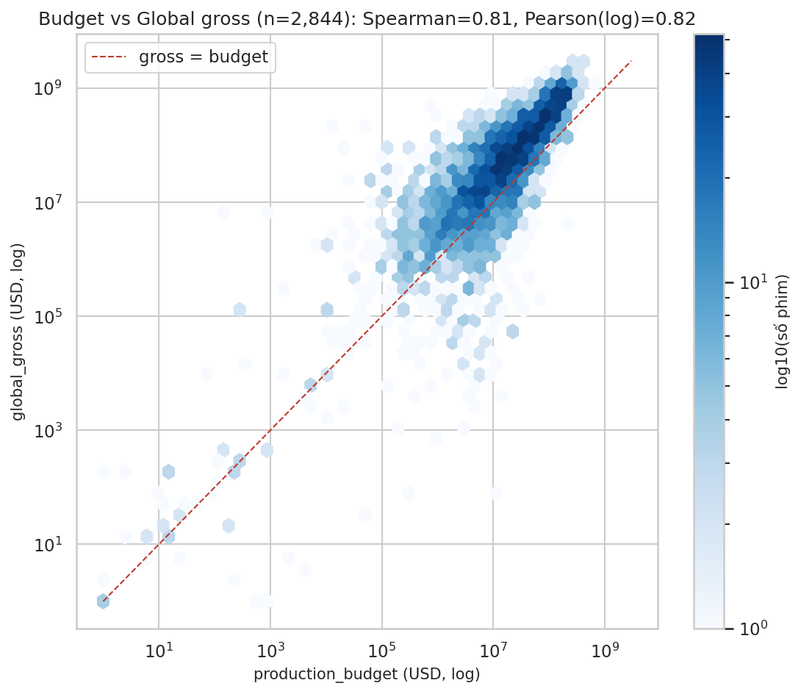

*Hình 10.1 — Hexbin budget vs global_gross (log–log), n = 2.844.*

**Finding:** Spearman 0,81; Pearson(log) 0,82. Quan hệ đồng biến mạnh trải qua nhiều bậc độ lớn. Đám nhỏ phía dưới-trái (giá trị < 1.000) tách biệt khỏi dải chính. **Kiểm tra độ ổn định:**

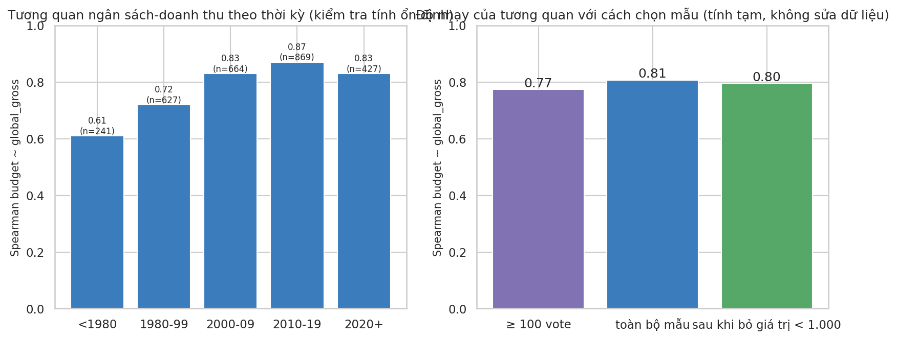

*Hình 10.2 — Trái: Spearman budget~global theo thời kỳ. Phải: độ nhạy theo cách chọn mẫu.*

Spearman theo thời kỳ: <1980: 0,61 (n=241); 1980–99: 0,72; 2000–09: 0,83; 2010–19: 0,87; 2020+: 0,83. Chỉ phim ≥ 100 vote: 0,77 (n=2.329); sau khi tạm bỏ giá trị < 1.000: 0,80 (n=2.787). **Interpretation:** mối quan hệ **bền vững** với cách chọn mẫu nhưng yếu hơn ở phim cũ (mẫu nhỏ, dữ liệu thưa). **Limitation:** đây là tương quan, không chứng minh nhân quả; cả hai biến cùng bị chi phối bởi quy mô và độ nổi tiếng (budget~vote_count Spearman 0,76; gross~vote_count 0,74).

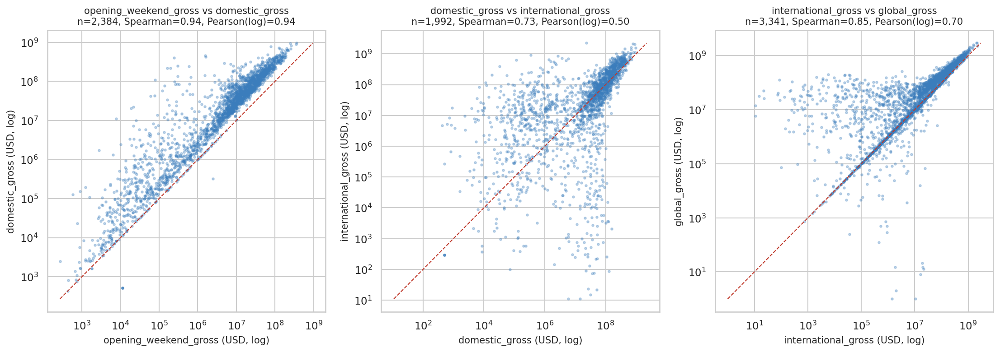

*Hình 10.3 — Opening vs domestic; domestic vs international; international vs global.*

**Finding:** `opening_weekend_gross`~`domestic_gross` Spearman **0,94**, Pearson(log) 0,94 → cực mạnh; `international_gross`~`global_gross` Pearson **0,97** nhưng Spearman 0,85 và Pearson(log) 0,70 — chênh lớn giữa ba thước đo cho thấy hệ số 0,97 bị chi phối bởi vài phim rất lớn (leverage) và bởi quan hệ cơ học (global gần như = dom + intl) cùng các xung đột nguồn (§11.4). `domestic`~`international` Pearson 0,81 nhưng log chỉ 0,50.
**VIF** (log10, n=1.496 phim đủ 6 biến): domestic 7,30; opening 7,62; budget 2,07; critic 2,03; audience 1,98; international 1,65. → domestic và opening mang gần cùng thông tin (đa cộng tuyến), **là đặc tính dữ liệu chứ không phải lỗi**.

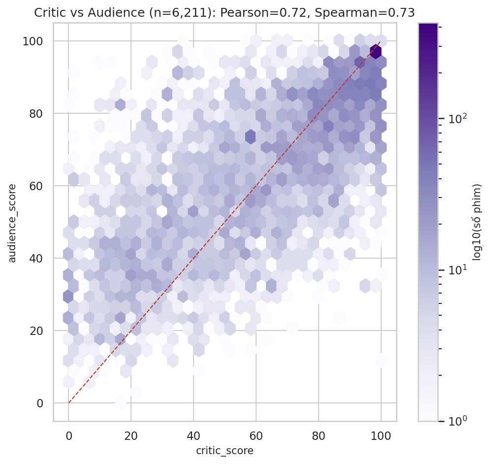

*Hình 10.4 — Critic vs Audience, n = 6.211.*

Pearson 0,72, Spearman 0,73: đồng thuận mạnh nhưng không hoàn toàn; hai điểm không thay thế nhau hoàn toàn.

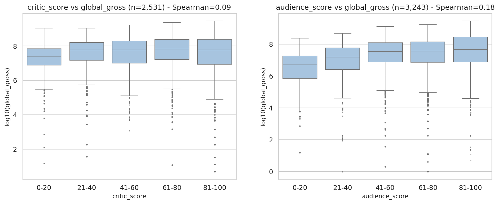

*Hình 10.5 — log10(global_gross) theo khoảng điểm.*

**Finding:** `critic_score`~`global_gross` Spearman 0,09 (n=2.531); `audience_score`~`global_gross` 0,18 (n=3.243); `critic_score`~`production_budget` −0,05. Median global_gross theo bin critic: 0–20: 23,5 triệu; 21–40: 58,8 triệu; 41–60: 59,2 triệu; 61–80: 67,5 triệu; 81–100: 58,6 triệu → **không đơn điệu**. **Interpretation:** điểm đánh giá hầu như không tuyến tính/đơn điệu với doanh thu trong mẫu này. **Limitation:** n nhỏ (mẫu phim có cả hai), thiên lệch chọn mẫu; không loại trừ quan hệ phi tuyến theo thể loại.

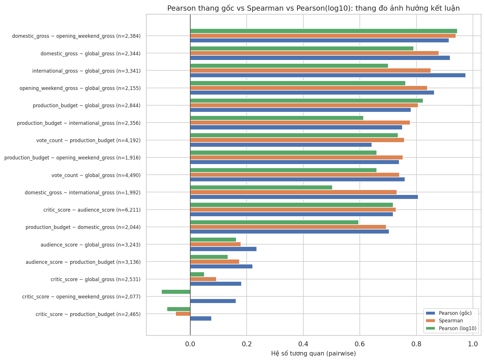

*Hình 10.6 — So sánh Pearson, Spearman, Pearson(log10) theo cặp biến.*

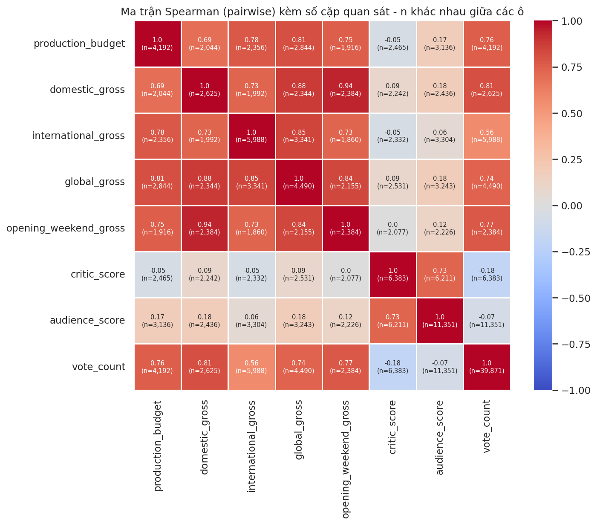

*Hình 10.7 — Ma trận Spearman kèm n. Lưu ý n biến thiên từ 1.860 đến 11.351 giữa các ô; vote_count tương quan mạnh với mọi biến doanh thu (0,56–0,81) nhưng âm nhẹ với điểm critic (−0,18).*

---

## 11. Phân tích liên bảng (Cross-dataset)

### 11.1. Khóa và số lượng

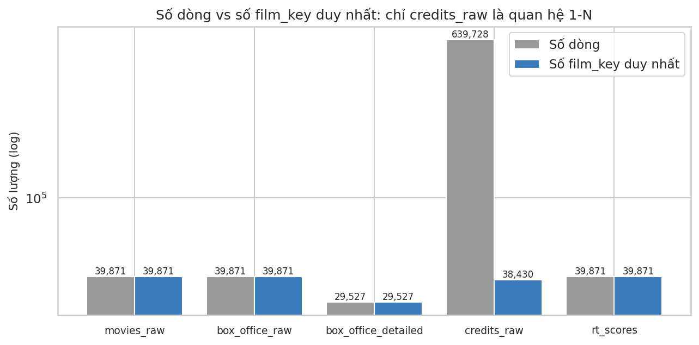

*Hình 11.1 — Số dòng so với số `film_key` duy nhất (thang log).*

Xem bảng `key_consistency` ở §6: không khóa thiếu, không khóa mồ côi; `credits_raw` 639.728 dòng cho 38.430 phim (trung bình 16,65 dòng/phim).

### 11.2. Hiện diện của phim trong các bảng

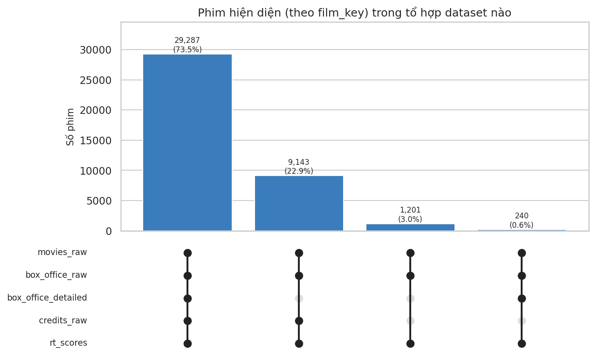

*Hình 11.2 — Phim hiện diện trong tổ hợp bảng nào.*

| Hiện diện | Số phim | % |
|---|---:|---:|
| cả 5 bảng | 29.287 | 73,46% |
| thiếu `box_office_detailed` | 9.143 | 22,93% |
| thiếu `box_office_detailed` và `credits_raw` | 1.201 | 3,01% |
| thiếu `credits_raw` (có detailed) | 240 | 0,60% |

*Hiện diện theo khóa ≠ có dữ liệu thực* (xem 11.3).

### 11.3. Độ phủ thông tin thực (non-null)

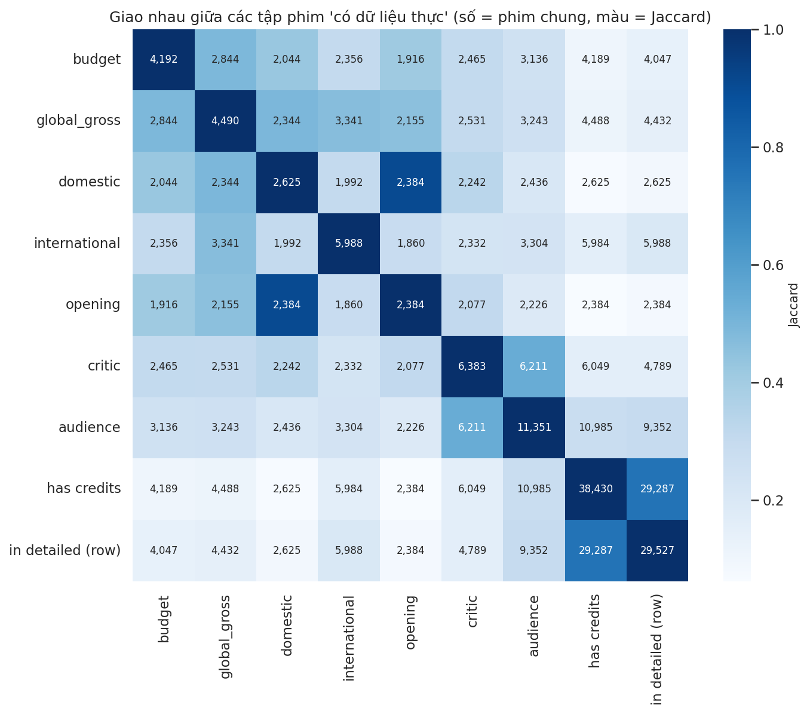

*Hình 11.3 — Số phim chung giữa các tập "có giá trị thực" (màu = Jaccard).*

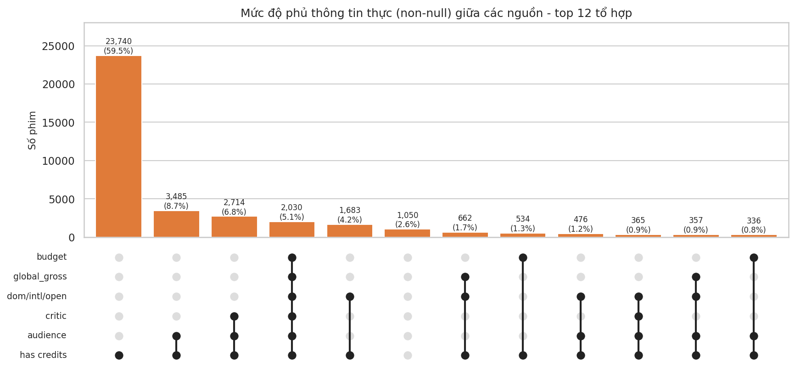

*Hình 11.4 — Tổ hợp nguồn có dữ liệu thực.*

**Finding:** 23.740 phim (59,5%) chỉ có credits mà không có bất kỳ giá trị tài chính/điểm nào; **1.050 phim** không có thông tin thực ở cả 6 nguồn. Phim có budget∩global = 2.844; có thêm critic và audience = 2.154. Mức độ phủ thực mỏng hơn nhiều so với mức hiện diện khóa (73,5% hiện diện đủ 5 bảng).

### 11.4. `box_office_raw` so với `box_office_detailed`: bổ sung hay dư thừa?

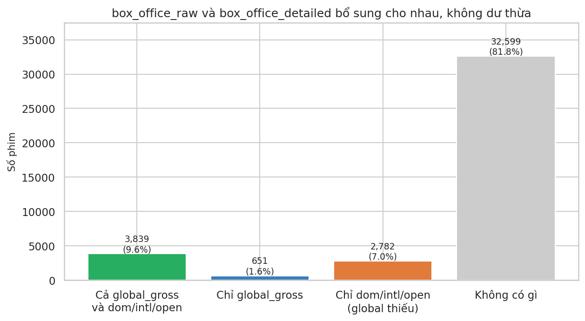

*Hình 11.5 — Phân loại phim theo nguồn doanh thu có giá trị.*

| Tình huống | Số phim |
|---|---:|
| có cả `global_gross` và dom/intl/open | 3.839 |
| chỉ `global_gross` | 651 |
| chỉ dom/intl/open (global thiếu) | 2.782 |
| không có doanh thu ở cả hai | 32.599 |

**Kết luận:** hai bảng **không trùng lặp**: 2.782 phim chỉ có doanh thu ở bảng chi tiết (trong đó 3.996 phim có international nhưng không có domestic), 651 phim chỉ có global. Do đó **không được mặc định bỏ một bảng**.

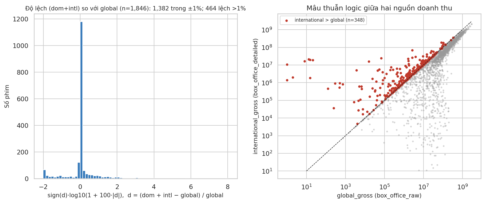

*Hình 11.6 — Trái: độ lệch (dom + intl) so với global. Phải: international vs global.*

| Kiểm tra | Kết quả |
|---|---|
| international > global (>1%) | 348 / 3.341 phim (10,4%) |
| domestic > global (>1%) | 51 / 2.344 |
| \|dom + intl − global\| > 1% | 464 / 1.846 (25,1%): 219 thấp hơn, 245 cao hơn global |
| dom + intl = global (độ lệch < 1e-9) | 886 / 1.846 |
| trong ±1% | 1.382 / 1.846 |
| opening > domestic | 10 / 2.384 |

**Interpretation:** ở đa số phim có đủ 3 biến, global ≈ dom + intl (886 phim khớp chính xác, median độ lệch ~1,4e-6) — gợi ý global được tính từ hai thành phần ở nguồn nhiều phim; nhưng ~25% phim lệch hơn 1%, và 348 phim có phần quốc tế lớn hơn tổng toàn cầu (vô lý về logic). Nguyên nhân (thời điểm thu thập khác nhau, phạm vi thị trường khác, lỗi) **chưa xác định được**. Opening > domestic ở 10 phim cũng vô lý.

### 11.5. Rủi ro tăng dòng khi merge

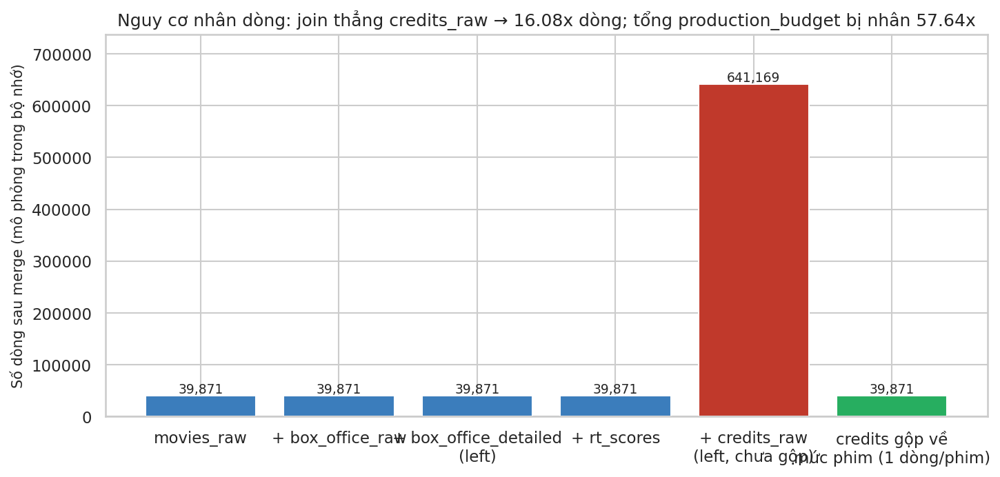

*Hình 11.7 — Số dòng sau các phép merge mô phỏng (trong bộ nhớ).*

- Left join `movies_raw` ⟕ `box_office_raw` ⟕ `box_office_detailed` ⟕ `rt_scores` giữ nguyên **39.871 dòng** (các khóa duy nhất).
- Left join thêm `credits_raw` nguyên bản → **641.169 dòng (16,08×)**; tổng `production_budget` bị nhân **57,64×** vì bom tấn có nhiều dòng credits (một phim có 452 dòng). Tương tự mọi phép tổng/trung bình.
- Chiều ngược lại: join inner với `box_office_detailed` làm mất 25,9% phim (10.344).

---

## 12. Phân tích 5 biểu đồ hiện có

Năm ảnh gốc được lưu nguyên vẹn tại `plots/existing/`. Với mỗi ảnh, các số liệu đã được **tính lại từ dataset** (không đọc số từ hình). Cấu trúc: (1) mục đích; (2) dữ liệu; (3) quan sát; (4) số liệu hỗ trợ; (5) ý nghĩa; (6) vấn đề chất lượng gợi ý; (7) chưa thể kết luận; (8) phân tích bổ sung; (9) liên hệ Data Preparation.

### 12.1. Hình 01 — Tỷ lệ missing theo cột và theo dataset

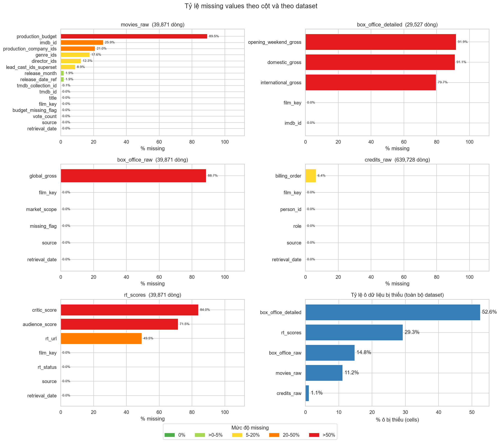

1. **Mục đích:** nhìn nhanh cột nào thiếu và dataset nào thiếu nhiều nhất (thang màu 0% / >0–5% / 5–20% / 20–50% / >50%).
2. **Dữ liệu:** tất cả cột của 5 dataset; panel cuối là % ô thiếu cả bảng.
3. **Quan sát:** cụm đỏ (>50%) gồm `production_budget`, `global_gross`, 3 cột doanh thu chi tiết, 2 điểm RT; cam (20–50%) gồm `imdb_id`, `production_company_ids`, `rt_url`; mọi cột khóa và metadata truy vết đầy đủ.
4. **Số liệu hỗ trợ:** tính lại khớp: 89,49% / 88,74% / 91,11% / 79,72% / 91,93% / 83,99% / 71,53%; `rt_url` 49,46%. Ô thiếu toàn bảng: 52,55% / 29,28% / 14,79% / 11,19% / 1,07%.
5. **Ý nghĩa:** thiếu tập trung ở nhóm biến cốt lõi cho phân tích tài chính, khác với metadata gần đầy đủ — đây là giới hạn chính về mức đại diện của dữ liệu.
6. **Vấn đề gợi ý:** độ phủ thấp; nhưng hình **bỏ cột `theater_count`** (rỗng 100%) khỏi `box_office_detailed` nên con số 52,6% bảng chi tiết **không phải** tỷ lệ của toàn bảng (60,46% khi tính đủ 6 cột).
7. **Chưa kết luận được:** lý do thiếu (chưa thu thập vs không tồn tại), mức độ chồng lấn giữa các cột thiếu (biểu đồ chỉ cho tỷ lệ riêng lẻ), ý nghĩa khác nhau của "thiếu" ở `rt_scores`.
8. **Bổ sung:** pattern thiếu ở mức phim (Hình 5.2–5.4), thiếu theo `vote_count`/thập niên/thể loại (5.5, 5.6, 9.3), phân loại thiếu theo `rt_status` (5.7).
9. **Data Preparation:** không impute mặc định; tạo cờ presence; tách tập Catalog/Financial (S04, S14).

### 12.2. Hình 02 — Phân phối các biến chính

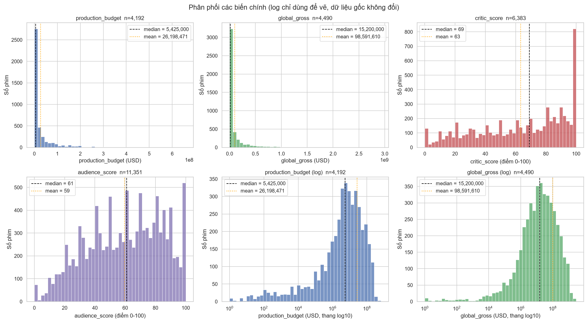

1. **Mục đích:** kiểm tra hình dạng phân phối của budget, global_gross, critic, audience ở thang gốc và thang log.
2. **Dữ liệu:** `production_budget` (n=4.192), `global_gross` (4.490), `critic_score` (6.383), `audience_score` (11.351).
3. **Quan sát:** hai biến tiền dồn sát 0 ở thang gốc, đuôi phải kéo tới 6,6×10^8 và 2,9×10^9; ở thang log tạo hình chuông lệch trái với một "chân" kéo tới 10^0; critic có đỉnh cao tại 100; audience trải rộng, nhiều cột nhọn.
4. **Số liệu hỗ trợ:** hình ghi median/mean đúng với tính lại: budget 5.425.000/26.198.471; global 15.200.000/98.591.610; critic 69/63; audience 61/59. **Các số này mâu thuẫn bảng trong báo cáo cũ** (5.000.000/24.161.424; 2.578.414/16.738.450; 67/61,6).
5. **Ý nghĩa:** mean không đại diện cho giá trị điển hình ở biến tiền (4,83×; 6,49×); thang log phù hợp để quan sát nhưng nhận định "gần đối xứng" của báo cáo cũ cần điều chỉnh vì skewness log là −1,54 và −1,59 (đuôi trái).
6. **Vấn đề gợi ý:** giá trị nhỏ (< 1.000 USD) ở chân trái; dồn cụm ở 0/100 của điểm critic (127 và 729 phim).
7. **Chưa kết luận được:** các giá trị nhỏ là lỗi hay thật; hình đã gộp bin nên không thấy giá trị lặp.
8. **Bổ sung:** ECDF, KDE (Hình 7.1, 7.3), heaping điểm (7.4), kiểm tra giá trị nhỏ và tỷ lệ gross/budget (7.7–7.8).
9. **Data Preparation:** quyết định cách xử lý < 1.000 USD trước khi log (S05–S06, S10); log10 tạo cột mới, không thay cột gốc.

### 12.3. Hình 03 — Boxplot các biến quan trọng

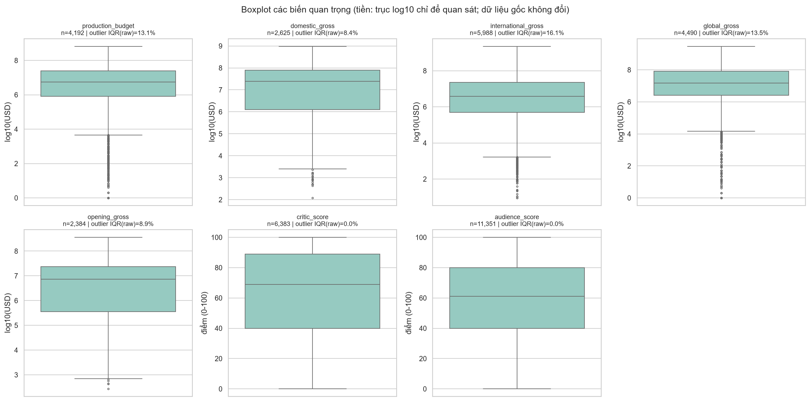

1. **Mục đích:** so sánh phân tán và outlier của 5 biến tiền và 2 điểm RT.
2. **Dữ liệu:** như bảng IQR (§7.2).
3. **Quan sát:** tiền vẽ trên trục log10; hộp tập trung ở 10^6–10^8; **các chấm outlier nằm ở phía dưới** (giá trị nhỏ); điểm RT không có outlier.
4. **Số liệu hỗ trợ:** tiêu đề mỗi panel ghi % outlier **tính trên thang gốc** (13,1% / 8,4% / 16,1% / 13,5% / 8,9%) — các tỷ lệ này tính lại khớp và là outlier **phía cao**. Trên thang log, outlier phía thấp là 290 / 21 / 126 / 134 / 5 và phía cao bằng 0.
5. **Ý nghĩa:** cùng một biến nhưng hai thang đo cho hai nhóm outlier khác nhau: bom tấn (thang gốc) và giá trị cực nhỏ (thang log). Phải xử lý hai nhóm theo hai cách (giữ vs điều tra).
6. **Vấn đề gợi ý:** hình **dễ gây hiểu nhầm** vì tỷ lệ % ở tiêu đề (cao, thang gốc) không phải thứ nhìn thấy trên đồ thị (thấp, thang log).
7. **Chưa kết luận được:** nguồn gốc outlier thấp (xem §7.2); boxplot không chỉ ra giá trị lặp hay cụm giá trị.
8. **Bổ sung:** so sánh IQR raw/log (7.6), ECDF, kiểm tra đối chiếu với ngân sách (7.7–7.8).
9. **Data Preparation:** *không* loại outlier cao; gắn cờ outlier thấp và điều tra (S05–S06, S10).

### 12.4. Hình 04 — Correlation heatmap (Pearson và Spearman)

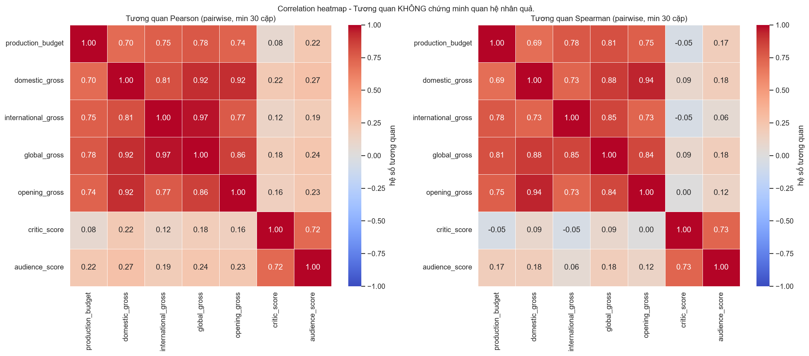

1. **Mục đích:** nhìn tổng thể quan hệ giữa 7 biến số (pairwise, tối thiểu 30 cặp).
2. **Dữ liệu:** budget, domestic, international, global, opening, critic, audience.
3. **Quan sát:** khối doanh thu/ngân sách tương quan cao (0,69–0,97); hai điểm RT tương quan 0,72–0,73 với nhau nhưng rất thấp với doanh thu.
4. **Số liệu hỗ trợ:** tính lại khớp mọi ô kiểm tra (budget~global 0,78/0,81; domestic~opening 0,92/0,94; critic~global 0,18/0,09).
5. **Ý nghĩa:** ngân sách và doanh thu đồng biến mạnh; đa cộng tuyến ở cụm doanh thu; điểm RT gần như độc lập với tiền.
6. **Vấn đề gợi ý:** `domestic~opening` (0,94) và các biến vốn là thành phần của nhau (global ≈ dom + intl) → tương quan "cơ học", không phải bằng chứng độc lập.
7. **Chưa kết luận được:** (i) **n mỗi ô rất khác nhau** (1.860–11.351) nhưng hình không ghi n; (ii) `international~global` Pearson 0,97 so với Spearman 0,85 và Pearson(log) 0,70 — chênh lớn do leverage của bom tấn và xung đột nguồn; (iii) không có kiểm tra log hay phân tầng; (iv) không suy ra nhân quả.
8. **Bổ sung:** ma trận Spearman kèm n (Hình 10.7), so sánh 3 thước đo (10.6), ổn định theo thời kỳ/mẫu (10.2), VIF.
9. **Data Preparation:** chọn một trong `domestic`/`opening` hoặc dùng chính quy hóa khi mô hình hóa; mô tả mẫu cho từng hệ số (S10, S14).

### 12.5. Hình 05 — Tích hợp và độ phủ dữ liệu

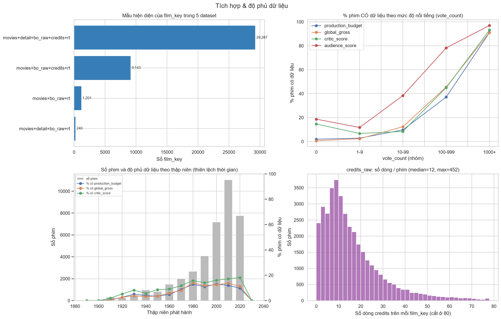

1. **Mục đích:** bốn góc nhìn: hiện diện khóa, độ phủ theo vote_count, theo thập niên, số dòng credits/phim.
2. **Dữ liệu:** `film_key` của 5 bảng; `vote_count`; `release_date_ref`; `credits_raw`.
3. **Quan sát:** (trái-trên) 4 tổ hợp hiện diện; (phải-trên) độ phủ tăng mạnh theo vote_count; (trái-dưới) số phim tăng rất mạnh đến 2010s rồi giảm, độ phủ thấp (<20%) và giảm về 0 ở thập niên 2030; (phải-dưới) lệch phải, median 12, max 452.
4. **Số liệu hỗ trợ:** 29.287/9.143/1.201/240 khớp; độ phủ theo vote_count của hình **khớp tính lại** (ví dụ ≥1.000 vote: 91,0% budget; 97,0% audience) và **không khớp bảng trong báo cáo cũ**; max 452 khớp tính lại (báo cáo cũ ghi 451).
5. **Ý nghĩa:** phát hiện cốt lõi về thiên lệch lựa chọn nằm ở panel phải-trên; panel trái-dưới cho thấy độ phủ không "tăng vọt sau 2000".
6. **Vấn đề gợi ý:** thiên lệch lựa chọn; thiên lệch thời gian; nguy cơ nhân dòng khi join credits; thập niên "2030" gồm 2 phim ngày tương lai.
7. **Chưa kết luận được:** panel trái-trên chỉ nói khóa **hiện diện**, không nói có dữ liệu thực (23.740 phim chỉ có credits); histogram cắt ở 80 nên ẩn đuôi (max 452); không cho biết cơ chế thiếu.
8. **Bổ sung:** UpSet thông tin thực (11.4), giao nhau (11.3), mô phỏng merge (11.7), kiểm tra Jan-1 và ngày tương lai (9.1–9.2).
9. **Data Preparation:** aggregate credits trước join; kiểm soát số dòng; phân tầng theo vote_count/thập niên (S07, S12–S14).

---

## 13. Biểu đồ bổ sung và phát hiện mới

Đã tạo **41 biểu đồ mới** (script chạy 0 lỗi), lưu theo chủ đề trong `plots/`. Phần lớn được nhúng và diễn giải tại vị trí phù hợp (cột "Mục"). Mỗi biểu đồ trả lời một câu hỏi cụ thể mà 5 hình gốc chưa trả lời.

| Thư mục / Hình | Câu hỏi | Loại biểu đồ (lý do) | Phát hiện chính | Mục |
|---|---|---|---|---|
| missing_values/mv_01 | Cột nào thiếu nhiều nhất, trên mọi dataset? | Thanh ngang xếp hạng, màu theo dataset (so sánh trực tiếp) | 7 biến ≥71,5% thiếu | 5.1 |
| missing_values/mv_02 | Thiếu có theo khối không? | Heatmap nhị phân ở mức phim (thấy cấu trúc) | Thiếu theo cụm, cùng vắng | 5.2 |
| missing_values/mv_03 | Một phim có bao nhiêu biến? | Cột đếm (phân phối độ đầy đủ) | 62,18% phim không có biến nào; 3,72% đủ 7 | 5.2 |
| missing_values/mv_04 | Tổ hợp biến nào đi cùng nhau? | UpSet (giao nhau nhiều tập) | Chỉ 5,09% có đủ 5 nhóm biến | 5.2 |
| missing_values/mv_05 | "Thiếu điểm" nghĩa là gì? | Thanh chồng theo `rt_status` | 3 loại thiếu khác nghĩa | 5.5 |
| missing_values/mv_06 | Thiếu có liên quan độ nổi tiếng? | Đường + boxplot | 1,9% → 91,0%; median vote 324 vs 2 | 5.4 |
| missing_values/mv_07 | Thiếu có khác theo thể loại? | Thanh nhóm | Doc 3,8% vs Thriller 26,8% | 5.4 |
| numerical_distributions/num_01 | Dải giá trị và đuôi trái? | ECDF thang log | 9 bậc độ lớn | 7.1 |
| numerical_distributions/num_02 | Mean/Median và skew trước-sau log? | Thanh | Skew đổi dấu sau log | 7.1 |
| numerical_distributions/num_03 | Hình dạng log của 5 biến? | KDE chồng | Đỉnh 10^6–10^8, chân trái | 7.1 |
| numerical_distributions/num_04 | Điểm RT có dồn cụm? | Histogram 1 điểm/bin | critic=100: 11,42% | 7.1 |
| numerical_distributions/num_05 | Phim nổi tiếng chiếm bao nhiêu vote? | Histogram + tích lũy | top 1% = 52% vote | 7.1 |
| outliers/out_01 | Giá trị nhỏ là lỗi đơn vị hay placeholder? | Thanh + scatter log-log + số tròn | Không giống lỗi triệu USD | 7.2 |
| outliers/out_02 | Tỷ lệ gross/budget có cực đoan? | Histogram log-tỷ lệ | 467 phim < 1×; 43 > 100× | 7.2 |
| outliers/out_03 | Outlier raw vs log khác nhau thế nào? | Thanh nhóm | Cao (raw) ↔ thấp (log) | 7.2 |
| outliers/out_04 | Điểm biên có đi với ít vote? | Đường median theo bin | Median vote 1 vs 118 | 7.2 |
| categorical/cat_01 | Phân bố thể loại? | Thanh ngang top-N | Comedy 14,79%; top10 76,65% | 8.1 |
| categorical/cat_02 | Mỗi ô đa trị có bao nhiêu giá trị? | 4 histogram | tối đa 10/35/42/20 | 8.2 |
| categorical/cat_03 | Mức độ tập trung? | Đường tích lũy | 47,4% đạo diễn chỉ 1 lần | 8.2 |
| categorical/cat_04 | Kích thước nhóm collection? | Histogram log-log + top 10 | 9.728 nhóm; max 148 | 8.3 |
| categorical/cat_05 | Tổ hợp thể loại có nhất quán? | Thanh top-15 | 3.833 chuỗi vs 1.573 tập | 8.1 |
| categorical/cat_06 | Cấu trúc credits? | Thanh + histogram | median 12; max 452 | 8.4 |
| dates/date_01 | Phân bố năm + ngày tương lai? | Thanh theo năm | 200 phim sau 2026-10-22 | 9 |
| dates/date_02 | Độ phủ theo thập niên? | Thanh + đường | Không tăng vọt sau 2000 | 9 |
| dates/date_03 | Có ngày mặc định 01-01? | Đường + thanh tháng | 6,26% vs 0,27% | 9 |
| dates/date_04 | Xu hướng median theo năm? | Đường log (n ≥ 20/năm) | Danh nghĩa, thiên lệch mẫu | 9 |
| correlations/cor_01 | Budget–global có bền? | Hexbin log-log | ρ=0,81; đám giá trị nhỏ tách | 10 |
| correlations/cor_02 | Quan hệ trong họ doanh thu? | 3 scatter log-log | opening~domestic ρ=0,94 | 10 |
| correlations/cor_03 | Critic và audience đồng thuận? | Hexbin | r=0,72 | 10 |
| correlations/cor_04 | Điểm có tách doanh thu? | Boxplot theo bin | Không đơn điệu | 10 |
| correlations/cor_05 | Thước đo ảnh hưởng kết luận? | Thanh nhóm 3 thước đo | international~global 0,97/0,85/0,70 | 10 |
| correlations/cor_06 | Tương quan có ổn định? | Thanh theo thời kỳ/mẫu | 0,61 → 0,87 theo thời kỳ | 10 |
| correlations/cor_07 | n mỗi ô tương quan? | Heatmap kèm n | n từ 1.860 đến 11.351 | 10 |
| cross_dataset/xd_01 | Dòng vs khóa duy nhất? | Thanh log | Chỉ credits 1-N | 11 |
| cross_dataset/xd_02 | Giao nhau thông tin thực? | Heatmap Jaccard + số | Mỏng hơn hiện diện khóa | 11 |
| cross_dataset/xd_03 | Hiện diện khóa? | UpSet | 73,46% đủ 5 bảng | 11 |
| cross_dataset/xd_04 | Hai nguồn doanh thu dư thừa? | Thanh | Không: 2.782 chỉ có detailed | 11 |
| cross_dataset/xd_05 | Hai nguồn mâu thuẫn? | Histogram + scatter | 348, 464 phim | 11 |
| cross_dataset/xd_06 | Merge có nhân dòng? | Thanh mô phỏng | 641.169 dòng; 57,64× tổng | 11 |
| cross_dataset/xd_07 | Quan hệ bảng | Sơ đồ | 1-1 / 1-N | 3 |
| cross_dataset/xd_08 | Tổ hợp nguồn có dữ liệu thực | UpSet | 23.740 phim chỉ có credits | 11 |

*Không tạo thêm* biểu đồ trùng lặp: ví dụ không vẽ thêm bar chart missing theo bảng (đã có ở Hình 01), và không vẽ phân phối theo từng thể loại vì mẫu có dữ liệu quá nhỏ ở nhiều thể loại để so sánh đáng tin.

---

## 14. Tổng hợp vấn đề chất lượng dữ liệu

Phân loại **Trạng thái**: *Đã xác nhận* (số liệu trực tiếp); *Dấu hiệu — cần điều tra* (bất thường, chưa rõ nguyên nhân); *Rủi ro* (chỉ xác minh được khi thực hiện bước sau). **Mức ưu tiên** dựa trên (a) độ nghiêm trọng, (b) phạm vi ảnh hưởng, (c) vai trò trong pipeline (vấn đề chặn các bước sau = HIGH). Đặc điểm tự nhiên của dữ liệu (outlier bom tấn, đa cộng tuyến) **không** được liệt kê như lỗi.

### 14.1. Bảng tóm tắt

| ID | Dataset | Column / Key | Finding | Priority | Status |
|---|---|---|---|---|---|
| DQ-01 | movies_raw, box_office_raw, box_office_detailed, rt_scores | production_budget, global_gross, domestic_gross, international_gross, opening_weekend_gross, critic_score, audience_score | Các biến tài chính và điểm RT thiếu rất nhiều (79,7%–91,9%; audience_score 71,5%) | HIGH | Đã xác nhận |
| DQ-02 | tất cả (liên bảng) | vote_count ~ missingness | Missingness gắn chặt với mức độ nổi tiếng (vote_count): phim nhiều vote có dữ liệu hơn hẳn | HIGH | Đã xác nhận mối liên hệ; cơ chế chưa xác định |
| DQ-03 | box_office_detailed | domestic_gross, international_gross, opening_weekend_gross | Phần lớn dòng chỉ có film_key + imdb_id ('dòng vỏ rỗng') | MEDIUM | Đã xác nhận |
| DQ-04 | box_office_detailed | theater_count | Cột rỗng 100% (0 giá trị) - báo cáo cũ không ghi nhận (ghi 5 cột) | LOW | Đã xác nhận |
| DQ-05 | movies_raw, box_office_raw, box_office_detailed | production_budget, global_gross, international_gross | Có nhiều giá trị tiền cực nhỏ (< 1.000 USD) khó phù hợp phim chiếu rạp thương mại; giả thuyết 'sai đơn vị' không được ủng hộ (gross cũng cực nhỏ), còn lại placeholder / phim vô danh - chưa chứng minh | HIGH | Dấu hiệu bất thường - cần điều tra |
| DQ-06 | box_office_raw vs box_office_detailed | global_gross vs international_gross/domestic_gross | Hai nguồn doanh thu mâu thuẫn ở một số phim | HIGH | Đã xác nhận mâu thuẫn; nguyên nhân chưa xác định |
| DQ-07 | credits_raw ↔ movies_raw | film_key | Quan hệ 1-N: join trực tiếp làm nhân dòng và nhân bội các tổng | HIGH | Rủi ro đã đo (mô phỏng) |
| DQ-08 | credits_raw | (film_key, person_id, role), billing_order | Cùng một người lặp trong cùng vai trò của cùng một phim (khác billing_order) | MEDIUM | Đã xác nhận trùng; quy tắc xử lý cần quyết định |
| DQ-09 | movies_raw | genre_ids, director_ids, lead_cast_ids_superset, production_company_ids | Trường đa trị phân tách bằng '\|' trong một ô; thứ tự không chuẩn hóa; chỉ có ID, không có tên | MEDIUM | Đã xác nhận |
| DQ-10 | movies_raw | director_ids, lead_cast_ids_superset ↔ credits_raw | director_ids là thông tin có thể suy ra từ credits_raw (trùng 100%); lead_cast_ids_superset là tập con ≤ 20 diễn viên | LOW | Đã xác nhận (đối chiếu) |
| DQ-11 | movies_raw | release_date_ref, release_month | Ngày thiếu, ngày ở tương lai so với thời điểm thu thập và dồn cụm ngày 01-01 | MEDIUM | Đã xác nhận (nguyên nhân 01-01 là giả thuyết) |
| DQ-12 | movies_raw + box_office + rt_scores | release_date_ref, tiền tệ | Thiên lệch thời gian và giá trị danh nghĩa (chưa điều chỉnh lạm phát) | MEDIUM | Đã xác nhận quan sát; cần quyết định |
| DQ-13 | rt_scores | critic_score, audience_score, rt_status, rt_url | Thiếu điểm có nhiều ý nghĩa khác nhau (không tìm thấy trên RT / có trang nhưng không có điểm) | MEDIUM | Đã xác nhận |
| DQ-14 | rt_scores | critic_score | Điểm dồn ở biên 0/100 (phim ít review - giả thuyết) | LOW | Dấu hiệu - cần dữ liệu bổ sung |
| DQ-15 | box_office_detailed | domestic_gross, opening_weekend_gross | Đa cộng tuyến rất cao giữa các biến doanh thu (đặc tính dữ liệu, không phải lỗi) | MEDIUM | Đã xác nhận (đặc tính) |
| DQ-16 | movies_raw | tmdb_collection_id | Gần như mọi phim đều có collection id; ý nghĩa của trường chưa rõ | MEDIUM | Cần điều tra |
| DQ-17 | movies_raw | title | Title trùng giữa các phim khác nhau; 1 nhóm trùng cả title lẫn ngày | LOW | Đã xác nhận / nghi vấn nhỏ |
| DQ-18 | movies_raw, box_office_raw, credits_raw, rt_scores | source, retrieval_date, market_scope, budget_missing_flag, missing_flag | Cột hằng số hoặc cờ dư thừa so với null | LOW | Đã xác nhận |
| DQ-19 | BAO_CAO cũ | số liệu thống kê trong báo cáo phiên bản trước | Một số số liệu của báo cáo cũ không khớp dữ liệu thật | HIGH | Đã xác nhận |

### 14.2. Bảng chi tiết

| ID | Dataset | Column / Key | Finding | Evidence | Potential Impact | Priority | Recommended Action | Validation Criteria | Status |
|---|---|---|---|---|---|---|---|---|---|
| DQ-01 | movies_raw, box_office_raw, box_office_detailed, rt_scores | production_budget, global_gross, domestic_gross, international_gross, opening_weekend_gross, critic_score, audience_score | Các biến tài chính và điểm RT thiếu rất nhiều (79,7%–91,9%; audience_score 71,5%) | budget 89.49%; global 88.74%; domestic 91.11%; intl 79.72%; opening 91.93%; critic 83.99%; audience 71.53%. Chỉ 2,844 phim có đồng thời budget+global (7.1%); 2,154 phim đủ 4 biến | Mọi phân tích ROI/lợi nhuận chỉ áp dụng cho ~7% phim; không suy rộng được cho toàn catalog | HIGH | Chia 2 tập: Catalog (giữ 39.871 phim + cờ has_*) và Financial (complete-case). Không impute hàng loạt khi chưa quyết định nghiệp vụ | Số phim mỗi tập khớp bảng theo dõi; mọi báo cáo ghi rõ n và tập mẫu | Đã xác nhận |
| DQ-02 | tất cả (liên bảng) | vote_count ~ missingness | Missingness gắn chặt với mức độ nổi tiếng (vote_count): phim nhiều vote có dữ liệu hơn hẳn | Median vote phim CÓ budget=324 vs THIẾU=2; coverage budget từ 1.9% (0 vote) lên 91.0% (≥1000 vote); rank-biserial=0.749 | Mẫu có dữ liệu là mẫu thiên lệch về phim phổ biến → kết luận không đại diện cho phim ít vote; loại trừ MCAR cho biến quan sát được nhưng chưa phân biệt được MAR vs MNAR | HIGH | Báo cáo kết quả theo phân tầng vote_count; kiểm tra độ nhạy; chỉ chọn mô hình impute sau khi thống nhất giả định | So sánh phân phối vote_count/năm/thể loại giữa mẫu complete-case và catalog; ghi vào tài liệu giới hạn | Đã xác nhận mối liên hệ; cơ chế chưa xác định |
| DQ-03 | box_office_detailed | domestic_gross, international_gross, opening_weekend_gross | Phần lớn dòng chỉ có film_key + imdb_id ('dòng vỏ rỗng') | 22,906/29,527 dòng (77.58%) không có giá trị nào trong 3 cột doanh thu | Đếm 'phim có doanh thu chi tiết' theo số dòng sẽ sai gấp ~4,5 lần; join làm tăng tưởng tượng về độ phủ | MEDIUM | Tạo cờ has_detail_values; đếm coverage theo giá trị non-null; giữ nguyên dòng ở nguồn | Coverage báo cáo = 6.621 phim (29.527 − 22.906), không phải 29.527 | Đã xác nhận |
| DQ-04 | box_office_detailed | theater_count | Cột rỗng 100% (0 giá trị) - báo cáo cũ không ghi nhận (ghi 5 cột) | Missing 100.0%; dtype float64; 0 giá trị duy nhất | Không mang thông tin; làm sai tỷ lệ missing tổng của bảng (60,46% vs 52,55% khi bỏ cột này) | LOW | Đề xuất loại khỏi tập phân tích sau khi xác nhận với nguồn rằng không có dữ liệu | Schema sau xử lý không còn cột rỗng; ghi lý do trong log | Đã xác nhận |
| DQ-05 | movies_raw, box_office_raw, box_office_detailed | production_budget, global_gross, international_gross | Có nhiều giá trị tiền cực nhỏ (< 1.000 USD) khó phù hợp phim chiếu rạp thương mại; giả thuyết 'sai đơn vị' không được ủng hộ (gross cũng cực nhỏ), còn lại placeholder / phim vô danh - chưa chứng minh | budget <1000: 225 (<100: 103); global <1000: 73; intl <1000: 91; dom <1000: 12; opening <1000: 14. Trong 48 phim budget<1000 có global_gross, 4.2% có global ≥ 1 triệu | Làm sai ROI, log-transform (log10(1)=0), tạo đuôi trái nặng; tỷ lệ gross/budget có giá trị phi thực tế | HIGH | Gắn cờ (không xóa) → điều tra nguồn gốc (placeholder vs đơn vị) → quyết định sửa/loại/giữ theo từng nhóm | Danh sách phim bị gắn cờ + kết luận từng nhóm; phân phối log10 không còn đuôi trái phi lý nếu có sửa | Dấu hiệu bất thường - cần điều tra |
| DQ-06 | box_office_raw vs box_office_detailed | global_gross vs international_gross/domestic_gross | Hai nguồn doanh thu mâu thuẫn ở một số phim | intl > global (>1%): 348/3,341; domestic > global: 51/2,344; \|dom+intl−global\| > 1%: 464/1,846; còn lại 1,382 khớp (median lệch 1.4e-06); opening > domestic: 10 | Dùng nguồn nào cho 'doanh thu' sẽ thay đổi kết quả; tổng hợp dom+intl không thay thế được global ở mọi phim | HIGH | Chọn một nguồn chuẩn cho từng mục tiêu (cần quyết định nghiệp vụ); ghi cờ conflict_flag; không tự ghi đè | Số phim conflict được liệt kê; quy tắc ưu tiên nguồn được phê duyệt bằng văn bản | Đã xác nhận mâu thuẫn; nguyên nhân chưa xác định |
| DQ-07 | credits_raw ↔ movies_raw | film_key | Quan hệ 1-N: join trực tiếp làm nhân dòng và nhân bội các tổng | Left join movies→credits = 641,169 dòng (16.08x); tổng production_budget bị nhân 57.64x; 1,441 phim không có credits | Sai tổng/trung bình, thiên lệch về phim có nhiều credits | HIGH | Gộp credits về mức phim (aggregate) TRƯỚC khi merge; kiểm tra rows_after == rows_before | len(merged) == 39.871 và film_key duy nhất sau merge | Rủi ro đã đo (mô phỏng) |
| DQ-08 | credits_raw | (film_key, person_id, role), billing_order | Cùng một người lặp trong cùng vai trò của cùng một phim (khác billing_order) | 1,021 dòng dư ({'cast': 1021}); 3 dòng trùng (film_key, billing_order) trong cast; billing_order thiếu 100% ở director (do thiết kế) | Đếm cast_count bị thổi phồng; ảnh hưởng đặc trưng top-billed | MEDIUM | Điều tra mẫu → quy tắc giữ billing_order nhỏ nhất (cần xác nhận) trước khi khử trùng | Không còn khóa (film_key, person_id, role) lặp; log dòng bị loại | Đã xác nhận trùng; quy tắc xử lý cần quyết định |
| DQ-09 | movies_raw | genre_ids, director_ids, lead_cast_ids_superset, production_company_ids | Trường đa trị phân tách bằng '\|' trong một ô; thứ tự không chuẩn hóa; chỉ có ID, không có tên | genre_ids: 3,833 chuỗi/1,573 tập, 38.4% ô không sắp thứ tự; director_ids: 13,002 chuỗi/12,741 tập, 5.2% ô không sắp thứ tự; lead_cast_ids_superset: 34,535 chuỗi/34,291 tập, 90.1% ô không sắp thứ tự; production_company_ids: 14,348 chuỗi/13,531 tập, 24.9% ô không sắp thứ tự | Group-by chuỗi ô sẽ tách cùng một tổ hợp thành nhiều nhóm; không thể đếm theo thể loại/đạo diễn nếu chưa explode | MEDIUM | Tách thành bảng quan hệ (movie-genre, movie-director, ...) trong bước chuẩn bị, không sửa cột gốc; cần bảng tra cứu tên | Số token sau explode = tổng token đếm được; mọi id có trong bảng tra cứu | Đã xác nhận |
| DQ-10 | movies_raw | director_ids, lead_cast_ids_superset ↔ credits_raw | director_ids là thông tin có thể suy ra từ credits_raw (trùng 100%); lead_cast_ids_superset là tập con ≤ 20 diễn viên | director_ids non-null=34,963; khớp tập hợp với credits: 34,963/34,963; max lead cast=20 | Nguy cơ dùng trùng hai nguồn cho cùng một thông tin; lead_cast bị cắt ≤ 20 | LOW | Chọn credits_raw làm nguồn chuẩn cho đạo diễn/diễn viên (đề xuất); giữ movies_raw cho kiểm tra chéo | Sau aggregate: số đạo diễn khớp giữa hai nguồn | Đã xác nhận (đối chiếu) |
| DQ-11 | movies_raw | release_date_ref, release_month | Ngày thiếu, ngày ở tương lai so với thời điểm thu thập và dồn cụm ngày 01-01 | Thiếu 754 (1.89%); 200 phim sau 2026-10-22 (124 phim từ năm 2027); 01-01: 2,447 phim = 6.26% (kỳ vọng ~0.27%); trong phim tương lai có budget=19, global=0 | Phân tích theo năm/tháng sai; 01-01 có thể là ngày mặc định khi chỉ biết năm; phim chưa phát hành không nên có doanh thu | MEDIUM | Gắn cờ date_is_jan1, date_after_retrieval, date_missing; thống nhất cách xử lý theo mục tiêu phân tích | Cờ khớp số đếm EDA; phân tích theo tháng loại 01-01 hoặc ghi chú | Đã xác nhận (nguyên nhân 01-01 là giả thuyết) |
| DQ-12 | movies_raw + box_office + rt_scores | release_date_ref, tiền tệ | Thiên lệch thời gian và giá trị danh nghĩa (chưa điều chỉnh lạm phát) | 6,400 phim trước 1980 (16.36% phim có ngày) với coverage budget ≤ 9% ở các thập niên trước 1980; coverage không tăng vọt sau 2000 mà ổn định ~10–14% và giảm ở 2020s | So sánh doanh thu giữa các thập niên theo USD danh nghĩa sai lệch | MEDIUM | Quyết định nghiệp vụ: có cần quy đổi theo CPI không (cần nguồn CPI ngoài dataset); lọc/phân tầng theo thập niên | Tài liệu ghi rõ danh nghĩa/thực; phân tầng theo era | Đã xác nhận quan sát; cần quyết định |
| DQ-13 | rt_scores | critic_score, audience_score, rt_status, rt_url | Thiếu điểm có nhiều ý nghĩa khác nhau (không tìm thấy trên RT / có trang nhưng không có điểm) | rt_status: {'UNMATCHED': 19719, 'MATCHED': 11521, 'MATCHED_NO_SCORES': 8629, 'SEARCH_ONLY': 2}; rt_url thiếu = 19,721 (UNMATCHED + SEARCH_ONLY) | Gộp mọi NaN thành một loại sẽ lẫn 'chưa khớp' với 'khớp nhưng chưa có điểm' | MEDIUM | Giữ rt_status làm biến phân loại trạng thái; tách các nhóm missing khi báo cáo | Mỗi NaN của điểm được gán một trong các nguyên nhân từ rt_status | Đã xác nhận |
| DQ-14 | rt_scores | critic_score | Điểm dồn ở biên 0/100 (phim ít review - giả thuyết) | critic=0: 127; critic=100: 729 (11.42%); bội số của 10: 25.3% (kỳ vọng ~10%); median vote_count (TMDB) ở biên 1 vs 118 ở giữa | Điểm biên kém tin cậy; không có số review RT để kiểm chứng | LOW | Thu thập thêm số lượng review nếu có nguồn; trước mắt gắn cờ score_at_boundary | Cờ khớp số đếm; ghi giới hạn trong báo cáo | Dấu hiệu - cần dữ liệu bổ sung |
| DQ-15 | box_office_detailed | domestic_gross, opening_weekend_gross | Đa cộng tuyến rất cao giữa các biến doanh thu (đặc tính dữ liệu, không phải lỗi) | Spearman domestic~opening = 0.94; VIF (log10, n=1,496): domestic 7.3, opening 7.62 | Hệ số hồi quy bất ổn nếu đưa cả hai vào mô hình tuyến tính | MEDIUM | Chọn một biến hoặc dùng chính quy hóa/PCA ở bước mô hình hóa (không xử lý ở bước làm sạch) | VIF < 5 trên bộ biến cuối cùng | Đã xác nhận (đặc tính) |
| DQ-16 | movies_raw | tmdb_collection_id | Gần như mọi phim đều có collection id; ý nghĩa của trường chưa rõ | 39,841/39.871 phim có giá trị; 9,728 nhóm; median 3 phim/nhóm; 10 nhóm 1 phim; max 148 | Nếu dùng làm nhóm nhượng quyền (franchise) mà ý nghĩa là khác → sai kết luận | MEDIUM | Xác minh định nghĩa trường với người thu thập dữ liệu; kiểm tra thủ công mẫu nhóm lớn nhất | Biên bản xác nhận ý nghĩa; kiểm tra ngẫu nhiên 30 nhóm | Cần điều tra |
| DQ-17 | movies_raw | title | Title trùng giữa các phim khác nhau; 1 nhóm trùng cả title lẫn ngày | 652 dòng có title trùng; 1 nhóm cùng title + cùng ngày; 8.74% title có ký tự phi-ASCII | Không được dùng title làm khóa; chuẩn hóa tên tùy tiện có thể gộp nhầm | LOW | Dùng film_key làm định danh; điều tra thủ công nhóm cùng title+ngày | film_key vẫn duy nhất; danh sách nhóm nghi trùng được xem xét | Đã xác nhận / nghi vấn nhỏ |
| DQ-18 | movies_raw, box_office_raw, credits_raw, rt_scores | source, retrieval_date, market_scope, budget_missing_flag, missing_flag | Cột hằng số hoặc cờ dư thừa so với null | Cột có ≤1 giá trị duy nhất: [['movies_raw', 'source', 1], ['movies_raw', 'retrieval_date', 1], ['box_office_raw', 'market_scope', 1], ['box_office_raw', 'source', 1], ['box_office_raw', 'retrieval_date', 1], ['box_office_detailed', 'theater_count', 0], ['credits_raw', 'source', 1], ['credits_raw', 'retrieval_date', 1], ['rt_scores', 'source', 1], ['rt_scores', 'retrieval_date', 1]]; budget_missing_flag và missing_flag khớp 100% với trạng thái null của budget/global_gross | Không thêm thông tin; rủi ro hiểu nhầm cờ là biến dự báo | LOW | Giữ làm metadata truy vết; loại khỏi tập đặc trưng khi mô hình hóa | Không còn cột hằng số trong tập phân tích | Đã xác nhận |
| DQ-19 | BAO_CAO cũ | số liệu thống kê trong báo cáo phiên bản trước | Một số số liệu của báo cáo cũ không khớp dữ liệu thật | Xem bảng 'Đối chiếu báo cáo cũ' (reports/old_report_discrepancies.csv) | Kết luận dựa trên số liệu sai có thể dẫn quyết định sai | HIGH | Chỉ dùng số liệu của phiên bản này; giữ nguyên file cũ để đối chiếu | Mọi số liệu trong báo cáo mới truy được tới reports/*.csv | Đã xác nhận |

*Bản CSV: `reports/data_quality_issues.csv`.*

**Đặc điểm KHÔNG coi là lỗi:** outlier cao (bom tấn); lệch phải của biến tiền; Mean ≫ Median; đa cộng tuyến (DQ-15 chỉ là cảnh báo cho giai đoạn mô hình); `billing_order` thiếu ở director; quan hệ 1-N của credits; title trùng giữa các phim khác nhau; `rt_scores` UNMATCHED.

---

## 15. Kết luận Data Understanding

**1. Chất lượng tổng thể.** Năm dataset có **cấu trúc tốt, nội dung thưa và thiên lệch**. Khóa `film_key` đạt yêu cầu (duy nhất, không mồ côi, định dạng đồng nhất, quan hệ 1-1 và 1-N rõ ràng); kiểu số đọc sạch; không có token nhiễu ở cột số. Ngược lại, các biến mang ý nghĩa phân tích (tiền, điểm RT) thiếu 71,5–91,9%, và phim có dữ liệu là mẫu có chọn lọc.

**2. Đặc điểm quan trọng nhất.** (a) Tập hợp phim là một "catalog" rộng: 28,1% phim không có vote nào, median vote chỉ 3, phần lớn phim chỉ có metadata; (b) một lõi nhỏ phim phổ biến (≈ 4,1% có ≥ 1.000 vote) có dữ liệu gần đầy đủ (≈ 81–97% độ phủ tùy biến); (c) biến tiền lệch phải cực đoan, dải trải 9 bậc độ lớn; (d) ngân sách là ước lượng làm tròn (52% bội số của 1 triệu), doanh thu chính xác hơn; (e) ngân sách và doanh thu đồng biến mạnh (ρ ≈ 0,81) và ổn định theo mẫu, còn điểm RT gần như không liên quan tuyến tính với doanh thu (ρ 0,09–0,18).

**3. Vấn đề nghiêm trọng nhất.** (i) Độ phủ tài chính thấp và thiên lệch theo độ nổi tiếng (DQ-01, DQ-02); (ii) giá trị tiền cực nhỏ chưa rõ bản chất (DQ-05); (iii) hai nguồn doanh thu bổ sung nhau nhưng mâu thuẫn (DQ-06); (iv) merge `credits_raw` nhân dòng 16,08× và nhân tổng 57,64× (DQ-07); (v) số liệu báo cáo cũ không đáng tin ở nhiều chỗ (DQ-19).

**4. Dataset/cột cần ưu tiên.** `movies_raw.production_budget`, `box_office_raw.global_gross`, 3 cột doanh thu của `box_office_detailed`, `credits_raw` (trùng và aggregate), `movies_raw.release_date_ref`, `rt_scores.rt_status`.

**5. Ảnh hưởng đến độ tin cậy phân tích doanh thu/ngân sách/điểm.** Mọi kết luận về ROI, quan hệ budget–gross hoặc điểm–doanh thu chỉ có hiệu lực cho tập 2.844 phim (7,13%) (hoặc 2.154 cho phân tích kèm 2 điểm), vốn nghiêng về phim phổ biến, USD danh nghĩa, ngân sách làm tròn và một số giá trị nghi ngờ; chưa đại diện cho toàn bộ catalog.

**6. Ảnh hưởng đến tích hợp.** Credits 1-N; hai nguồn doanh thu mâu thuẫn; trường đa trị lưu dưới dạng chuỗi không chuẩn thứ tự (38,4% genre); nguy cơ dùng `imdb_id` làm khóa phụ bị hổng (25,92% thiếu ở movies); `tmdb_collection_id` có ý nghĩa chưa xác định.

**7. Có thể xử lý bằng quy tắc kỹ thuật xác định.** Ép kiểu ngày; tách trường đa trị; chuẩn hóa thứ tự token genre; cờ presence (has_budget...); aggregate credits (số cast, số director); gắn cờ ngày 01-01/ngày sau thời điểm thu thập/giá trị < 1.000; kiểm tra rows_before == rows_after; loại cột hằng số khỏi tập đặc trưng.

**8. Cần kiểm tra nguồn hoặc quyết định nghiệp vụ.** Giá trị < 1.000 USD là gì; nguồn doanh thu chuẩn khi mâu thuẫn; quy tắc xử lý credits trùng (giữ billing_order nào); ngày 01-01 có phải mặc định; ý nghĩa `tmdb_collection_id`; có cần quy đổi theo lạm phát; `theater_count` thật sự không có dữ liệu?

**9. Chưa đủ bằng chứng để chọn phương pháp.** Cơ chế thiếu (MAR hay MNAR) nên chưa thể chọn phương pháp impute; nguyên nhân mâu thuẫn doanh thu; độ tin cậy điểm biên; xử lý 200 phim tương lai (giữ ngân sách, bỏ điểm?).

**10. Điều kiện trước khi chuyển sang Data Preparation.** (1) Xác nhận mục tiêu phân tích (xác định tập con cần dùng); (2) phê duyệt quy tắc nguồn doanh thu chuẩn; (3) có kết quả điều tra mẫu cho nhóm giá trị < 1.000; (4) chốt quy tắc dedupe credits; (5) có bảng tra cứu tên genre/(tùy chọn) nhân sự; (6) thống nhất cách báo cáo phân tầng theo `vote_count`; (7) snapshot (hash) 5 file gốc để bảo đảm tái lập.

**Thông điệp tổng kết:** dữ liệu *đủ để phân tích mô tả toàn catalog* và *đủ để khám phá ban đầu* quan hệ ngân sách–doanh thu trên lõi phim phổ biến, nhưng **chưa đủ để suy rộng kết luận tài chính cho toàn bộ 39.871 phim**.

---

## 16. Đề xuất Data Preparation dựa trên bằng chứng

Mỗi nhóm trình bày: vấn đề + bằng chứng EDA; cột liên quan; phương pháp và điều kiện áp dụng; lý do; phương án thay thế; ưu/nhược/rủi ro; quyết định cần xác nhận; tiêu chí kiểm tra. Tất cả đề xuất **chưa được thực hiện**. Không có phương pháp nào được chọn "mặc định" (không impute median hàng loạt, không loại mọi outlier).

| Nhóm | Vấn đề & bằng chứng EDA | Cột liên quan | Phương pháp đề xuất & điều kiện | Lý do | Phương án thay thế | Ưu / nhược / rủi ro | Quyết định cần xác nhận | Kiểm tra sau xử lý |
|---|---|---|---|---|---|---|---|---|
| **G1. Schema & kiểu** | Ngày là text; 10 cột hằng số/rỗng; cờ dư thừa; float chỉ vì NaN (§4) | `release_date_ref`, `retrieval_date`, `theater_count`, `source`, `market_scope`, `*_missing_flag`, `release_month` | Tạo schema contract (kiểu mong đợi); parse ngày sang datetime trên bản sao; cột hằng số giữ làm metadata, loại khỏi tập đặc trưng; `theater_count` đề xuất loại sau xác nhận | Nguồn có thể đổi; contract giúp phát hiện sai lệch | Giữ mọi cột, chỉ đánh dấu | Ưu: tái lập; nhược: tốn công; rủi ro thấp | Xác nhận với nguồn rằng `theater_count` thật sự không có dữ liệu | 0 lỗi kiểu; số cột/dòng trước–sau khớp log |
| **G2. Quản lý `film_key`** | 100% khóa duy nhất/không mồ côi; `film_key` = "FK"+tmdb_id 8 số; `imdb_id` thiếu 25,92% ở movies (§3, §6) | `film_key`, `tmdb_id`, `imdb_id` | Validate regex `^FK\d{8}$`; kiểm tra tính duy nhất trước mỗi merge; **luôn join bằng `film_key`**, dùng `imdb_id` chỉ làm kiểm tra chéo | Khóa đã sạch, không cần sinh khóa mới | Dùng `imdb_id` làm khóa phụ (không khuyến nghị: thiếu 25,92%) | Ưu: đơn giản; rủi ro: không có | Không | Mọi bảng: 0 khóa thiếu/mồ côi; bảng 1-1 khóa duy nhất |
| **G3. Duplicate** | 1.021 dòng cast trùng (film, person, role) khác billing; 3 dòng trùng (film, billing); 1 nhóm title+ngày trùng (§6) | `credits_raw`, `movies_raw.title` | Điều tra mẫu → nếu cùng người lặp, giữ dòng có `billing_order` nhỏ nhất và ghi log dòng bị loại; **không xóa** dòng ở file gốc (chỉ ở bản làm việc) | Bảo toàn đếm cast chính xác | Giữ cả hai dòng, dùng `nunique(person_id)` khi đếm | Ưu: đếm đúng; nhược: quy tắc "giữ nhỏ nhất" chưa được chứng minh; rủi ro mất thông tin vai phụ | Quy tắc giữ dòng nào | Không còn khóa (film, person, role) lặp; log khớp 1.021 |
| **G4. Missing** | 7 biến thiếu 71,5–91,9%; thiên lệch theo vote_count; 3 loại thiếu ở rt (§5) | Biến tiền, điểm RT, metadata | (1) Cờ `has_*`; (2) giữ NaN trong Catalog; (3) Financial subset: complete-case theo biến cần dùng; (4) impute **chỉ khi** có mục tiêu + giả định cơ chế thiếu + đánh giá độ nhạy, kèm cờ imputed | Thiếu >80% khiến impute tạo phân phối giả; cơ chế thiếu chưa xác định | MICE/KNN theo phân tầng vote; mô hình xử lý NaN trực tiếp; bỏ biến | Ưu: trung thực; nhược: n nhỏ (2.844); rủi ro thiên lệch chọn mẫu | Mục tiêu phân tích; chấp nhận complete-case hay impute | Số dòng/NaN trước–sau khớp log; cờ imputed = đúng số giá trị điền |
| **G5. Ngày** | 754 thiếu; 200 sau 2026-10-22 (124 từ 2027); 2.447 ngày 01-01 (6,26%) (§9) | `release_date_ref`, `release_month` | Cờ `date_missing`, `date_after_retrieval`, `date_is_jan1`; giữ ngày gốc; với phim tương lai: cờ + loại khỏi phân tích doanh thu/điểm (tùy mục tiêu) | Ngăn nhầm 01-01 và phim chưa chiếu là dữ liệu hợp lệ | Chỉ dùng `year` cho phân tích; thay 01-01 bằng NaN theo tháng | Ưu: bảo toàn; nhược: cần thêm bước lọc | 01-01 có phải ngày mặc định? Xử lý phim tương lai | Tổng cờ khớp số đếm EDA |
| **G6. Categorical/text/đa trị** | `genre_ids`: 3.833 chuỗi vs 1.573 tập; token đuôi dài; chỉ ID (§8) | 4 cột đa trị, `title`, `tmdb_collection_id` | Tách ra bảng quan hệ (movie–genre, movie–director, movie–company); chuẩn hóa thứ tự trong ô (genre); lookup tên ngoài; chỉ tạo đặc trưng đếm/top-k cho ID đuôi dài; **không** chuẩn hóa title | Group-by chuỗi sẽ chia sai; one-hot ID không khả thi | Giữ chuỗi nhưng chuẩn hóa thứ tự; embedding | Ưu: đếm đúng; nhược: nhiều bảng; rủi ro mất thứ tự billing ở `lead_cast` | Bảng tra tên; xác nhận thứ tự `lead_cast` có nghĩa | Số token sau tách = tổng token đếm EDA |
| **G7. Hợp lệ giá trị số** | 225 budget và 73 global < 1.000 USD; 467 phim gross < budget; 10 phim opening > domestic (§7) | 5 biến tiền | Quy tắc **cờ**: `value_lt_1000`, `ratio_extreme`; điều tra mẫu trước khi quyết định | Không đủ bằng chứng để sửa/xóa | Loại hẳn; thay NaN; giữ nguyên | Ưu: có kiểm chứng; nhược: tốn công | Quy tắc cho từng nhóm | Danh sách cờ khớp EDA; tỷ lệ phim được xem xét ≥ ngưỡng mẫu đã chốt |
| **G8. Outlier** | Cao = bom tấn (hợp lệ); thấp = nghi vấn (§7.2) | 5 biến tiền | **Giữ outlier cao**; outlier thấp xử lý theo kết luận G7; dùng log10/hạng khi cần | Xóa bom tấn làm mất thông tin chính | Winsorize (chỉ khi mô hình nhạy outlier và có lý do) | Ưu: giữ thông tin; rủi ro: mô hình tuyến tính nhạy | Có winsorize không | Phân phối log sau xử lý được lập báo cáo trước–sau |
| **G9. Đơn vị đo** | Dataset không có cột tiền tệ/đơn vị; giá trị danh nghĩa, chưa điều chỉnh lạm phát; ngân sách làm tròn (§7, §9) | 5 biến tiền | Xác nhận USD với nguồn; nếu so sánh theo thời gian: điều chỉnh CPI từ nguồn ngoài (cần cung cấp) | Tránh so sánh sai thập niên | Phân tầng theo era thay vì điều chỉnh | Ưu: so sánh đúng; rủi ro: phụ thuộc nguồn CPI | Cần quy đổi lạm phát không? | Ghi rõ "USD danh nghĩa/thực" trong mọi bảng |
| **G10. Nhất quán nguồn** | 348 intl>global; 464 lệch >1%; hai nguồn bổ sung nhau (§11.4) | `global_gross`, `domestic_gross`, `international_gross`, `opening_weekend_gross` | Cờ `conflict_*`; định nghĩa **nguồn chuẩn theo mục đích** (vd. global từ `box_office_raw`); chỉ điền global từ dom+intl nếu được duyệt và gắn cờ nguồn | Không tự ghi đè; giữ truy vết | Giữ cả hai cột song song | Ưu: minh bạch; rủi ro: thêm cột | Quy tắc ưu tiên nguồn | Mọi phim conflict có cờ; số liệu tổng không đổi sau khi gắn cờ |
| **G11. Merge** | Credits 1-N → 16,08× dòng và 57,64× tổng; `box_office_detailed` phủ 74% (§11.5) | Tất cả bảng | Spine = `movies_raw`; **left join** từng bảng 1-1; credits **gộp về mức phim trước**; không inner join với detailed | Giữ đủ 39.871 phim, tránh mất 25,9% | Bảng quan hệ riêng cho cast/director | Ưu: kiểm soát; nhược: nhiều bước | Danh sách đặc trưng gộp từ credits | `len(merged) == 39.871`; `film_key` duy nhất |
| **G12. Sau merge** | Nguy cơ nhân dòng, mất giá trị, trùng cột (§11) | Tập tích hợp | Assert số dòng, số null mỗi cột = nguồn, tổng tiền = nguồn, tên cột không đụng nhau | Bắt lỗi merge sớm | Kiểm thử từng bước | Ưu: phát hiện lỗi; rủi ro: không | Không | Toàn bộ assert pass |
| **G13. QC cuối** | Cần chứng minh từng thay đổi (§14) | Toàn bộ | Báo cáo trước–sau; log mọi thay đổi/loại; đối chiếu ngược 14.1 | Trách nhiệm giải trình | — | — | Người phê duyệt | Mọi vấn đề HIGH có trạng thái đóng/ghi chú |

---

## 17. Pipeline Data Preparation chi tiết

**Thứ tự và lý do:** (1) snapshot và xác thực schema/khóa trước mọi thao tác (không hiểu khóa thì chưa merge được); (2) điều tra trùng, bản chất thiếu và tính hợp lệ **ở từng bảng** (chỉ gắn cờ); (3) **cổng quyết định thủ công S06** — vì cách xử lý giá trị nhỏ, nguồn doanh thu, dedupe credits, ngày 01-01 và mục tiêu phân tích cần xác nhận, nên các bước biến đổi S07–S11 chỉ bắt đầu sau cổng này; (4) chuẩn bị từng bảng đến mức "đúng độ chi tiết để join" (credits gộp về phim; đa trị tách bảng); (5) merge và kiểm tra sau merge; (6) xử lý thiếu cho tập con phân tích **sau** khi biết mục tiêu và giả định (S14); (7) QC và bàn giao.

**Phụ thuộc:** S01 → S02 → {S03, S04, S05} → S06 → {S07, S08, S09, S10, S11} → S12 → S13 → S14 → S15. S10 cần S05+S06; S11 cần S05+S06; S12 cần S07–S11. Mọi bước chỉ làm việc trên **bản sao** trong thư mục làm việc riêng; 5 CSV gốc chỉ đọc.

### S01 — Snapshot và xác thực schema

| Field | Description |
|---|---|
| Step ID | S01 |
| Step Name | Snapshot dữ liệu gốc và xác thực schema/kiểu |
| Objective | Cố định phiên bản đầu vào; phát hiện thay đổi schema |
| Input | 5 CSV gốc |
| Affected Columns | Tất cả 41 cột |
| EDA Evidence | Ngày dạng text; 10 cột hằng số/rỗng; cờ dư thừa (§4) |
| Proposed Action | Tính hash từng file; lưu schema contract (tên, kiểu, nullable); phát hiện cột lạ |
| Method | Hash SHA-256; so sánh với `column_overview.csv`; cột rỗng 100% chỉ gắn cờ |
| Dependencies | — |
| Expected Output | `schema_contract.json`, bảng hash, log |
| Validation Criteria | Số dòng/cột đúng bảng §3; 0 sai kiểu |
| Priority | HIGH |
| Decision Required | Xác nhận `theater_count` thật sự rỗng ở nguồn |

### S02 — Xác thực `film_key` và quan hệ liên bảng

| Field | Description |
|---|---|
| Step ID | S02 |
| Step Name | Kiểm tra `film_key` và quan hệ bảng |
| Objective | Bảo đảm khóa dùng được cho merge |
| Input | 5 CSV |
| Affected Columns | `film_key`, `imdb_id`, `tmdb_id` |
| EDA Evidence | 0 mồ côi; khóa duy nhất ở bảng 1-1; credits 1-N; imdb khớp 29.527/29.527 (§6) |
| Proposed Action | Kiểm tra định dạng, duy nhất, mồ côi, kích thước quan hệ; lập bảng coverage |
| Method | Regex `^FK\d{8}$`; set-difference; `groupby.size().max()` |
| Dependencies | S01 |
| Expected Output | `key_consistency` (cập nhật), cờ `in_<bảng>` |
| Validation Criteria | 0 khóa thiếu/mồ côi; bảng 1-1 max=1 |
| Priority | HIGH |
| Decision Required | Không |

### S03 — Điều tra duplicate

| Field | Description |
|---|---|
| Step ID | S03 |
| Step Name | Điều tra bản ghi trùng |
| Objective | Hiểu bản chất trùng ở credits và title |
| Input | `credits_raw`, `movies_raw` |
| Affected Columns | `film_key`, `person_id`, `role`, `billing_order`, `title`, `release_date_ref` |
| EDA Evidence | 1.021 cast trùng; 3 trùng billing; 1 nhóm title+ngày trùng (§6) |
| Proposed Action | Lấy mẫu 50–100 nhóm trùng để xem nguyên nhân; đề xuất quy tắc; **chưa xóa** |
| Method | So sánh billing_order giữa các dòng trùng; kiểm tra thủ công nhóm title+ngày trùng |
| Dependencies | S02 |
| Expected Output | `duplicate_cases.csv`, đề xuất quy tắc |
| Validation Criteria | Mọi nhóm trùng được phân loại (lỗi/hợp lệ) |
| Priority | MEDIUM |
| Decision Required | Quy tắc giữ dòng (xem S06-D3) |

### S04 — Ngữ nghĩa thiếu và cờ presence

| Field | Description |
|---|---|
| Step ID | S04 |
| Step Name | Phân loại thiếu và tạo cờ presence |
| Objective | Phân biệt không áp dụng / chưa ghi nhận / chưa khớp / dòng vỏ rỗng |
| Input | Tất cả bảng |
| Affected Columns | 7 biến tiền–điểm; `rt_status`, `rt_url`; `billing_order`; `imdb_id` |
| EDA Evidence | 62,18% phim không có biến nào; 22.906 dòng vỏ rỗng; 3 loại thiếu ở rt; billing_order thiếu theo thiết kế (§5) |
| Proposed Action | Tạo cờ `has_budget`, `has_global`, `has_detail_values`, `has_critic`, `has_audience`, `rt_missing_reason`, `has_credits`; **không điền thiếu** |
| Method | Cờ từ `notna()`; `rt_missing_reason` từ `rt_status` |
| Dependencies | S02 |
| Expected Output | Bảng cờ (khóa film_key), báo cáo thiếu theo phân tầng vote |
| Validation Criteria | Tổng cờ = số liệu §5 (ví dụ has_budget = 4.192; has_detail_values = 6.621) |
| Priority | HIGH |
| Decision Required | Không (chỉ gắn cờ) |

### S05 — Quy tắc hợp lệ và cờ bất thường

| Field | Description |
|---|---|
| Step ID | S05 |
| Step Name | Kiểm tra hợp lệ giá trị, gắn cờ bất thường |
| Objective | Lập danh sách bản ghi nghi vấn mà không sửa |
| Input | `movies_raw`, `box_office_*`, `rt_scores` |
| Affected Columns | 5 biến tiền; `release_date_ref`; `critic_score` |
| EDA Evidence | 225/73 giá trị < 1.000; 467 gross<budget; 348 intl>global; 464 lệch >1%; 10 opening>domestic; 200 ngày tương lai; 2.447 ngày 01-01; critic biên (§7, §9, §11) |
| Proposed Action | Cờ `value_lt_1000_<col>`, `ratio_extreme`, `conflict_intl_gt_global`, `conflict_sum`, `open_gt_dom`, `date_after_retrieval`, `date_is_jan1`, `score_at_boundary` |
| Method | Quy tắc xác định trên bản sao; xuất danh sách |
| Dependencies | S02 |
| Expected Output | `anomaly_flags.csv`, `anomaly_summary.csv` |
| Validation Criteria | Số cờ khớp bảng §14 |
| Priority | HIGH |
| Decision Required | Ngưỡng 1.000 USD và 1% (xem S06) |

### S06 — Cổng quyết định thủ công

| Field | Description |
|---|---|
| Step ID | S06 |
| Step Name | Điều tra mẫu và phê duyệt quyết định |
| Objective | Biến các điểm "chưa đủ bằng chứng" thành quyết định có căn cứ |
| Input | Đầu ra S03–S05 |
| Affected Columns | Biến tiền; credits; ngày; `tmdb_collection_id` |
| EDA Evidence | DQ-05, 06, 08, 11, 12, 16 (§14) |
| Proposed Action | **D1** giá trị < 1.000 (placeholder/thật/sai đơn vị); **D2** nguồn doanh thu chuẩn; **D3** quy tắc dedupe credits; **D4** xử lý 01-01 và phim tương lai; **D5** ý nghĩa `tmdb_collection_id`; **D6** mục tiêu phân tích và tập con; **D7** điều chỉnh lạm phát |
| Method | Lấy mẫu ngẫu nhiên có phân tầng, đối chiếu nguồn ngoài; ghi biên bản |
| Dependencies | S03, S04, S05 |
| Expected Output | `decision_log.md` có chữ ký người duyệt |
| Validation Criteria | Mọi D1–D7 có quyết định hoặc ghi "chưa quyết" kèm hệ quả |
| Priority | HIGH |
| Decision Required | Tất cả D1–D7 |

### S07 — Làm sạch và gộp `credits_raw`

| Field | Description |
|---|---|
| Step ID | S07 |
| Step Name | Dedupe (theo D3) và aggregate credits về mức phim |
| Objective | Tạo bảng 1 dòng/phim để join không nhân dòng |
| Input | `credits_raw` |
| Affected Columns | `film_key`, `person_id`, `role`, `billing_order` |
| EDA Evidence | 639.728 dòng cho 38.430 phim; join thô 16,08×; 3.467 phim không có đạo diễn; 2.101 không có cast (§8, §11) |
| Proposed Action | Áp quy tắc D3; tính `cast_count`, `director_count`, `has_director`, `top_billed_ids` (tùy chọn) |
| Method | `groupby(film_key)` sau dedupe; phim không có credits giữ NaN + cờ `has_credits=0` |
| Dependencies | S06 (D3) |
| Expected Output | `credits_by_film` (38.430 dòng, khóa duy nhất) |
| Validation Criteria | `film_key` duy nhất; Σ cast_count = số dòng cast sau dedupe |
| Priority | HIGH |
| Decision Required | Danh sách đặc trưng gộp |

### S08 — Chuẩn hóa trường đa trị

| Field | Description |
|---|---|
| Step ID | S08 |
| Step Name | Tách trường đa trị thành bảng quan hệ |
| Objective | Cho phép đếm/gom nhóm chính xác |
| Input | `movies_raw` |
| Affected Columns | `genre_ids`, `director_ids`, `production_company_ids`, `lead_cast_ids_superset` |
| EDA Evidence | 3.833 chuỗi vs 1.573 tập (genre); 38,4% ô không sắp; token đuôi dài; director_ids = credits 100% (§8) |
| Proposed Action | Tạo bảng movie–genre/company (và movie–director nếu không dùng credits); đặc trưng đếm; join bảng tra cứu tên |
| Method | tách chuỗi theo ký tự gạch đứng + explode trên bản sao; chuẩn hóa thứ tự genre; không one-hot đầy đủ cho ID hiếm |
| Dependencies | S06 |
| Expected Output | `movie_genre`, `movie_company`, (tùy chọn) `movie_director` |
| Validation Criteria | Số token sau explode = số token EDA (genre: 68,371 token); mọi genre_id có trong bảng tra |
| Priority | MEDIUM |
| Decision Required | Nguồn bảng tra tên |

### S09 — Chuẩn hóa ngày

| Field | Description |
|---|---|
| Step ID | S09 |
| Step Name | Parse ngày và tạo trường thời gian |
| Objective | Có ngày chuẩn + cờ chất lượng ngày |
| Input | `movies_raw` |
| Affected Columns | `release_date_ref`, `release_month` |
| EDA Evidence | 754 thiếu; 200 sau thời điểm thu thập; 2.447 ngày 01-01 (§9) |
| Proposed Action | Cột `release_date` (datetime), `release_year`, `release_decade`; áp D4 cho 01-01 và phim tương lai |
| Method | `to_datetime(errors='coerce')`; không ghi đè cột gốc |
| Dependencies | S06 (D4) |
| Expected Output | Bảng ngày chuẩn + cờ |
| Validation Criteria | 0 lỗi parse; tháng trùng `release_month` (hiện khớp 100%) |
| Priority | MEDIUM |
| Decision Required | D4 |

### S10 — Biến đổi số và chính sách outlier

| Field | Description |
|---|---|
| Step ID | S10 |
| Step Name | Biến đổi log/hạng và áp chính sách outlier |
| Objective | Làm biến tiền dùng được cho thống kê/mô hình mà không mất thông tin |
| Input | 5 biến tiền (sau S05–S06) |
| Affected Columns | `production_budget`, `global_gross`, `domestic_gross`, `international_gross`, `opening_weekend_gross` |
| EDA Evidence | skew 3,15–6,04 → âm sau log; outlier cao = bom tấn; outlier thấp nghi vấn (§7) |
| Proposed Action | Tạo cột `log10_*` (chỉ cho giá trị ≥ 1 và theo D1); giữ outlier cao; xử lý nhóm < 1.000 theo D1; **chọn một** trong domestic/opening khi mô hình (VIF 7,3/7,6) |
| Method | `log10(x)` trên cột mới; cột gốc giữ nguyên; winsorize chỉ nếu D6 yêu cầu |
| Dependencies | S05, S06 (D1, D6) |
| Expected Output | Cột log10 mới; báo cáo trước–sau phân phối |
| Validation Criteria | Không có -inf/NaN mới; số NaN = nguồn + số loại theo D1 |
| Priority | MEDIUM |
| Decision Required | D1; winsorize hay không |

### S11 — Đối chiếu nguồn doanh thu

| Field | Description |
|---|---|
| Step ID | S11 |
| Step Name | Hòa giải `box_office_raw` và `box_office_detailed` |
| Objective | Quy định cột doanh thu chuẩn và cách xử lý xung đột |
| Input | `box_office_raw`, `box_office_detailed` |
| Affected Columns | `global_gross`, `domestic_gross`, `international_gross`, `opening_weekend_gross` |
| EDA Evidence | 2.782 chỉ có detailed; 651 chỉ có global; 348 intl>global; 464 lệch >1%; 886 khớp chính xác (§11.4) |
| Proposed Action | Giữ cả hai nguồn; thêm `revenue_source_used`, `conflict_flag`; tùy D2 có/không điền global từ dom+intl (gắn cờ nguồn) |
| Method | So sánh theo quy tắc ±1%; không ghi đè |
| Dependencies | S05, S06 (D2) |
| Expected Output | Bảng doanh thu có cờ nguồn/conflict |
| Validation Criteria | Phim conflict = 348 (intl>global) / 464 (tổng); không số liệu nào bị mất |
| Priority | HIGH |
| Decision Required | D2 |

### S12 — Lập kế hoạch và thực hiện merge

| Field | Description |
|---|---|
| Step ID | S12 |
| Step Name | Merge tạo Catalog (và tập con Financial) |
| Objective | Tích hợp 5 nguồn mà không đổi số dòng |
| Input | Đầu ra S04, S07–S11; `movies_raw` |
| Affected Columns | Tất cả |
| EDA Evidence | Join thô credits 16,08×; inner join với detailed mất 25,9% (§11.5) |
| Proposed Action | Spine = `movies_raw` (39.871); left join các bảng 1-1 và `credits_by_film`; đặt tên cột không đụng nhau; tạo tập Financial theo D6 |
| Method | `merge(how='left', validate='one_to_one')` |
| Dependencies | S07–S11 |
| Expected Output | `catalog_prepared`; (tùy chọn) `financial_subset_<định nghĩa>` |
| Validation Criteria | `len == 39.871`; `film_key` duy nhất; không merge `_x/_y` |
| Priority | HIGH |
| Decision Required | Định nghĩa tập Financial (D6) |

### S13 — Kiểm tra sau merge

| Field | Description |
|---|---|
| Step ID | S13 |
| Step Name | Post-merge validation |
| Objective | Chứng minh không mất/nhân dữ liệu |
| Input | Đầu ra S12 + dữ liệu gốc |
| Affected Columns | Tất cả |
| EDA Evidence | Rủi ro nhân dòng/tổng; số NaN từng cột (§5, §11) |
| Proposed Action | So sánh số dòng, số null theo cột, tổng tiền, giá trị mẫu ngẫu nhiên với nguồn |
| Method | Assert tự động + kiểm tra mẫu 100 phim |
| Dependencies | S12 |
| Expected Output | `post_merge_report.csv` |
| Validation Criteria | Tổng `production_budget` = 1.0× nguồn; null mỗi cột = nguồn (+ cờ mới) |
| Priority | HIGH |
| Decision Required | Không |

### S14 — Xử lý thiếu cho tập con phân tích (có điều kiện)

| Field | Description |
|---|---|
| Step ID | S14 |
| Step Name | Chiến lược thiếu cho tập con (chỉ khi D6 yêu cầu) |
| Objective | Chọn complete-case hay impute có kiểm soát |
| Input | `catalog_prepared`, cờ S04 |
| Affected Columns | Biến cần dùng của tập con |
| EDA Evidence | Thiếu 71,5–91,9%; liên hệ mạnh với vote_count; MAR/MNAR chưa phân biệt (§5.4) |
| Proposed Action | (a) complete-case + báo cáo thiên lệch theo vote/thập niên/thể loại; (b) nếu impute: phân tầng, kèm cờ imputed, so sánh độ nhạy |
| Method | Chọn sau khi có D6; không dùng median/mode mặc định |
| Dependencies | S13, S06 (D6) |
| Expected Output | Tập con phân tích + `imputation_log.csv` |
| Validation Criteria | Số giá trị điền = số cờ imputed; phân phối trước–sau không bị biến dạng ngoài dự kiến |
| Priority | MEDIUM |
| Decision Required | Giả định cơ chế thiếu; chấp nhận n nhỏ |

### S15 — QC cuối và bàn giao

| Field | Description |
|---|---|
| Step ID | S15 |
| Step Name | Đánh giá chất lượng cuối cùng và bàn giao |
| Objective | Chứng minh mọi vấn đề HIGH đã đóng hoặc ghi nhận |
| Input | Mọi đầu ra S01–S14 |
| Affected Columns | Tất cả |
| EDA Evidence | Bảng vấn đề §14 |
| Proposed Action | Báo cáo chất lượng trước–sau; đối chiếu từng DQ-ID; danh sách phim bị loại và lý do |
| Method | Chạy lại script EDA trên đầu ra; so sánh với baseline |
| Dependencies | S13, S14 |
| Expected Output | Các đầu ra ở §19 |
| Validation Criteria | Mọi DQ HIGH có trạng thái; mọi số trong báo cáo truy được tới tệp |
| Priority | HIGH |
| Decision Required | Người phê duyệt cuối |

---

## 18. Sơ đồ pipeline

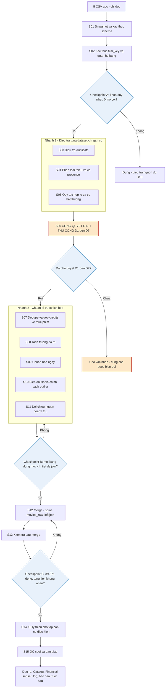

*Chú giải:* ô cam = bước cần xác minh/phê duyệt thủ công; ô xanh nhạt = checkpoint chất lượng. Mọi nút S01–S15 đều có bảng ở §17 và có cơ sở EDA ở §5–§11. Sơ đồ dùng chữ không dấu để tương thích mọi trình hiển thị Mermaid.

---

## 19. Đầu ra mong đợi và tiêu chí xác nhận

| Đầu ra | Mục đích | Điều kiện xác nhận sẵn sàng |
|---|---|---|
| `schema_contract.json`, bảng hash 5 file | Tái lập, phát hiện đổi nguồn | Hash khớp; schema khớp §4 |
| `key_consistency` cập nhật | Chứng minh toàn vẹn khóa | 0 thiếu/mồ côi; bảng 1-1 duy nhất |
| `anomaly_flags.csv` + `anomaly_summary.csv` | Danh sách bản ghi nghi vấn (không sửa) | Số cờ khớp §14 |
| `decision_log.md` (D1–D7) | Căn cứ mọi quyết định | Có người duyệt, ngày, lý do |
| `credits_by_film` | Join không nhân dòng | `film_key` duy nhất; Σ cast_count khớp |
| `movie_genre`, `movie_company` (+ bảng tra tên) | Đếm/gom nhóm chính xác | Token khớp EDA; mọi id có tên |
| `catalog_prepared` (39.871 dòng) | Phân tích toàn catalog | `len == 39.871`; null = nguồn + cờ |
| `financial_subset_*` | Phân tích ngân sách–doanh thu | Định nghĩa tập (D6) + n; báo cáo thiên lệch theo vote |
| `imputation_log.csv` (nếu có) | Truy vết giá trị điền | Số điền = số cờ imputed |
| `excluded_records.csv` | Danh sách bản ghi bị loại + lý do | Mọi bản ghi loại có lý do |
| `unverified_cases.csv` | Các trường hợp chưa xác minh được | Mỗi mục có người chịu trách nhiệm |
| Bảng theo dõi số dòng trước–sau từng bước | Kiểm soát mất/nhân dòng | Mọi bước giải thích được thay đổi |
| `data_quality_before_after.md` | Chứng minh cải thiện | Mọi DQ-ID HIGH có trạng thái |

**Điều kiện "sẵn sàng cho bước phân tích tiếp theo":** (1) S13 pass; (2) mọi quyết định D1–D7 đã ghi nhận; (3) không còn vấn đề HIGH chưa có trạng thái; (4) tập phân tích có mô tả đầy đủ (n, thiên lệch, đơn vị).

---

## 20. Giới hạn và các quyết định cần xác minh thêm

**Giới hạn của báo cáo:**
- **Không biết cách thu thập** (chưa có mô tả nguồn): vì vậy không thể xác định cơ chế thiếu (MCAR/MAR/MNAR); chỉ chứng minh được mối liên hệ với `vote_count`.
- **Không có đơn vị/tiền tệ trong dataset**: các nhận định "USD" là giả định theo quy ước nguồn, cần xác nhận.
- **Chỉ có ID, không có tên** cho thể loại, đạo diễn, diễn viên, hãng; tên thể loại trong biểu đồ lấy từ bảng TMDB chuẩn (ngoài dataset).
- **Chưa kiểm chứng ngoài dữ liệu**: các giá trị lớn nhất (ví dụ ngân sách 658,8 triệu), xác minh phim 01-01, giá trị < 1.000 USD đều cần nguồn ngoài.
- **Số review RT không có** nên không đánh giá được độ tin cậy điểm biên.
- **Tương quan ≠ nhân quả**; các hệ số tính trên mẫu có dữ liệu (thiên lệch) và dùng quan sát chung (pairwise) với n khác nhau.
- **Mục tiêu mô hình hóa chưa được xác định** → pipeline không chọn biến mục tiêu; một số bước (S10, S14) có điều kiện.

**Quyết định cần xác nhận (D1–D7):**

| ID | Quyết định | Hệ quả nếu chưa quyết |
|---|---|---|
| D1 | Giá trị < 1.000 USD: placeholder, thật, hay sai đơn vị? | Không thể tính ROI/log đáng tin; S10 treo |
| D2 | Nguồn doanh thu chuẩn khi mâu thuẫn; có điền global từ dom+intl? | Số liệu doanh thu không nhất quán giữa các phân tích |
| D3 | Quy tắc dedupe credits | `cast_count` sai |
| D4 | Xử lý ngày 01-01 và phim ngày tương lai | Phân tích theo tháng/mùa sai; điểm/ngân sách của phim chưa chiếu lẫn vào |
| D5 | Ý nghĩa `tmdb_collection_id` | Không nên dùng làm nhóm nhượng quyền |
| D6 | Mục tiêu phân tích và định nghĩa tập con | Không chọn được cách xử lý thiếu |
| D7 | Có điều chỉnh lạm phát không (cần nguồn CPI) | So sánh theo thời kỳ sai lệch |

**Cách kiểm tra thêm gợi ý:** lấy mẫu có phân tầng theo `vote_count` để đối chiếu giá trị < 1.000 với nguồn gốc; so sánh `box_office_raw` và `box_office_detailed` theo thời điểm thu thập (nếu có); hỏi nhóm thu thập về `tmdb_collection_id` và `theater_count`; lấy số review RT cho điểm biên.

---

*Hết báo cáo. Bảng và biểu đồ tái tạo bằng `python code/data_understanding_eda.py --data-dir <thư mục CSV> --out-dir <thư mục đầu ra>` rồi `python build_report.py` để ghép lại báo cáo từ `_template/`. Dataset gốc không bị thay đổi.*
