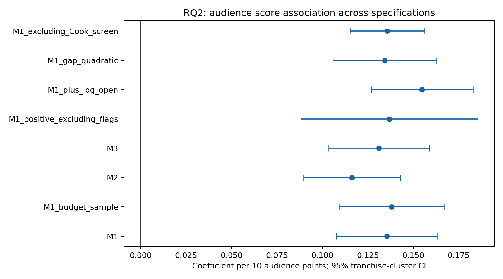
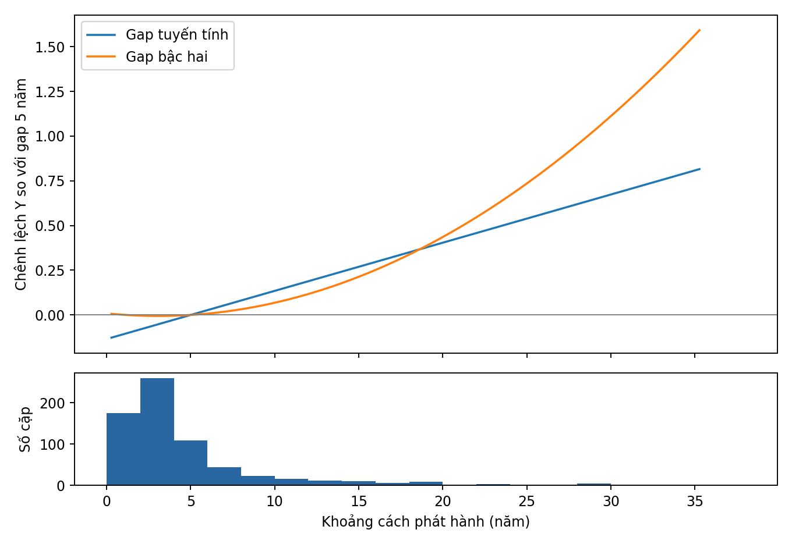
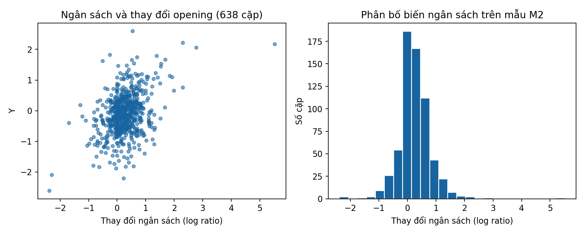

# TASK 5 — HOÀN CHỈNH BÀN GIAO MODELING RQ2

**Người phụ trách:** Duyên  
**Ngày cập nhật:** 07/11/2026  
**Mốc theo RP5_DL:** Bàn giao đầy đủ lần 1 lúc 12:00, kiểm tra chéo 12:00–17:00 và chốt bàn giao lúc 18:00 ngày 07/11.  
**Trạng thái:** Bản Modeling sẵn sàng kiểm tra. Chờ bảng Thống kê bước 3 và phản hồi kiểm tra chéo với Người 4 trước khi xác nhận chốt chung.

## 1. Câu hỏi nghiên cứu và phạm vi

Điểm khán giả phần trước liên hệ thế nào với thay đổi doanh thu mở màn của phần tiếp theo khi xét cùng khoảng cách phát hành, thứ tự phần và giai đoạn phát hành?

Câu hỏi xuất phát từ liên hệ đơn biến đã tái lập trên Master. Trong 676 cặp đủ điểm khán giả của nhóm cả hai opening từ 1 triệu USD, Spearman giữa điểm khán giả và Y khoảng 0,342. Modeling xem xét liên hệ này khi đưa thêm các biến bối cảnh. Mục tiêu business là hiểu các yếu tố đi cùng mức thay đổi opening thuận lợi hơn.

Đơn vị phân tích là một transition theo thứ tự phát hành trong cùng TMDB collection. Giữ target \(Y=\ln(Open_N/Open_{N-1})\). Y cao hơn biểu thị opening tăng nhiều hơn hoặc giảm ít hơn. Đây là thiết kế hồi cứu.

## 2. Dữ liệu và chuẩn bị đầu vào — bước 5

Dùng cùng Master với Task 3 và Task 4. SHA-256 được ghi trong results/run_metadata.json. Mẫu nền có 689 transition thuộc 403 franchise, cả hai opening từ 1 triệu USD. Mẫu chính có 676 transition thuộc 394 franchise, đủ target, điểm khán giả và biến bối cảnh. Mẫu ngân sách có 638 transition thuộc 365 franchise. Mẫu điểm phê bình và tập giao hai điểm RT có 674 transition thuộc 394 franchise.

| Vai trò | Biến | Cách biểu diễn và lý do |
|---|---|---|
| Kết quả | Y | Liên tục, đo thay đổi opening dạng log ratio |
| Yếu tố chính | Điểm khán giả phần trước | Chia 10 để đọc hệ số theo chênh lệch 10 điểm |
| Thước đo bổ trợ | Điểm phê bình phần trước | Chia 10, đưa vào mô hình riêng để khảo sát góc nhìn khác |
| Bối cảnh | Khoảng cách phát hành | Liên tục theo năm, xem thêm gap bậc hai |
| Bối cảnh | Thứ tự phần | 2/3/4+, tham chiếu phần 2 |
| Bối cảnh | Giai đoạn phát hành | Trước 1990, 1990–1999, 2000–2009, 2010–2019, từ 2020; tham chiếu 2010–2019 |
| Bổ trợ | budget_log_ratio | Thay đổi nguồn lực, giữ dạng log ratio |
| Bổ trợ | cast_retention_top5 | Tỷ lệ 0–1, công thức tạo biến vẫn chờ xác minh |
| Khóa | transition_id, franchise_id | Đối chiếu dòng và xác định cụm suy luận |

Dùng các dòng đầy đủ biến cho từng đặc tả. Giữ nguyên các giá trị cực trị trong mẫu chính. Danh sách ID của từng mẫu đi kèm bộ bàn giao.

## 3. Kết quả mô hình và lựa chọn — bước 6

Chọn OLS vì Y liên tục và mục tiêu là ước lượng liên hệ có điều kiện với hệ số dễ diễn giải. Các biến bối cảnh được chọn theo câu hỏi và vai trò đã chốt ở Task 2. Giữ mô hình gộp vì nhiều franchise chỉ có một transition và câu hỏi hiện tại dùng thông tin giữa các franchise. Hiệu ứng cố định và tương tác đòi hỏi mục tiêu diễn giải cùng giả định bổ sung. OLS có hệ số chặn. KTC 95% dùng sai số chuẩn CR1 theo franchise và phân phối t với G−1 bậc tự do. M1 có 394 franchise nên dùng 393 bậc tự do.

M0 gồm gap, nhóm thứ tự phần và nhóm giai đoạn. M1 thêm điểm khán giả/10. M2 thêm ngân sách vào M1. M3 thêm cast retention vào M1. M1-C thay điểm khán giả bằng điểm phê bình/10.

| Mô hình | Transition / franchise | Hệ số điểm khảo sát | KTC 95% | R² |
|---|---:|---:|---|---:|
| M0 | 676 / 394 | — | — | 0,0490 |
| M1, khán giả/10 | 676 / 394 | 0,1355 | [0,1076; 0,1635] | 0,1740 |
| M1 trên mẫu ngân sách | 638 / 365 | 0,1380 | [0,1091; 0,1668] | 0,1849 |
| M2, khán giả/10 | 638 / 365 | 0,1162 | [0,0896; 0,1428] | 0,2851 |
| M3, khán giả/10 | 676 / 394 | 0,1311 | [0,1034; 0,1588] | 0,1769 |
| M1-C, phê bình/10 | 674 / 394 | 0,0902 | [0,0699; 0,1106] | 0,1577 |

Hệ số ngân sách ở M2 là 0,4047 [0,3107; 0,4986]. Hệ số cast retention ở M3 là 0,1283 [−0,0300; 0,2865], còn bất định. Trên cùng tập giao 674 cặp, hệ số khán giả là 0,1356 [0,1077; 0,1634]. Trên cùng mẫu, điểm phê bình và điểm khán giả đều có liên hệ dương. Hai thước đo có phân bố và ý nghĩa khác nhau nên cần thận trọng khi so độ lớn hệ số.

Giữ M1 với gap tuyến tính làm mô hình chính cho liên hệ của điểm khán giả. Trên cùng 676 cặp, thêm gap bậc hai làm hệ số khán giả đổi rất ít, từ 0,1355 xuống 0,1343. Mô hình bậc hai vẫn được báo để thể hiện giới hạn của giả định tuyến tính về gap.

Khi so ngân sách, chuyển mẫu từ 676 xuống 638 chỉ làm hệ số khán giả đổi từ 0,1355 thành 0,1380. Trên cùng 638 dòng, thêm ngân sách làm hệ số giảm còn 0,1162. Như vậy phép so đã tách ảnh hưởng của thay đổi mẫu và thêm biến. R² là thông tin hỗ trợ cùng hệ số, khoảng tin cậy, giả định và độ phức tạp.

## 4. Chẩn đoán và độ vững — bước 7

| Kiểm tra | Kết quả chính |
|---|---|
| Gap bậc hai, 676 cặp | Hệ số khán giả 0,1343 [0,1058; 0,1629] |
| Gap ≤20 năm, dạng tuyến tính, 664 cặp/387 franchise | Hệ số khán giả 0,1323 [0,1038; 0,1607] |
| Bỏ 41 dòng vượt ngưỡng Cook, 635 cặp/376 franchise | Hệ số khán giả 0,1357 [0,1151; 0,1563] |
| Bỏ ngưỡng opening, tạm loại 4 cờ, 880 cặp/544 franchise | Hệ số khán giả 0,1368 [0,0882; 0,1855] |
| Thêm log_open_prev, 676 cặp | Hệ số khán giả 0,1548 [0,1268; 0,1828] |
| Bỏ lần lượt từng franchise | Hệ số khán giả dao động 0,1322–0,1411 |

Mẫu chính có 12 cặp gap trên 20 năm và 8 trên 25 năm. Hệ số gap tuyến tính giảm từ 0,0269 xuống 0,0162 [−0,0011; 0,0334] khi chỉ dùng gap ≤20 năm. Dấu hiệu độ cong vẫn xuất hiện trên mẫu rút gọn. Vì thế cần hạn chế suy rộng hệ số gap tuyến tính, nhất là ở vùng gap dài.

VIF tối đa của M1/M2/M3 lần lượt khoảng 1,31/1,29/1,31. Tương quan giữa hai điểm RT trên 674 dòng là Pearson 0,689 và Spearman 0,697. Hai điểm nằm trong các mô hình riêng.

Có 53 dòng được sàng lọc theo Cook, leverage hoặc phần dư. Y tính lại ở các dòng đó khớp trong sai số số học cỡ 10⁻¹⁵. Đây là đối chiếu nội bộ. Các dòng vẫn được giữ trong mẫu chính. Chi tiết có trong influence_review.csv. Rà soát nguồn bên ngoài và xác minh công thức cast retention vẫn là các vấn đề mở.

Kiểm tra ngân sách bổ sung gồm scatter, histogram và danh sách sàng lọc IQR trên đúng mẫu M2. Pearson khoảng 0,397 và Spearman khoảng 0,295 là hai phép đo khác nhau về quan hệ. Chênh lệch giữa chúng cần đọc cùng phân bố và dạng quan hệ, chưa đủ để quy cho một nguyên nhân cụ thể. Biểu đồ cho thấy phần lớn giá trị tập trung gần 0 với một số điểm ở xa, đặc biệt ở đuôi phải. Sàng lọc IQR đánh dấu 32 cặp để rà soát, các mã được lưu trong budget_IQR_screen.csv. Giữ nguyên mẫu ngân sách trong phân tích chính. Trong kiểm tra bổ trợ tạm bỏ 32 dòng vượt ngưỡng IQR ngân sách, mẫu còn 606 cặp/348 franchise. Hệ số khán giả là 0,1172 [0,0899; 0,1444], gần mức 0,1162 ở M2 đầy đủ. Hệ số ngân sách giảm từ 0,4047 xuống 0,2856 [0,1571; 0,4141]. Như vậy độ lớn liên hệ ngân sách nhạy hơn với phép lọc này, còn hệ số khán giả khá ổn định. Phép lọc thay đổi cả mẫu và phạm vi ngân sách nên chưa quy chênh lệch cho riêng một quan sát. Chi tiết trong M2_budget_sensitivity.csv.

Ở mẫu bỏ ngưỡng opening, KTC rộng hơn và R² khoảng 0,055. Do thành phần mẫu và phân bố Y thay đổi, diễn giải kết quả theo từng phạm vi mẫu.

## 5. Trả lời RQ2 và ý nghĩa business — bước 8

Trong nhóm hồi cứu cả hai opening từ 1 triệu USD, điểm khán giả phần trước cao hơn 10 điểm gắn với Y cao hơn 0,1355 [0,1076; 0,1635], khi giữ cố định các biến bối cảnh. Trên thang tỷ số opening được mô hình hóa theo trung bình hình học, mức chênh lệch tương đối khoảng 14,5% [11,4%; 17,8%].

Ví dụ minh họa, nếu tỷ số opening được mô hình hóa ở một bối cảnh bằng 0,80, chênh lệch 10 điểm khán giả tương ứng tỷ số khoảng 0,80 × exp(0,1355) = 0,916. Giá trị 0,80 được đặt để minh họa cách đọc hệ số.

Mối liên hệ của điểm khán giả giữ cùng chiều khi thêm ngân sách, cast retention, thay dạng gap và thực hiện các kiểm tra mẫu. Thay đổi ngân sách cũng có liên hệ dương trong M2. Catalog gán budget_log_ratio vai trò secondary_outcome. M2 vì vậy được sử dụng như đặc tả bổ trợ điều kiện hóa thêm vào thay đổi ngân sách. Chưa có bằng chứng xác nhận thời điểm quan sát ngân sách so với opening, và hệ số ngân sách được diễn giải theo liên hệ hồi cứu. Mức giảm hệ số khán giả khi thêm ngân sách phản ánh thay đổi điều kiện mô hình. Kết quả cast retention còn bất định và cần xác minh định nghĩa.

Về business, mức đón nhận phần trước là một yếu tố đáng xem xét cùng với bối cảnh phát hành và nguồn lực khi phân tích diễn biến opening. Kết quả phản ánh các liên hệ quan sát được trong mẫu hồi cứu. Các quyết định kinh doanh còn cần dữ liệu về marketing, phát hành và điều kiện thị trường.

## 6. Giới hạn

Điểm RT là snapshot, có thể chứa đánh giá ghi nhận sau khi phần tiếp theo ra mắt. Việc dùng các điểm này mang mục đích hồi cứu. Kết quả không được trình bày như bằng chứng dự đoán trước phát hành. Opening chưa được xác minh đầy đủ về thị trường, tiền tệ và cửa sổ mở màn. TMDB collection là quy ước vận hành franchise. Điều kiện lọc sử dụng cả opening phần hiện tại nên phạm vi mẫu được xác định sau quan sát.

Sai số chuẩn theo cụm xét phụ thuộc trong franchise. Các vấn đề chọn mẫu, đo lường và thiếu biến quan trọng vẫn giới hạn diễn giải. Giữ ngôn ngữ liên hệ, không suy ra nhân quả.

## 7. Phối hợp và trạng thái review

| Nội dung | Trạng thái |
|---|---|
| Modeling RQ2.5 và độ vững hồi quy trong RQ2.6 | Có kết quả, bảng, biểu đồ và code |
| Bảng đối chiếu cùng mẫu | Đã chuẩn bị trong same_sample_statistics.csv |
| Kết quả chính thức RQ2.1–RQ2.4 của Thống kê bước 3 | Chưa nhận trong tài liệu hiện có |
| Đối chiếu và giải thích khác biệt hai bên | Chờ bảng Thống kê |
| Review phần Người 4 và phản hồi review của Người 4 về RQ2 | Chưa có tài liệu/phản hồi để xác nhận |
| Định nghĩa cast_retention_top5 | Chờ tài liệu DP hoặc code tạo biến |

Hai bên thống nhất phiên bản Master, target, định nghĩa biến, điều kiện lọc, số cặp/franchise, xử lý missing và phương pháp tính bất định trước khi đối chiếu. Các tương quan trong bộ Modeling là số mô tả để chuẩn bị phối hợp. Bản bàn giao này sẵn sàng review phần Modeling. Trạng thái chốt chung được cập nhật khi hoàn tất các mục còn chờ.

## 8. Code và kết quả tái lập

Bộ bàn giao có code, bảng hệ số đầy đủ, ID mẫu, chẩn đoán, biểu đồ và hướng dẫn chạy trong README.txt.

**Link code và kết quả:** [Dán link Drive của TASK5_RQ2_Duyen.zip]
